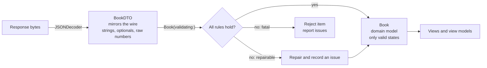

A response that decodes is not a response that is correct. `JSONDecoder` checks that a `title` is a string; it does not check that the string is not empty, not 40,000 characters long, and not carrying a Unicode control character that reverses the text around it. It checks that `availableCopies` and `totalCopies` are integers; it does not check that the first is not larger than the second. Those checks are the difference between a server bug that shows up as a clear error in your logs and one that shows up as a layout explosion, a crash on an array index, or a misleading screen.

This article adds a layer between decoding and the UI. Raw decoded values, **data transfer objects**, are converted into **domain types** that cannot hold invalid values, and every rule that conversion enforces is written down once. It covers the kinds of rules worth checking, how to treat text from the network safely, what to do with an item that fails, and how to report all the problems in a payload instead of only the first.

<!--more-->

The examples use Swift 6 language mode and were compiled and run with the Swift 6.4 toolchain from Xcode 27.1 on macOS 26. Paste the blocks below, in order, into one `main.swift` to run the assertions.

## Two types per resource

The pattern is to decode into a type that mirrors the wire format exactly, then convert it into the type the rest of the app uses:



The DTO is deliberately permissive: optional where the server might omit a field, raw `String` and `Int` where the domain has richer types. It changes when the API changes. The domain model is strict: its stored properties have types that make invalid values unrepresentable, and its only initializer from network data is the validating one. It changes when the product changes.

The phrase for this approach is **parse, don't validate**, from [Alexis King's essay](https://lexi-lambda.github.io/blog/2019/11/05/parse-don-t-validate/) of that name. A function that checks a value and returns `Bool` leaves the caller holding the same unchecked type afterwards, and nothing stops the next caller from skipping the check. A function that checks a value and returns a *new type* carries the proof with it: any code holding a `BookTitle` knows it is valid without checking again.

## Small types that carry their rules

Start with the leaves. A title is a string with rules, so it gets a type whose initializer enforces them:

```swift
import Foundation

enum Issue: Error, Equatable, Sendable, CustomStringConvertible {
    case empty(field: String)
    case tooLong(field: String, length: Int, limit: Int)
    case outOfRange(field: String, value: Int, range: ClosedRange<Int>)
    case invalidFormat(field: String, value: String)
    case inconsistent(String)
    case repaired(field: String, note: String)

    var description: String {
        switch self {
        case .empty(let field): "\(field) is empty"
        case .tooLong(let field, let length, let limit): "\(field) has \(length) characters, limit \(limit)"
        case .outOfRange(let field, let value, let range): "\(field) = \(value), expected \(range)"
        case .invalidFormat(let field, let value): "\(field) has invalid value \(value.debugDescription)"
        case .inconsistent(let rule): "inconsistent: \(rule)"
        case .repaired(let field, let note): "\(field) repaired: \(note)"
        }
    }

    var isFatal: Bool {
        if case .repaired = self { false } else { true }
    }
}

struct BookTitle: Hashable, Sendable {
    let value: String
    static let limit = 300

    init(_ raw: String, field: String = "title") throws(Issue) {
        let cleaned = Text.sanitized(raw)
        guard !cleaned.isEmpty else { throw .empty(field: field) }
        guard cleaned.count <= Self.limit else {
            throw .tooLong(field: field, length: cleaned.count, limit: Self.limit)
        }
        value = cleaned
    }
}
```

`BookTitle` has no other initializer and no setter, so there is no way to hold an empty or oversized title. `Text.sanitized` is the subject of the next section; it is where most of the interesting rules about strings from the network live.

## Text from the network is not plain text

Unicode text carries more than visible characters. Three properties of it matter for any string that came from a server, and especially for strings that originally came from other users, such as names, reviews, and list titles.

**Invisible and control characters.** The Unicode general category *Cc* covers control characters such as the bell, U+0007, and *Cf* covers format characters such as the zero-width space, U+200B, and the right-to-left override, U+202E. A bidirectional override changes the direction in which the following text is displayed. A review written as `Invoice‮fdp.exe` renders as "Invoice" followed by "exe.pdf" in many contexts, a spoofing trick known from file names and, in source code, from the [Trojan Source](https://trojansource.codes) attack. Zero-width characters make two strings look identical when they are not, which breaks search, deduplication, and "is this the same user?" checks that a person makes by eye.

**Several encodings of the same text.** `é` can be one scalar, U+00E9, or two, `e` followed by the combining acute accent U+0301. Swift's `String` compares by canonical equivalence, so the two are `==`, hash the same, and collapse in a `Set`. Their UTF-8 bytes differ, so a server, a database index, or a cache key built from `Data` treats them as different:

```swift
let composed = "caf\u{E9}"
let decomposed = "cafe\u{301}"
assert(composed == decomposed && Set([composed, decomposed]).count == 1)
assert(Data(composed.utf8) != Data(decomposed.utf8))
assert(composed.utf8.count == 5 && decomposed.utf8.count == 6)
assert(composed.precomposedStringWithCanonicalMapping.utf8.elementsEqual(decomposed.precomposedStringWithCanonicalMapping.utf8))
```

Normalizing to the composed form, NFC, before storing or comparing as bytes makes the two encodings identical everywhere. [UAX #15](https://www.unicode.org/reports/tr15/) defines the normalization forms.

**Length depends on what you count.** A "character" in Swift is an extended grapheme cluster, what a reader perceives as one character. A family emoji is one character, 7 Unicode scalars, 11 UTF-16 code units (what `NSString.length` and many server languages count), and 25 UTF-8 bytes. A single letter followed by 50 combining marks is one character that renders as a tall smear across several lines:

```swift
let family = "👨‍👩‍👧‍👦"
assert(family.count == 1 && family.unicodeScalars.count == 7)
assert(family.utf16.count == 11 && family.utf8.count == 25)

let stacked = "Z" + String(repeating: "\u{301}", count: 50)
assert(stacked.count == 1 && stacked.unicodeScalars.count == 51)
```

A limit of "300 characters" therefore needs a unit. For layout, `count` is the meaningful one. For agreement with a server that enforces its own limit, use the server's unit, usually UTF-16 or bytes. And a limit on combining marks per character stops the stacked case, which no character count catches.

The sanitizer below applies all three concerns. It collapses runs of whitespace, removes control and format characters except the zero-width joiner that emoji sequences need, caps combining marks, and normalizes to NFC. Whitespace is handled first, because tab and newline are themselves control characters and would otherwise be deleted rather than turned into spaces:

```swift
enum Text {
    static let maxCombiningMarks = 4

    static func sanitized(_ raw: String) -> String {
        var scalars = String.UnicodeScalarView()
        var marks = 0
        var pendingSpace = false
        for scalar in raw.unicodeScalars {
            let properties = scalar.properties
            if properties.isWhitespace {  // before the category check: tab and newline are controls
                pendingSpace = !scalars.isEmpty
                continue
            }
            switch properties.generalCategory {
            case .control,
                 .format where scalar != "\u{200D}":  // keep the emoji joiner
                continue
            case .nonspacingMark, .enclosingMark:
                marks += 1
                if marks > maxCombiningMarks { continue }
            default:
                marks = 0
            }
            if pendingSpace { scalars.append(" "); pendingSpace = false }
            scalars.append(scalar)
        }
        return String(scalars).precomposedStringWithCanonicalMapping
    }
}

assert(Text.sanitized("  Dune\n\tMessiah ") == "Dune Messiah")
assert(Text.sanitized("Invoice\u{202E}fdp.exe") == "Invoicefdp.exe")
assert(Text.sanitized("Du\u{200B}ne") == "Dune")
assert(Text.sanitized("A\u{7}B") == "AB")                          // control characters always go
assert(Text.sanitized("\u{A0}Dune\u{3000}") == "Dune")       // non-breaking and ideographic spaces
assert(Text.sanitized("cafe\u{301}").unicodeScalars.count == 4)  // normalized to NFC
assert(Text.sanitized(family) == family)                       // emoji sequences survive
assert(Text.sanitized(stacked).unicodeScalars.count == 4)       // Z + 4 marks, then NFC makes Z + U+0301 into Ź
```

The line break after `.control,` is deliberate. A `where` clause in a case with several patterns applies only to the pattern it follows, and the compiler warns when that is ambiguous on one line. Here the intent is exactly that: control characters are always removed, and format characters are removed unless they are the joiner.

Sanitizing is not escaping. SwiftUI's `Text` and UIKit's labels render strings as text, so there is no markup to inject. The moment a string is passed to something that *interprets* it, it needs escaping for that context: `AttributedString(markdown:)` parses Markdown links, a `WKWebView` parses HTML, and `NSPredicate(format:)` parses a query language. Server-controlled text should never be fed to any of them without escaping.

## Checksums: catching typos in identifiers

Some identifiers carry their own validation. An ISBN-13 has 12 data digits and a check digit chosen so that a weighted sum of all 13 digits is divisible by 10, with weights alternating 1 and 3:

$$
\sum_{i=1}^{13} w_i d_i \equiv 0 \pmod{10},
\qquad
w_i = \begin{cases} 1 & i \text{ odd} \\ 3 & i \text{ even} \end{cases}
$$

The scheme detects every single-digit error. Changing digit $$d_i$$ by $$\delta \ne 0$$ changes the sum by $$w_i \delta$$, and neither $$\delta$$ nor $$3\delta$$ is divisible by 10 for $$|\delta| \le 9$$. It also detects most transpositions of adjacent digits. Swapping $$a$$ and $$b$$ changes the sum by $$(3-1)(a-b) = 2(a-b)$$, which is a multiple of 10 only when $$|a-b| = 5$$. So a swap goes undetected only when the two digits differ by exactly 5, such as 1 and 6 or 4 and 9.

```swift
struct ISBN13: Hashable, Sendable {
    let digits: String

    init(_ raw: String) throws(Issue) {
        let digits = raw.filter { $0 != "-" && $0 != " " }
        guard digits.count == 13, digits.allSatisfy(\.isASCII), digits.allSatisfy(\.isNumber) else {
            throw .invalidFormat(field: "isbn", value: raw)
        }
        let sum = digits.enumerated().reduce(0) { total, pair in
            total + pair.element.wholeNumberValue! * (pair.offset.isMultiple(of: 2) ? 1 : 3)
        }
        guard sum.isMultiple(of: 10) else { throw .invalidFormat(field: "isbn", value: raw) }
        self.digits = digits
    }
}

assert((try? ISBN13("978-0-441-01359-3")) != nil)   // Dune
assert((try? ISBN13("978-0-441-01359-4")) == nil)   // last digit changed
assert((try? ISBN13("978-0-441-01395-3")) == nil)   // 5 and 9 swapped: differ by 4, detected
assert((try? ISBN13("９７８０４４１０１３５９３")) == nil)  // full-width digits are numbers, but not ASCII
```

The last assertion is a Unicode trap of its own. `Character.isNumber` is true for full-width digits, Arabic-Indic digits, and many others, and `wholeNumberValue` happily converts them. The `isASCII` check keeps the identifier to the digits the server will actually match.

The same idea applies to other identifiers with check digits: IBANs use mod 97, payment card numbers use the Luhn algorithm. None of these checks prove an identifier exists. They prove it was not mistyped or corrupted, which is cheap to check on the client.

## Ranges, URLs, and relationships

Most rules are simpler than a checksum. A rating is between 0 and 5. A page count is positive and plausibly bounded. A cover image URL uses HTTPS and points at a host the app expects. And some rules involve more than one field: a library cannot have more copies available than it owns, and a loan cannot be due before it started.

The DTO and the domain model for a book, with every rule in one initializer:

```swift
struct BookDTO: Decodable {
    var id: String
    var title: String
    var subtitle: String?
    var isbn: String?
    var rating: Int?
    var pages: Int?
    var coverURL: String?
    var totalCopies: Int
    var availableCopies: Int
}

struct Book: Sendable, Equatable {
    let id: String
    let title: BookTitle
    let subtitle: BookTitle?
    let isbn: ISBN13?
    let rating: Int?
    let pages: Int?
    let coverURL: URL?
    let totalCopies: Int
    let availableCopies: Int
}

struct Validated<Value> {
    var value: Value?
    var issues: [Issue]
}

extension Book {
    static let coverHosts: Set<String> = ["covers.library.example"]

    static func validating(_ dto: BookDTO) -> Validated<Book> {
        var issues: [Issue] = []

        var title: BookTitle?
        do { title = try BookTitle(dto.title) } catch { issues.append(error) }

        // Optional fields: a bad value is dropped and recorded, not fatal.
        var subtitle: BookTitle?
        if let raw = dto.subtitle, !Text.sanitized(raw).isEmpty {
            do { subtitle = try BookTitle(raw, field: "subtitle") }
            catch { issues.append(.repaired(field: "subtitle", note: "dropped: \(error)")) }
        }

        var isbn: ISBN13?
        if let raw = dto.isbn {
            do { isbn = try ISBN13(raw) } catch { issues.append(.repaired(field: "isbn", note: "dropped \(raw)")) }
        }

        var rating = dto.rating
        if let value = rating, !(0...5).contains(value) {
            issues.append(.repaired(field: "rating", note: "dropped \(value)"))
            rating = nil
        }

        var pages = dto.pages
        if let value = pages, !(1...50_000).contains(value) {
            issues.append(.repaired(field: "pages", note: "dropped \(value)"))
            pages = nil
        }

        var coverURL: URL?
        if let raw = dto.coverURL {
            if let url = URL(string: raw, encodingInvalidCharacters: false), url.scheme == "https",
               let host = url.host(percentEncoded: false), coverHosts.contains(host) {
                coverURL = url
            } else {
                issues.append(.repaired(field: "coverURL", note: "dropped \(raw)"))
            }
        }

        if dto.id.isEmpty { issues.append(.empty(field: "id")) }
        if dto.totalCopies < 0 {
            issues.append(.outOfRange(field: "totalCopies", value: dto.totalCopies, range: 0...Int.max))
        }
        if dto.availableCopies < 0 || dto.availableCopies > dto.totalCopies {
            issues.append(.inconsistent("availableCopies (\(dto.availableCopies)) must be in 0...totalCopies (\(dto.totalCopies))"))
        }

        guard let title, !issues.contains(where: \.isFatal) else { return Validated(value: nil, issues: issues) }
        return Validated(value: Book(id: dto.id, title: title, subtitle: subtitle, isbn: isbn, rating: rating,
                                     pages: pages, coverURL: coverURL, totalCopies: dto.totalCopies,
                                     availableCopies: dto.availableCopies),
                         issues: issues)
    }
}
```

The function does not stop at the first problem. It records every issue it finds, then decides whether the result is usable. That matters for diagnosis: a log line that lists all four problems in a bad record points at a broken server job, while one that lists only the first sends someone on four separate investigations.

## Reject, repair, or degrade

Not every rule violation should cost the user the item. The validator above makes a deliberate choice per field, and the choices follow a short policy:

| Situation | Policy | Example |
|---|---|---|
| The item cannot be identified or shown at all | **Reject** the item, report | empty `id`, empty `title` |
| A relationship the UI depends on is broken | **Reject**, report | more copies available than owned |
| An optional, decorative field is invalid | **Repair** by dropping it, record | rating 7, malformed cover URL |
| A value is valid but surprising | **Accept**, maybe log | a 4,000-page book |
| Text contains unsafe or invisible characters | **Repair** by sanitizing, silently | bidi overrides, zero-width spaces |

The copies rule is fatal because the UI shows "3 of 2 available" otherwise, and a "Borrow" button that the server will reject. A dropped cover image is not: a placeholder is a fine experience. The line between them is a product decision, which is why it belongs in one readable function rather than spread across views as `if` statements.

Repairs are recorded as non-fatal `.repaired` issues, so they still reach logs. A server that starts sending ratings of 7 is a server with a bug, and the client is the first place anyone can see it.

## Validating a whole response

Applying the validator to a list combines the lossy decoding idea from [Decoding JSON with `Codable`](/swift-decoding-json-codable/) with per-item validation. Each item produces a book or a rejection, and every issue is kept with the item's index:

```swift
struct Report: CustomStringConvertible {
    var books: [Book] = []
    var rejected: [Int] = []
    var issues: [(index: Int, issue: Issue)] = []

    var description: String {
        issues.map { "[\($0.index)] \($0.issue)" }.joined(separator: "\n")
    }
}

func validateCatalog(_ dtos: [BookDTO]) -> Report {
    var report = Report()
    var seen = Set<String>()
    for (index, dto) in dtos.enumerated() {
        let result = Book.validating(dto)
        report.issues += result.issues.map { (index, $0) }
        guard let book = result.value else { report.rejected.append(index); continue }
        guard seen.insert(book.id).inserted else {
            report.issues.append((index, .inconsistent("duplicate id \(book.id)")))
            report.rejected.append(index)
            continue
        }
        report.books.append(book)
    }
    return report
}

let payload = Data(#"""
[
  {"id":"b-1","title":"  Dune ","isbn":"978-0-441-01359-3","rating":5,"pages":412,
   "coverURL":"https://covers.library.example/b-1.jpg","totalCopies":3,"availableCopies":1},
  {"id":"b-2","title":"Emma","rating":7,"coverURL":"http://evil.example/x.jpg","totalCopies":1,"availableCopies":1},
  {"id":"b-3","title":"   ","totalCopies":2,"availableCopies":0},
  {"id":"b-4","title":"Ulysses","totalCopies":2,"availableCopies":3},
  {"id":"b-1","title":"Dune (duplicate)","totalCopies":1,"availableCopies":1},
  {"id":"b-5","title":"Invoice‮fdp.exe","subtitle":"​","isbn":"978-0-441-01359-4","totalCopies":1,"availableCopies":0}
]
"""#.utf8)

let report = validateCatalog(try JSONDecoder().decode([BookDTO].self, from: payload))
print(report)

assert(report.books.map(\.id) == ["b-1", "b-2", "b-5"])
assert(report.rejected == [2, 3, 4])
assert(report.books[0].title.value == "Dune" && report.books[0].isbn != nil)
assert(report.books[1].rating == nil && report.books[1].coverURL == nil)   // repaired
assert(report.books[2].title.value == "Invoicefdp.exe")                   // sanitized
assert(report.books[2].subtitle == nil && report.books[2].isbn == nil)     // empty subtitle ignored, bad ISBN dropped
assert(report.issues.filter { $0.issue.isFatal }.map(\.index) == [2, 3, 4])
```

The printed report reads like a bug report for the server:

```text
[1] rating repaired: dropped 7
[1] coverURL repaired: dropped http://evil.example/x.jpg
[2] title is empty
[3] inconsistent: availableCopies (3) must be in 0...totalCopies (2)
[4] inconsistent: duplicate id b-1
[5] isbn repaired: dropped 978-0-441-01359-4
```

Three books reach the UI, three are rejected, and every decision is accounted for. Send the report to your error tracker in aggregate, counts per issue kind and per field, rather than one event per item, or a single bad server deploy will flood it.

## Where validation stops

Client-side validation protects the client. It keeps the UI consistent, impossible values out of index paths, and garbage out of local storage. It is not a security boundary for the server: anyone can send any bytes to an API, so the server must validate everything it receives again, regardless of what the official app checks. The two sets of rules overlap but serve different purposes, and the client's set should be no stricter than the server's on input it sends, or users will be unable to save things the server would have accepted.

It is also not a substitute for agreeing on the contract. If validation rejects items regularly, the right fix is usually a conversation with the API's owners and a test that pins the agreement down, which is the subject of [Verifying Contracts Against a Controlled Server](/swift-contract-testing-controlled-server/).

## Summary

- Decode into a permissive DTO that mirrors the wire, then convert it into a strict domain type. Parse, don't validate: return a new type that carries the proof.
- Server text needs sanitizing: remove control and format characters (keeping the emoji joiner), collapse whitespace, cap combining marks, and normalize to NFC.
- Swift's `String` equality uses canonical equivalence; bytes, servers, and caches do not.
- Character counts depend on the unit. Use graphemes for layout and the server's unit for agreement with its limits.
- ISBN-13's weighted mod-10 checksum catches all single-digit errors and every adjacent swap except digits that differ by 5. Restrict identifier digits to ASCII.
- Check ranges, URL schemes and hosts, and cross-field relationships. Reject what the UI cannot show, repair what is decorative, and record both.
- Collect every issue, not just the first, and report them in aggregate.

## Exercise

Add a `Loan` domain type with `start` and `due` dates, a rule that `due` is after `start` and at most 90 days later, and a rule that the loaned book's ID appears in the validated catalog. Validate a payload of loans against the `Report` from this article, so that a loan referring to a rejected book is itself rejected with a clear issue. Then write a randomized test: generate 1,000 `BookDTO` values with random defects drawn from the policy table and assert that `validateCatalog` rejects exactly those whose defects are fatal.

## Further reading

- Alexis King, [*Parse, don't validate*](https://lexi-lambda.github.io/blog/2019/11/05/parse-don-t-validate/).
- [UAX #15: Unicode Normalization Forms](https://www.unicode.org/reports/tr15/) and [UTS #39: Unicode Security Mechanisms](https://www.unicode.org/reports/tr39/), which covers confusable characters.
- [Trojan Source: Invisible Vulnerabilities](https://trojansource.codes), on bidirectional control characters.
- The Swift book's [Strings and Characters](https://docs.swift.org/swift-book/documentation/the-swift-programming-language/stringsandcharacters/) chapter, on extended grapheme clusters.

Previous: [Decoding JSON with `Codable`](/swift-decoding-json-codable/). Next: [Pagination: Page Numbers, Cursors, and Stable Ordering](/swift-pagination-cursors/).

Return to the [Networking roadmap](/swift-networking/).
