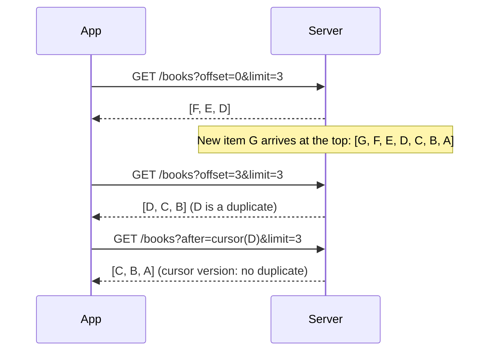

An infinite list in an app is a sequence of requests pretending to be one list. Each request returns a page, and the client stitches the pages together. The stitching works perfectly in development, where the data does not change while you scroll. In production, new items arrive at the top of the feed, others are deleted, and two items share a timestamp, and the stitched list starts showing the same book twice, or quietly skipping one.

The cause is almost never the client's code. It is the pagination scheme: how the client tells the server where the next page starts. This article compares the two common schemes, page numbers (offsets) and cursors, against a local server whose data changes between requests, counts exactly how many duplicates and gaps each one produces, and shows why both depend on a sort order with no ties. It ends with an `AsyncSequence` of pages and a formula for when to start loading the next one.

<!--more-->

The examples use Swift 6 language mode and were compiled and run with the Swift 6.4 toolchain from Xcode 27.1 on macOS 26. They send requests to `LocalServer`, the loopback HTTP server from the [appendix of the first article](/swift-http-methods-status-codes-headers/#appendix-the-local-server-used-in-this-series); paste that code first, then the blocks below in order, into one `main.swift`.

<!-- check-uses: local-server -->

## Two ways to say "the next page"

**Offset pagination** identifies a page by its position: `?offset=40&limit=20`, or the equivalent `?page=3&per_page=20`. It is simple, it lets a UI jump to page 17, and most databases support it directly with `LIMIT` and `OFFSET`.

**Cursor pagination** identifies a page by the last item the client has seen: `?after=<cursor>&limit=20`. The cursor is a token the server produced, which encodes the sort key of the last item on the previous page. The server answers "the 20 items that come after this one in the sort order." When the cursor is a sort key and the server uses it in a `WHERE` clause, the technique is also called **keyset** or **seek** pagination.

The difference is what each one holds constant when the data changes. An offset holds the *position* constant. A cursor holds the *last item seen* constant. A feed whose items move position, because new ones arrive at the top, behaves very differently under the two.



## A server whose data moves

The server below holds a list of books, newest first. Each book has a creation time and an ID. It answers both styles of request, and it exposes `insert` and `delete` so the client can change the data between pages, the way other users do in production:

```swift
import Foundation
import Synchronization

struct Item: Codable, Hashable, Sendable {
    let id: Int
    let created: Int  // seconds since some epoch; not unique
}

struct Page: Codable, Sendable {
    var items: [Item]
    var next: String?
}

final class Catalog: Sendable {
    private let items = Mutex<[Item]>([])
    private let nextID = Mutex(1)

    init(count: Int, tiesEvery: Int = 1) {
        for index in 0..<count { insert(created: index / tiesEvery) }
    }

    @discardableResult
    func insert(created: Int? = nil) -> Item {
        let id = nextID.withLock { id in defer { id += 1 }; return id }
        let item = Item(id: id, created: created ?? (items.withLock { $0.map(\.created).max() ?? 0 } + 1))
        items.withLock { $0.append(item) }
        return item
    }

    func delete(_ ids: Set<Int>) { items.withLock { $0.removeAll { ids.contains($0.id) } } }

    /// Newest first. With `stable: false`, items that share a timestamp come back in arbitrary order,
    /// as they do from a database query whose ORDER BY does not cover a unique column.
    func sorted(stable: Bool) -> [Item] {
        let snapshot = items.withLock { $0 }
        if stable { return snapshot.sorted { ($0.created, $0.id) > ($1.created, $1.id) } }
        return snapshot.shuffled().sorted { $0.created > $1.created }
    }
}

enum Cursor {
    static func encode(_ item: Item) -> String {
        Data("\(item.created):\(item.id)".utf8).base64EncodedString()
    }
    static func decode(_ text: String) -> (created: Int, id: Int)? {
        guard let data = Data(base64Encoded: text) else { return nil }
        let parts = String(decoding: data, as: UTF8.self).split(separator: ":").compactMap { Int($0) }
        return parts.count == 2 ? (parts[0], parts[1]) : nil
    }
}

func pageResponse(_ items: [Item], next: String?) -> HTTPResponse {
    let encoder = JSONEncoder()
    encoder.outputFormatting = .sortedKeys
    return HTTPResponse(status: 200, headers: [("Content-Type", "application/json")],
                        body: [.bytes(try! encoder.encode(Page(items: items, next: next)))])
}

func startServer(_ catalog: Catalog, stableOrder: Bool = true) async throws -> LocalServer {
    try await LocalServer.start { request in
        let limit = min(Int(request.query["limit"] ?? "20") ?? 20, 100)
        let all = catalog.sorted(stable: stableOrder)
        switch request.path {
        case "/offset":
            let offset = Int(request.query["offset"] ?? "0") ?? 0
            let page = Array(all.dropFirst(offset).prefix(limit))
            let more = offset + page.count < all.count
            return pageResponse(page, next: more ? "\(offset + page.count)" : nil)
        case "/keyset":
            var remaining = all[...]
            if let raw = request.query["after"] {
                guard let after = Cursor.decode(raw) else { return .text("bad cursor", status: 400) }
                remaining = all.drop { ($0.created, $0.id) >= (after.created, after.id) }
            }
            let page = Array(remaining.prefix(limit))
            let more = page.count == limit && remaining.count > limit
            return pageResponse(page, next: more ? page.last.map(Cursor.encode) : nil)
        default:
            return .text("not found", status: 404)
        }
    }
}
```

The keyset route finds the first item strictly after the cursor in the sort order, which is `(created, id)` descending. Because the cursor encodes both fields, the position it names is exact even when many items share a `created` value. The `next` field in each page is how the server tells the client what to ask for next; for the offset route it is simply the next offset.

The client fetches pages with a closure that lets the test mutate the catalog after each page, and reports what it collected:

```swift
struct Walk {
    var items: [Item] = []
    var requests = 0
    var duplicates: Int { items.count - Set(items).count }
}

func walk(_ server: LocalServer, style: String, limit: Int = 10,
          afterPage: (Int) -> Void = { _ in }) async throws -> Walk {
    var walk = Walk()
    var next: String? = nil
    repeat {
        var components = URLComponents(url: server.baseURL.appending(path: style), resolvingAgainstBaseURL: false)!
        components.queryItems = [URLQueryItem(name: "limit", value: "\(limit)")]
        if let next {
            components.queryItems!.append(URLQueryItem(name: style == "offset" ? "offset" : "after", value: next))
        }
        let (data, _) = try await URLSession.shared.data(from: components.url!)
        let page = try JSONDecoder().decode(Page.self, from: data)
        walk.items += page.items
        walk.requests += 1
        afterPage(walk.requests)
        next = page.next
    } while next != nil
    return walk
}
```

## Inserts: offsets repeat, cursors do not

Fifty books, pages of ten, and three new books arriving at the top of the feed after the first page:

```swift
let insertCatalog = Catalog(count: 50)
let insertServer = try await startServer(insertCatalog)
let originalIDs = Set(insertCatalog.sorted(stable: true).map(\.id))

let offsetWalk = try await walk(insertServer, style: "offset") { page in
    if page == 1 { for _ in 0..<3 { insertCatalog.insert() } }
}
assert(offsetWalk.duplicates == 3)
assert(originalIDs.isSubset(of: Set(offsetWalk.items.map(\.id))))

let insertCatalog2 = Catalog(count: 50)
let insertServer2 = try await startServer(insertCatalog2)
let keysetWalk = try await walk(insertServer2, style: "keyset") { page in
    if page == 1 { for _ in 0..<3 { insertCatalog2.insert() } }
}
assert(keysetWalk.duplicates == 0)
assert(Set(keysetWalk.items.map(\.id)) == originalIDs)   // exactly the 50 that existed at the start
assert(keysetWalk.requests == 5)
```

The offset walk returned 53 items, three of them duplicates. The three new books pushed everything down by three positions, so the first three items of page 2 were the last three items of page 1, seen again. The keyset walk returned exactly the 50 items that existed when it started. The new books sort *before* the cursor, so they are never reached by walking forward. A pull-to-refresh, which starts again from the top, picks them up.

## Deletes: offsets skip, cursors do not

Deletion is the mirror image, and it is worse, because a duplicate is visible and a gap is not. Two books from the first page are deleted after it is fetched:

```swift
let deleteCatalog = Catalog(count: 50)
let deleteServer = try await startServer(deleteCatalog)
let firstPage = Array(deleteCatalog.sorted(stable: true).prefix(10))

let offsetAfterDelete = try await walk(deleteServer, style: "offset") { page in
    if page == 1 { deleteCatalog.delete([firstPage[0].id, firstPage[1].id]) }
}
let survivors = Set(deleteCatalog.sorted(stable: true).map(\.id))
let missedByOffset = survivors.subtracting(offsetAfterDelete.items.map(\.id))
assert(missedByOffset.count == 2)  // two books that still exist were never shown

let deleteCatalog2 = Catalog(count: 50)
let deleteServer2 = try await startServer(deleteCatalog2)
let firstPage2 = Array(deleteCatalog2.sorted(stable: true).prefix(10))
let keysetAfterDelete = try await walk(deleteServer2, style: "keyset") { page in
    if page == 1 { deleteCatalog2.delete([firstPage2[0].id, firstPage2[1].id]) }
}
let survivors2 = Set(deleteCatalog2.sorted(stable: true).map(\.id))
assert(survivors2.isSubset(of: Set(keysetAfterDelete.items.map(\.id))))
assert(keysetAfterDelete.duplicates == 0)
```

Deleting two items moved every later item up by two positions, so the offset for page 2 jumped past two books that still exist. The user never sees them, and nothing in the client can tell. The cursor named the last item seen, `firstPage2[9]`, which was not deleted, so the next page started in the right place.

Cursors have their own edge case: the item the cursor names can itself be deleted. A keyset cursor still works then, because it encodes the sort key, not a reference to a row; the server simply finds the first item after that key. An opaque cursor that stores a row ID would need the server to handle its disappearance.

### How many duplicates to expect

For a feed where new items arrive at a rate $$\lambda$$ per second, and the user takes $$\Delta t_i$$ seconds between loading page $$i$$ and page $$i+1$$, offset pagination produces, at each page boundary, as many duplicates as items arrived in between. Over a session that loads $$P$$ pages, the expected number of duplicates is:

$$
\mathbb{E}[\text{duplicates}] = \lambda \sum_{i=1}^{P-1} \Delta t_i
$$

A busy social feed with $$\lambda = 0.5$$ new posts per second, read for five pages at 20 seconds per page, shows about $$0.5 \times 4 \times 20 = 40$$ duplicates. A library catalog that changes a few times a day shows almost none. Deletions produce gaps at the same rate as they occur. This is the quantitative version of the usual advice: offsets are acceptable for data that rarely changes and when users need to jump to a page number, and cursors are needed for anything feed-like.

## Ties: why the sort order needs a unique key

Both schemes assume the server returns items in the same order on every request. A sort on a column that is not unique does not guarantee that. Two rows with the same `created` value can come back in either order, and databases genuinely vary it between queries, depending on the query plan, parallel scans, and which pages are cached.

The catalog below has 50 books but only five distinct timestamps, ten books per timestamp, and its unstable mode sorts by `created` alone. Nothing is inserted or deleted:

```swift
let tiedCatalog = Catalog(count: 50, tiesEvery: 10)
let unstableServer = try await startServer(tiedCatalog, stableOrder: false)

var worstUnstable = 0
for _ in 0..<20 {
    let result = try await walk(unstableServer, style: "offset", limit: 7)
    let missing = 50 - Set(result.items.map(\.id)).count
    worstUnstable = max(worstUnstable, missing)
}
assert(worstUnstable > 0)  // books vanished from a list whose data never changed
print("unstable order: up to \(worstUnstable) of 50 books never shown")

let stableServer = try await startServer(tiedCatalog, stableOrder: true)
for _ in 0..<20 {
    let result = try await walk(stableServer, style: "offset", limit: 7)
    assert(result.duplicates == 0 && Set(result.items.map(\.id)).count == 50)
}
```

With the order among equal timestamps varying from request to request, some books appeared on two pages and others on none. Across six runs of 20 walks each, the worst walk in a run missed between 13 and 16 of the 50 books, on a dataset that never changed. With `id` added as a tiebreaker, every walk returned all 50 books exactly once.

The rule is simple and applies to both schemes: **the sort order must be a total order**, which in practice means it must end with a unique column. `ORDER BY created DESC` is a bug waiting for two items to share a timestamp; `ORDER BY created DESC, id DESC` is correct. A keyset cursor must then encode every column of that order, as `Cursor.encode` does with `created:id`. This is a server-side fix, but it is the client that sees the symptom, so it is worth knowing how to recognize: duplicates or gaps in a list whose data was not changing.

## Treat the cursor as opaque

The cursors above are base64-encoded text, and a client could decode them. It should not. A cursor is the server's private format, and the server may change it, sign it, or encrypt it. The only operations a client needs are: store it, send it back, and treat a missing `next` as the end. Two habits break this:

- **Building cursors on the client**, for example by base64-encoding the last item's ID. It works until the server changes its sort order.
- **Stopping on an empty page** instead of a missing cursor. A server may legitimately return an empty page with a `next` cursor, for example when it filters items after fetching them. The end of the list is when `next` is absent.

Many APIs put the cursor in a `Link` header, defined by [RFC 8288](https://www.rfc-editor.org/rfc/rfc8288), instead of the body. GitHub's REST API is a well-known example. The header can hold several links with relation types:

```text
Link: <https://api.example.com/books?after=Mjo0OQ%3D%3D&limit=10>; rel="next",
      <https://api.example.com/books?limit=10>; rel="first"
```

A small parser extracts the URL for a relation. A robust one handles quoted and unquoted `rel` values and a `rel` listing several relations separated by spaces:

```swift
func links(in header: String) -> [String: URL] {
    var result: [String: URL] = [:]
    for part in header.split(separator: ",") {
        let fields = part.split(separator: ";").map { $0.trimmingCharacters(in: .whitespaces) }
        guard let target = fields.first, target.hasPrefix("<"), target.hasSuffix(">"),
              let url = URL(string: String(target.dropFirst().dropLast())) else { continue }
        for field in fields.dropFirst() where field.lowercased().hasPrefix("rel=") {
            let value = field.dropFirst(4).trimmingCharacters(in: CharacterSet(charactersIn: "\""))
            for relation in value.split(separator: " ") { result[relation.lowercased()] = url }
        }
    }
    return result
}

let linkHeader = #"<https://api.example.com/books?after=Mjo0OQ%3D%3D&limit=10>; rel="next", <https://api.example.com/books?limit=10>; rel=first"#
let parsed = links(in: linkHeader)
assert(parsed["next"]?.query() == "after=Mjo0OQ%3D%3D&limit=10")
assert(parsed["first"]?.absoluteString == "https://api.example.com/books?limit=10")
assert(links(in: "<https://x.example/a>; rel=\"next prev\"").keys.sorted() == ["next", "prev"])
```

Splitting on commas is safe here only because URLs in a `Link` header are enclosed in angle brackets and a raw comma would be percent-encoded in them. A general-purpose parser would tokenize properly; for paging links, this is enough.

## Pages as an `AsyncSequence`

A list screen should not know about cursors at all. It wants a sequence of items, delivered in batches, that ends when the server says so and stops when the screen goes away. An `AsyncSequence` expresses exactly that, and the [`AsyncSequence` article](/swift-asyncsequence/) covers the protocol in depth:

```swift
struct Pages: AsyncSequence, Sendable {
    typealias Element = [Item]
    let server: LocalServer
    let limit: Int

    struct AsyncIterator: AsyncIteratorProtocol {
        let server: LocalServer
        let limit: Int
        var position: String?? = .some(nil)  // .some(nil): first page; .none: finished
        var seen: Set<Int> = []

        mutating func next() async throws -> [Item]? {
            guard case .some(let cursor) = position else { return nil }
            try Task.checkCancellation()
            var components = URLComponents(url: server.baseURL.appending(path: "keyset"), resolvingAgainstBaseURL: false)!
            components.queryItems = [URLQueryItem(name: "limit", value: "\(limit)")]
                + (cursor.map { [URLQueryItem(name: "after", value: $0)] } ?? [])
            let (data, _) = try await URLSession.shared.data(from: components.url!)
            let page = try JSONDecoder().decode(Page.self, from: data)
            position = page.next.map { .some($0) } ?? .none
            let fresh = page.items.filter { seen.insert($0.id).inserted }  // defensive de-duplication
            return fresh
        }
    }

    func makeAsyncIterator() -> AsyncIterator { AsyncIterator(server: server, limit: limit) }
}

let sequenceCatalog = Catalog(count: 25)
let sequenceServer = try await startServer(sequenceCatalog)
var batches: [Int] = []
for try await batch in Pages(server: sequenceServer, limit: 10) {
    batches.append(batch.count)
}
assert(batches == [10, 10, 5])

var firstTwelve: [Item] = []
for try await batch in Pages(server: sequenceServer, limit: 10) {
    firstTwelve += batch
    if firstTwelve.count >= 12 { break }  // the screen only needed 12 items
}
let requestsBeforeBreak = sequenceServer.requests.count
assert(firstTwelve.count == 20 && requestsBeforeBreak == 5)  // 3 for the full walk, 2 for this one
```

The iterator fetches lazily: a page is requested only when the consumer asks for the next batch, so breaking out of the loop after twelve items stops after the second request. Cancellation of the surrounding task is checked before each request, and an in-flight request is cancelled with the task, as [Requests and Responses with `async` and `await`](/swift-urlsession-async-await/) showed. The `seen` set is a cheap defense against servers whose ordering is not as stable as they claim; with a correct keyset server it never removes anything.

## When to load the next page

An infinite list should start loading the next page *before* the user reaches the end, so the user never waits on a spinner. The question is how far before. If the user scrolls at $$v$$ items per second and a page takes $$L$$ seconds to load, then loading must start at least $$vL$$ items before the end of the loaded content:

$$
r_{\text{prefetch}} \;\ge\; v \cdot L_{p}
$$

Use a high percentile of latency, $$L_{p95}$$ or $$L_{p99}$$, rather than the mean, because the mean hides exactly the slow requests that produce visible spinners. With a fast fling at 15 rows per second and a 95th-percentile page latency of 0.8 seconds on cellular, the prefetch threshold is $$15 \times 0.8 = 12$$ rows. With pages of 20, that means requesting page $$n+1$$ when row $$20n - 12$$ appears on screen, which is early in each page.

The same formula says when bigger pages help. A page of size $$s$$ lasts $$s/v$$ seconds of scrolling; if that is shorter than $$L$$, the next page cannot arrive in time no matter when it is requested, so the page size must satisfy $$s > vL$$ as well. [Coalescing Duplicate Requests and Rejecting Stale Results](/swift-request-coalescing/) covers the other half of prefetching: making sure the threshold being crossed five times in quick succession sends one request, not five.

## Summary

- Offset pagination holds the position constant: inserts produce duplicates and deletes produce silent gaps. Expect $$\lambda \sum \Delta t_i$$ duplicates over a session.
- Cursor pagination holds the last item seen constant: no duplicates and no gaps from concurrent changes. New items appear on refresh.
- Both schemes need a total order. Measured: with ties broken arbitrarily, up to 16 of 50 books disappeared from an unchanging list. End every sort with a unique column, and encode every sort column in the cursor.
- Treat cursors as opaque, and stop when `next` is absent, not when a page is empty. Parse `Link` headers by relation.
- Expose pages as a lazy `AsyncSequence` that checks cancellation and de-duplicates defensively.
- Start loading at least $$vL_{p95}$$ items before the end, and use pages larger than $$vL$$.

## Exercise

Add a `/keyset` mode in which the server returns at most `limit` items but filters out books the user has hidden, so some pages come back shorter, and some empty, while `next` is still present. Verify that `Pages` handles this without stopping early. Then add a "jump to letter" feature for an alphabetical catalog: design a cursor that a client may construct for that one purpose (a sort-key prefix), and argue in a comment why this does not break the opaque-cursor rule for the server's other cursors.

## Further reading

- Markus Winand, [*We need tool support for keyset pagination*](https://use-the-index-luke.com/no-offset), on why `OFFSET` is slow as well as unstable.
- [RFC 8288: Web Linking](https://www.rfc-editor.org/rfc/rfc8288), which defines the `Link` header.
- GitHub's [Using pagination in the REST API](https://docs.github.com/en/rest/using-the-rest-api/using-pagination-in-the-rest-api), a widely used `Link`-header design.

Previous: [Validating Decoded Data Before It Reaches the UI](/swift-validating-decoded-data/). Next: [Designing an API Client Around Consumer Needs](/swift-api-client-design/).

Return to the [Networking roadmap](/swift-networking/).
