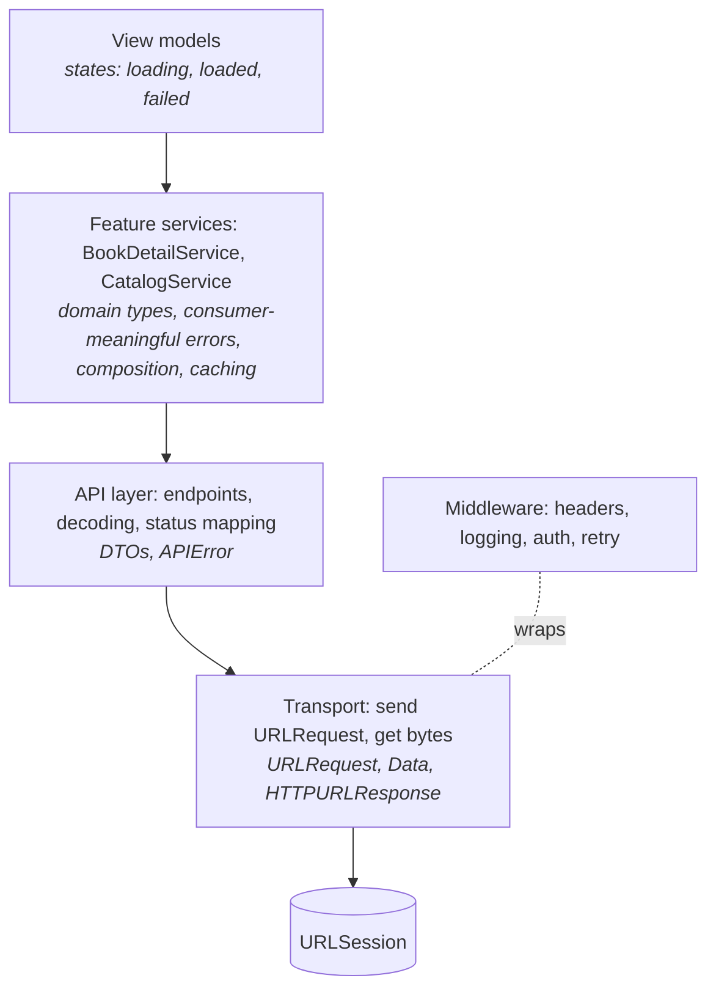

Most API clients are designed from the server inward. Someone opens the API documentation, writes one method per endpoint, returns whatever the endpoint returns, and calls the result `APIClient`. A year later it has 80 methods, every screen imports all of them, every test mocks a protocol with 80 requirements, and each screen has its own slightly different copy of the code that combines three of those methods into what it actually needed.

The alternative is to design from the consumer outward. A screen does not need "the `/books/{id}` endpoint." It needs "everything required to show a book's detail page, or a reason it can't be shown." This article separates those two concerns into layers: a transport that moves bytes, an API layer that speaks the server's language, and feature services that speak the app's. It shows how that structure keeps tests small, where cross-cutting behavior like logging belongs, and how it turns a slow sequence of requests into a fast one without the screen noticing.

<!--more-->

The examples use Swift 6 language mode and were compiled and run with the Swift 6.4 toolchain from Xcode 27.1 on macOS 26. They send requests to `LocalServer`, the loopback HTTP server from the [appendix of the first article](/swift-http-methods-status-codes-headers/#appendix-the-local-server-used-in-this-series); paste that code first, then the blocks below in order, into one `main.swift`.

<!-- check-uses: local-server -->

## Three layers, three vocabularies

Each layer has one job, and the boundary between two layers is where one vocabulary is translated into the next:



- The **transport** knows nothing about the API. It sends a `URLRequest` and returns `Data` and an `HTTPURLResponse`. Cross-cutting behavior, such as adding headers, logging, and authentication, wraps it.
- The **API layer** knows the server's contract: paths, methods, bodies, status codes, the JSON shapes. Its outputs are DTOs and an `APIError` like the one in [Separating Transport Errors from Application Failures](/swift-transport-vs-application-errors/).
- **Feature services** know what a particular part of the app needs. They combine endpoints, validate and convert DTOs into domain types as in [Validating Decoded Data](/swift-validating-decoded-data/), decide what can be cached, and translate failures into the few cases their consumers act on.

The dependency points one way. A view model depends on a feature service's protocol, never on endpoints or `URLSession`.

## The transport and its middleware

The transport is a protocol with one requirement. That is the right size for a seam that every request passes through:

```swift
import Foundation
import Synchronization

protocol HTTPTransport: Sendable {
    func send(_ request: URLRequest) async throws -> (Data, HTTPURLResponse)
}

struct URLSessionTransport: HTTPTransport {
    var session: URLSession = .shared

    func send(_ request: URLRequest) async throws -> (Data, HTTPURLResponse) {
        let (data, response) = try await session.data(for: request)
        guard let http = response as? HTTPURLResponse else { throw URLError(.badServerResponse) }
        return (data, http)
    }
}
```

Cross-cutting behavior is added by wrapping one transport in another, the **decorator** pattern. Each decorator does one thing and passes the request on:

```swift
struct HeaderTransport: HTTPTransport {
    let base: any HTTPTransport
    let headers: [String: String]

    func send(_ request: URLRequest) async throws -> (Data, HTTPURLResponse) {
        var request = request
        for (name, value) in headers where request.value(forHTTPHeaderField: name) == nil {
            request.setValue(value, forHTTPHeaderField: name)
        }
        return try await base.send(request)
    }
}

final class RequestLog: Sendable {
    private let lines = Mutex<[String]>([])
    func append(_ line: String) { lines.withLock { $0.append(line) } }
    var entries: [String] { lines.withLock { $0 } }
}

struct LoggingTransport: HTTPTransport {
    let base: any HTTPTransport
    let log: RequestLog

    func send(_ request: URLRequest) async throws -> (Data, HTTPURLResponse) {
        let start = ContinuousClock.now
        let label = "\(request.httpMethod ?? "GET") \(request.url?.path() ?? "?")"
        do {
            let (data, response) = try await base.send(request)
            log.append("\(label) -> \(response.statusCode) \(data.count)B in \(ContinuousClock.now - start)")
            return (data, response)
        } catch {
            log.append("\(label) -> \(type(of: error))")
            throw error
        }
    }
}
```

Composition order is a decision, not an accident. The outermost decorator sees the request first and the response last. Logging placed outside the header decorator logs requests before headers are added; placed inside, it sees what was actually sent. For authentication and retries the order matters more: a retry decorator outside the authentication decorator re-runs authentication on each attempt, which is what you want when the retry was caused by an expired token. [Refreshing Credentials Without Duplicate Requests](/swift-token-refresh/) builds that decorator, and [Redacting Sensitive Data from Network Logs](/swift-redacting-network-logs/) makes the logger safe for production.

## The API layer speaks the server's language

The API layer turns paths into requests and responses into DTOs. It is deliberately thin and mechanical: it has no opinions about what a screen needs. Here it is reduced to one generic `get`, with typed endpoints from [Building Typed Endpoints](/swift-typed-endpoints/) being the full version:

```swift
struct StatusError: Error, Equatable { let status: Int }

struct LibraryAPI: Sendable {
    let baseURL: URL
    let transport: any HTTPTransport

    func get<Value: Decodable>(_ path: String, query: [URLQueryItem] = [], as type: Value.Type = Value.self) async throws -> Value {
        var components = URLComponents(url: baseURL.appending(path: path), resolvingAgainstBaseURL: false)!
        if !query.isEmpty { components.queryItems = query }
        let (data, response) = try await transport.send(URLRequest(url: components.url!))
        guard (200..<300).contains(response.statusCode) else { throw StatusError(status: response.statusCode) }
        return try JSONDecoder().decode(Value.self, from: data)
    }
}

// DTOs: exactly what the server sends.
struct BookDTO: Decodable, Sendable { let id: String; let title: String; let authorID: String }
struct AvailabilityDTO: Decodable, Sendable { let total: Int; let available: Int; let nextDue: String? }
struct LoanDTO: Decodable, Sendable { let bookID: String; let due: String }
struct AuthorDTO: Decodable, Sendable { let id: String; let name: String }
```

## Feature services speak the app's language

The book detail screen shows a title, the author's name, whether a copy can be borrowed now or when the next one is due, and whether the user already has it. On the server, that is four resources. On the screen, it is one value:

```swift
struct BookDetail: Equatable, Sendable {
    enum Availability: Equatable, Sendable {
        case available(copies: Int)
        case waitlist(nextDue: String?)
    }

    let id: String
    let title: String
    let author: String
    let availability: Availability
    let onLoanToMe: Bool
}

enum DetailError: Error, Equatable, Sendable {
    case notFound
    case unavailable  // retrying later may help
    case failed       // a bug somewhere; retrying will not help
}

protocol BookDetailService: Sendable {
    func detail(for id: String) async throws(DetailError) -> BookDetail
}
```

The protocol is the contract with the screen, and it is shaped by the screen's needs:

- **One method.** The screen asks one question. A fake for tests is five lines.
- **A domain type.** `BookDetail` has the author's *name*, not an author ID the screen would have to resolve, and an `Availability` enum instead of two integers whose relationship the screen would have to interpret.
- **Errors the screen acts on.** "Not found" shows an empty state, "unavailable" shows a retry button, "failed" shows an apology and reports the bug. `URLError`, status codes, and decoding errors never reach the screen.

The live implementation is where the server's shape meets the screen's. The availability and loan requests do not depend on each other or on the book, so they run concurrently with it; only the author lookup has to wait for the book:

```swift
struct LiveBookDetailService: BookDetailService {
    let api: LibraryAPI

    func detail(for id: String) async throws(DetailError) -> BookDetail {
        do {
            async let book = api.get("books/\(id)", as: BookDTO.self)
            async let availability = api.get("books/\(id)/availability", as: AvailabilityDTO.self)
            async let loans = api.get("me/loans", as: [LoanDTO].self)

            let resolvedBook = try await book
            let author = try await api.get("authors/\(resolvedBook.authorID)", as: AuthorDTO.self)
            let copies = try await availability
            let myLoans = try await loans

            return BookDetail(
                id: resolvedBook.id,
                title: resolvedBook.title,
                author: author.name,
                availability: copies.available > 0 ? .available(copies: copies.available) : .waitlist(nextDue: copies.nextDue),
                onLoanToMe: myLoans.contains { $0.bookID == id })
        } catch let error as StatusError where error.status == 404 {
            throw .notFound
        } catch let error as StatusError where [429, 502, 503, 504].contains(error.status) {
            throw .unavailable
        } catch is URLError {
            throw .unavailable
        } catch {
            throw .failed
        }
    }
}
```

A server with a 100 ms delay on every route shows what the composition costs. The log records the order of completion:

```swift
let server = try await LocalServer.start { request in
    let delay = Duration.milliseconds(100)
    switch request.path {
    case "/books/b-7":
        return HTTPResponse(status: 200, body: [.bytes(Data(#"{"id":"b-7","title":"Dune","authorID":"a-1"}"#.utf8))], delay: delay)
    case "/books/b-7/availability":
        return HTTPResponse(status: 200, body: [.bytes(Data(#"{"total":3,"available":0,"nextDue":"2026-10-01"}"#.utf8))], delay: delay)
    case "/books/b-404", "/books/b-404/availability":
        return HTTPResponse(status: 404, delay: delay)
    case "/me/loans":
        return HTTPResponse(status: 200, body: [.bytes(Data(#"[{"bookID":"b-7","due":"2026-09-30"}]"#.utf8))], delay: delay)
    case "/authors":
        let ids = (request.query["ids"] ?? "").split(separator: ",")
        let authors = ids.map { #"{"id":"\#($0)","name":"Author \#($0)"}"# }.joined(separator: ",")
        return HTTPResponse(status: 200, body: [.bytes(Data("[\(authors)]".utf8))], delay: delay)
    case let path where path.hasPrefix("/authors/"):
        let id = path.dropFirst("/authors/".count)
        return HTTPResponse(status: 200, body: [.bytes(Data(#"{"id":"\#(id)","name":"Author \#(id)"}"#.utf8))], delay: delay)
    default:
        return .text("not found", status: 404)
    }
}

let log = RequestLog()
let transport = LoggingTransport(
    base: HeaderTransport(base: URLSessionTransport(), headers: ["Accept": "application/json"]),
    log: log)
let api = LibraryAPI(baseURL: server.baseURL, transport: transport)
let service = LiveBookDetailService(api: api)

let start = ContinuousClock.now
let detail = try await service.detail(for: "b-7")
let elapsed = ContinuousClock.now - start

assert(detail == BookDetail(id: "b-7", title: "Dune", author: "Author a-1",
                            availability: .waitlist(nextDue: "2026-10-01"), onLoanToMe: true))
assert(elapsed < .milliseconds(320))  // two round trips, not four
assert(server.requests.allSatisfy { $0.header("Accept") == "application/json" })
print(log.entries.joined(separator: "\n"))
```

The log shows the three independent requests finishing together after about 124 ms, and the author request, which had to wait for the book, finishing about 105 ms later:

```text
GET /books/b-7 -> 200 44B in 0.124317833 seconds
GET /books/b-7/availability -> 200 48B in 0.124374875 seconds
GET /me/loans -> 200 37B in 0.124419625 seconds
GET /authors/a-1 -> 200 32B in 0.104686333 seconds
```

Four requests took two round trips, about 200 ms, instead of the 400 ms a sequential implementation would need. The screen got this for free: the concurrency lives in the one place that knows which requests depend on which.

The error mapping works the same way. A missing book becomes `.notFound`, and the concurrent requests still in flight are cancelled when `async let` goes out of scope after the throw:

```swift
do throws(DetailError) {
    _ = try await service.detail(for: "b-404")
    assertionFailure("expected notFound")
} catch {
    assert(error == .notFound)
}
```

## The N+1 problem lives at this boundary

A list screen makes the composition question sharper. The catalog shows 20 books, each with its author's name. The API returns books with author IDs. The obvious implementation fetches the list, then each author, which is the **N+1 problem**: one request for the list and one per item.

With a round-trip time of $$W$$, and $$N$$ items, the three possible strategies cost:

$$
T_{\text{sequential}} = (N+1)\,W,
\qquad
T_{\text{concurrent}} \approx W + \left\lceil \tfrac{N}{L} \right\rceil W,
\qquad
T_{\text{batched}} = 2W
$$

where $$L$$ is the number of requests the session allows in flight to the host, six by default, as measured in [Choosing a `URLSession` Configuration](/swift-urlsession-configuration/). For $$N = 20$$ and $$W = 100$$ ms, that is 2.1 s, about 0.5 s, and 0.2 s. The batched version also sends two requests instead of 21, which matters for the server and for the user's data plan.

```swift
func authorNames(_ ids: [String], strategy: String) async throws -> [String] {
    switch strategy {
    case "sequential":
        var names: [String] = []
        for id in ids { names.append(try await api.get("authors/\(id)", as: AuthorDTO.self).name) }
        return names
    case "concurrent":
        return try await withThrowingTaskGroup(of: (Int, String).self) { group in
            for (index, id) in ids.enumerated() {
                group.addTask { (index, try await api.get("authors/\(id)", as: AuthorDTO.self).name) }
            }
            var names = [String](repeating: "", count: ids.count)
            for try await (index, name) in group { names[index] = name }
            return names
        }
    default:
        let authors = try await api.get("authors", query: [URLQueryItem(name: "ids", value: ids.joined(separator: ","))],
                                        as: [AuthorDTO].self)
        let byID = Dictionary(uniqueKeysWithValues: authors.map { ($0.id, $0.name) })
        return ids.map { byID[$0] ?? "Unknown author" }
    }
}

let ids = (1...20).map { "a-\($0)" }
var timings: [String: Duration] = [:]
for strategy in ["sequential", "concurrent", "batched"] {
    let before = server.requests.count
    let begin = ContinuousClock.now
    let names = try await authorNames(ids, strategy: strategy)
    timings[strategy] = ContinuousClock.now - begin
    assert(names.first == "Author a-1" && names.count == 20)
    print(strategy, timings[strategy]!, "requests:", server.requests.count - before)
}
assert(timings["sequential"]! > .seconds(2))
assert(timings["concurrent"]! < .milliseconds(700))
assert(timings["batched"]! < .milliseconds(200))
```

| Strategy (N = 20, W = 100 ms) | Requests | Predicted | Measured |
|---|---|---|---|
| Sequential | 20 | 2.0 s | 2.14 s |
| Concurrent, $$L = 6$$ | 20 | 0.4 s | 0.44 s |
| Batched | 1 | 0.1 s | 0.11 s |

The table counts only the author requests, which is why each prediction is one $$W$$ less than the formulas above. Which strategy is available is decided by the server: batching needs an endpoint that accepts several IDs, or a response that embeds the author. That is a conversation to have with the API's designers, and a feature service is the place in the client where its outcome is hidden. If the batch endpoint arrives later, only `authorNames` changes.

## Testing at the right seam

Because the screen depends on a one-method protocol, its tests use a one-method fake. There is no mock framework, no stubbed transport, and no JSON:

```swift
import Observation

@MainActor
@Observable
final class BookDetailModel {
    enum State: Equatable {
        case loading
        case loaded(BookDetail)
        case notFound
        case retryable
        case broken
    }

    private(set) var state = State.loading
    private let service: any BookDetailService
    private let id: String

    init(id: String, service: any BookDetailService) {
        self.id = id
        self.service = service
    }

    func load() async {
        state = .loading
        do throws(DetailError) {
            state = .loaded(try await service.detail(for: id))
        } catch {
            switch error {
            case .notFound: state = .notFound
            case .unavailable: state = .retryable
            case .failed: state = .broken
            }
        }
    }
}

struct FakeDetailService: BookDetailService {
    let result: Result<BookDetail, DetailError>
    func detail(for id: String) async throws(DetailError) -> BookDetail { try result.get() }
}

let sample = BookDetail(id: "b-1", title: "Emma", author: "Jane Austen", availability: .available(copies: 2), onLoanToMe: false)
let loadedModel = BookDetailModel(id: "b-1", service: FakeDetailService(result: .success(sample)))
await loadedModel.load()
assert(loadedModel.state == .loaded(sample))

let offlineModel = BookDetailModel(id: "b-1", service: FakeDetailService(result: .failure(.unavailable)))
await offlineModel.load()
assert(offlineModel.state == .retryable)
```

The model's tests cover the model's logic, the mapping from service outcomes to screen states, and nothing else. The service's own tests, against `LocalServer` as above or a `URLProtocol` stub as in [Isolating HTTP Fixtures with `URLProtocol`](/swift-urlprotocol-fixtures/), cover composition and error mapping. The transport's tests cover headers and logging. Each test fails for one reason, and none of them needs the 80-method protocol.

## What goes where

The layering answers most "where should this code live?" questions:

| Concern | Layer | Why |
|---|---|---|
| Default headers, `User-Agent` | Transport middleware | Same for every request |
| Authentication, token refresh | Transport middleware | Same for every request; must wrap retries correctly |
| Logging, metrics, redaction | Transport middleware | Sees every exchange |
| Paths, methods, bodies, status codes | API layer | The server's contract |
| DTO decoding | API layer | Mirrors the wire format |
| Validation, DTO → domain mapping | Feature service | Rules depend on what the feature needs |
| Combining endpoints, concurrency | Feature service | Only the feature knows which data it needs together |
| Caching policy, staleness | Feature service | "How old is too old" is a product decision per feature |
| Error vocabulary for the UI | Feature service | Each screen acts on a few cases |
| Loading, empty, and error states | View model | Presentation |

Two cautions keep the structure from becoming ceremony. A feature service is worth creating when a screen needs more than one call or any mapping; a screen that shows exactly one endpoint's data can depend on a small protocol over the API layer directly. And services are organized by feature, not by server resource: `BookDetailService` and `CatalogService` may both call `/books`, and that duplication is cheaper than a shared `BooksService` that serves two masters.

## Summary

- Design the client from the consumer outward: a screen needs an answer, not an endpoint.
- Separate a transport (bytes), an API layer (the server's contract and DTOs), and feature services (domain types, composition, errors that consumers act on).
- Add cross-cutting behavior by wrapping the transport in decorators, and choose their order deliberately.
- Feature services compose endpoints concurrently where the data allows it. Measured: four requests in two round trips, about 200 ms instead of 400 ms.
- N+1 request patterns cost $$(N+1)W$$ sequentially, about $$W + \lceil N/L \rceil W$$ concurrently, and $$2W$$ batched; the feature service hides which one the server makes possible.
- Small, consumer-shaped protocols make fakes trivial and keep each test focused on one layer.

## Exercise

Add a `CatalogService` with one method, `page(after:) async throws(DetailError) -> CatalogPage`, that returns 20 books with author names and a cursor, using the batched author endpoint. Then add a second implementation that wraps the live one and caches author names in memory for ten minutes, so that the second page only requests authors it has not seen. Verify with `server.requests` that scrolling through three pages whose books share authors requests each author at most once, and that the view model's tests did not change.

## Further reading

- Martin Fowler, [*Gateway*](https://martinfowler.com/articles/gateway-pattern.html), on wrapping external systems behind interfaces shaped by the client.
- Sam Newman, [*Backends For Frontends*](https://samnewman.io/patterns/architectural/bff/), the server-side counterpart of consumer-shaped APIs.
- The [concurrency roadmap's task groups article](/swift-task-groups/), for the concurrency patterns used in the feature service.

Previous: [Pagination: Page Numbers, Cursors, and Stable Ordering](/swift-pagination-cursors/). Next: [Authentication Headers and Credential Scope](/swift-authentication-headers-credential-scope/).

Return to the [Networking roadmap](/swift-networking/).
