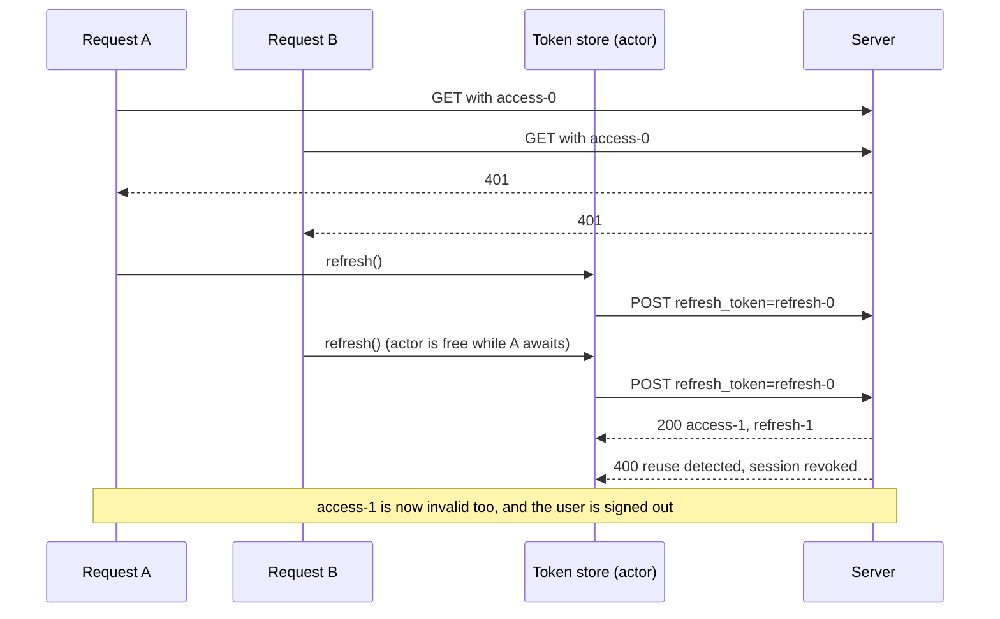

Access tokens expire on purpose. A short lifetime limits what a leaked token is worth, and the app holds a longer-lived refresh token that it exchanges for a new access token when the old one stops working. The exchange itself is one `POST`. Making it correct is harder, because the moment a token expires is exactly the moment several requests discover it at once.

A home screen that loads five sections sends five requests. When the token has expired, all five get `401`, and a client that handles each `401` independently sends five refresh requests. Against a server that **rotates** refresh tokens, issuing a new one on every refresh and treating reuse of an old one as theft, the second refresh request looks like an attack, and the server revokes the session. The user is signed out by their own app. This article reproduces that failure against a local server, then builds a refresh coordinator that sends exactly one refresh per expiry, survives callers being cancelled, and refreshes ahead of expiry so most requests never see a `401` at all.

<!--more-->

The examples use Swift 6 language mode and were compiled and run with the Swift 6.4 toolchain from Xcode 27.1 on macOS 26. They send requests to `LocalServer`, the loopback HTTP server from the [appendix of the first article](/swift-http-methods-status-codes-headers/#appendix-the-local-server-used-in-this-series); paste that code first, then the blocks below in order, into one `main.swift`. The coordinator is an actor, and [Actor Reentrancy Across Suspension Points](/swift-actor-reentrancy/) covers the behavior it depends on.

<!-- check-uses: local-server -->

## A server that rotates refresh tokens

[RFC 9700](https://www.rfc-editor.org/rfc/rfc9700), the current OAuth security best practice, recommends that servers either bind refresh tokens to the client cryptographically or **rotate** them: each refresh returns a new refresh token and invalidates the old one. If an old refresh token is ever presented again, the server cannot tell whether the legitimate client or an attacker holds the newer one, so it revokes the whole family of tokens. That rule turns a stolen refresh token into a short-lived one. It also turns a client that refreshes twice with the same token into a signed-out client.

The server below implements that rule. Access tokens expire after a configurable lifetime, the refresh endpoint takes 200 ms, which widens the window in which concurrent requests race, and every refresh call is counted:

```swift
import Foundation
import Synchronization

final class AuthServer: Sendable {
    struct State {
        var accessTokens: [String: ContinuousClock.Instant] = [:]  // token -> expiry
        var currentRefresh = "refresh-0"
        var usedRefresh: Set<String> = []
        var revoked = false
        var generation = 0
        var refreshCalls = 0
        var refreshCallsByToken: [String: Int] = [:]
    }

    let state = Mutex(State())
    let lifetime: Duration

    init(lifetime: Duration) {
        self.lifetime = lifetime
        state.withLock { $0.accessTokens["access-0"] = .now - .seconds(1) }  // the app starts with an expired token
    }

    func handle(_ request: HTTPRequest) async -> HTTPResponse {
        switch request.path {
        case "/auth/refresh":
            let presented = String(decoding: request.body, as: UTF8.self)
                .split(separator: "=", maxSplits: 1).last.map(String.init) ?? ""
            try? await Task.sleep(for: .milliseconds(200))
            return state.withLock { state in
                state.refreshCalls += 1
                state.refreshCallsByToken[presented, default: 0] += 1
                if state.revoked { return .json(#"{"error":"invalid_grant"}"#, status: 400) }
                if state.usedRefresh.contains(presented) {
                    state.revoked = true  // reuse detected: revoke the whole family
                    return .json(#"{"error":"invalid_grant","error_description":"refresh token reuse"}"#, status: 400)
                }
                guard presented == state.currentRefresh else { return .json(#"{"error":"invalid_grant"}"#, status: 400) }
                state.usedRefresh.insert(presented)
                state.generation += 1
                let access = "access-\(state.generation)"
                state.currentRefresh = "refresh-\(state.generation)"
                state.accessTokens[access] = .now + lifetime
                let seconds = lifetime.components.seconds
                return .json(#"{"access_token":"\#(access)","refresh_token":"\#(state.currentRefresh)","expires_in":\#(seconds)}"#)
            }
        default:
            let token = request.header("Authorization")?.replacing("Bearer ", with: "") ?? ""
            let valid = state.withLock { state in
                !state.revoked && (state.accessTokens[token].map { $0 > .now } ?? false)
            }
            guard valid else {
                return HTTPResponse(status: 401, headers: [("WWW-Authenticate", #"Bearer error="invalid_token""#)])
            }
            return .json(#"{"path":"\#(request.path)"}"#)
        }
    }
}

struct Tokens: Sendable, Equatable {
    var access: String
    var refresh: String
    var expires: ContinuousClock.Instant
}

struct TokenResponse: Decodable {
    let access_token: String
    let refresh_token: String
    let expires_in: Int
}

enum AuthError: Error, Equatable {
    case signedOut
}

func refreshTokens(at server: LocalServer, using refreshToken: String) async throws -> Tokens {
    var request = URLRequest(url: server.baseURL.appending(path: "auth/refresh"))
    request.httpMethod = "POST"
    request.setValue("application/x-www-form-urlencoded", forHTTPHeaderField: "Content-Type")
    request.httpBody = Data("refresh_token=\(refreshToken)".utf8)
    let (data, response) = try await URLSession.shared.data(for: request)
    guard (response as! HTTPURLResponse).statusCode == 200 else { throw AuthError.signedOut }
    let body = try JSONDecoder().decode(TokenResponse.self, from: data)
    return Tokens(access: body.access_token, refresh: body.refresh_token,
                  expires: .now + .seconds(body.expires_in))
}
```

The access tokens are opaque strings, which is all a client should assume about them. Real servers usually issue JWTs, and a client that decodes them to read the expiry is depending on a format the server may change; the `expires_in` field of the token response, defined by [RFC 6749](https://www.rfc-editor.org/rfc/rfc6749#section-5.1), is the supported way to learn it.

## The naive client signs itself out

The naive client keeps tokens in an actor, which makes access to them data-race free, and refreshes whenever a request gets `401`:

```swift
actor NaiveTokenStore {
    var tokens: Tokens
    let server: LocalServer
    init(tokens: Tokens, server: LocalServer) { (self.tokens, self.server) = (tokens, server) }

    func refresh() async throws -> Tokens {
        tokens = try await refreshTokens(at: server, using: tokens.refresh)
        return tokens
    }
}

func naiveRequest(_ path: String, store: NaiveTokenStore, server: LocalServer) async throws -> Int {
    func attempt(with access: String) async throws -> Int {
        var request = URLRequest(url: server.baseURL.appending(path: path))
        request.setValue("Bearer \(access)", forHTTPHeaderField: "Authorization")
        let (_, response) = try await URLSession.shared.data(for: request)
        return (response as! HTTPURLResponse).statusCode
    }
    let status = try await attempt(with: await store.tokens.access)
    guard status == 401 else { return status }
    let fresh = try await store.refresh()
    return try await attempt(with: fresh.access)
}

let naiveAuth = AuthServer(lifetime: .seconds(300))
let naiveServer = try await LocalServer.start { await naiveAuth.handle($0) }
let naiveStore = NaiveTokenStore(tokens: Tokens(access: "access-0", refresh: "refresh-0", expires: .now), server: naiveServer)

let naiveResults = await withTaskGroup { group in
    for index in 0..<5 {
        group.addTask { try? await naiveRequest("home/section-\(index)", store: naiveStore, server: naiveServer) }
    }
    var collected: [Int?] = []
    for await result in group { collected.append(result) }
    return collected
}

let naiveState = naiveAuth.state.withLock { $0 }
print("naive: \(naiveResults), refresh calls: \(naiveState.refreshCalls), revoked: \(naiveState.revoked)")
assert(naiveState.refreshCalls == 5)
assert(naiveState.refreshCallsByToken["refresh-0"] == 5)  // every refresh presented the same token
assert(naiveState.revoked)
assert(naiveResults.allSatisfy { $0 != 200 })  // every request failed in the end
```

The run printed `[nil, nil, nil, nil, Optional(401)]`, five refresh calls, and a revoked session: four requests failed because their refresh was rejected, and the one whose refresh succeeded was rejected anyway when it retried. The actor did its job, there was no data race, and the result was still wrong. Each of the five tasks read `refresh-0` from the store before any refresh had finished, because the actor is **reentrant**: while the first `refresh()` was suspended awaiting the network, the other four entered the actor and started their own. The first refresh rotated `refresh-0` to `refresh-1`. The second presented `refresh-0` again, which the server treats as reuse, so it revoked the family, and every later request, including the first task's retry with the brand-new token, was rejected.



## One refresh, shared by everyone

The fix is **single-flight** refresh: while a refresh is in progress, every caller that needs one waits for it instead of starting another. In Swift, an in-flight operation that several callers can await is a `Task`, and the actor stores it:

```swift
actor TokenCoordinator {
    enum Phase { case active(Tokens), signedOut }

    private var phase: Phase
    private var refreshing: Task<Tokens, any Error>?
    private let margin: Duration
    private let refresher: @Sendable (String) async throws -> Tokens
    private(set) var refreshes = 0

    init(tokens: Tokens, margin: Duration = .zero, refresher: @escaping @Sendable (String) async throws -> Tokens) {
        self.phase = .active(tokens)
        self.margin = margin
        self.refresher = refresher
    }

    /// A token believed to be valid, refreshing first if it expires within the margin.
    func validAccessToken() async throws -> String {
        if let refreshing { return try await refreshing.value.access }
        guard case .active(let tokens) = phase else { throw AuthError.signedOut }
        if tokens.expires - margin <= .now { return try await refresh(replacing: tokens.access) }
        return tokens.access
    }

    /// Called when the server rejected `rejected`. Refreshes at most once per token.
    func refresh(replacing rejected: String) async throws -> String {
        if let refreshing { return try await refreshing.value.access }
        guard case .active(let tokens) = phase else { throw AuthError.signedOut }
        guard tokens.access == rejected else { return tokens.access }  // someone already replaced it

        let refresher = self.refresher
        let task = Task { try await refresher(tokens.refresh) }
        refreshing = task
        refreshes += 1
        defer { refreshing = nil }
        do {
            let fresh = try await task.value
            phase = .active(fresh)
            return fresh.access
        } catch {
            phase = .signedOut
            throw AuthError.signedOut
        }
    }
}
```

Three rules make it correct, and each one closes a specific race:

1. **Await the in-flight task if there is one.** Every caller that arrives while `refreshing` is set awaits the same task, so concurrent `401`s produce one refresh. This check is the first line of both methods, and it runs again after every suspension because each method re-reads the property.
2. **Refresh only if the rejected token is still the current one.** A request can fail with `401` *after* a refresh has already completed: it was sent with the old token, and its response arrived late. Its caller passes the token that was rejected; if the coordinator already holds a different one, the right answer is "retry with the new token," not "refresh again." Without this check, a slow response would trigger a second rotation.
3. **Update the state before clearing the task.** `phase` is assigned inside the `do` block, and `refreshing = nil` runs in `defer`, after it. A caller that arrives between those two moments either sees the task and awaits it, or sees the new tokens. It never sees no task *and* old tokens, which would start a duplicate refresh.

The refresh runs in an unstructured `Task` rather than directly in the actor method. That decouples it from any one caller: if the request that started the refresh is cancelled, for example because the user left the screen, the refresh continues for everyone else, and its result is still stored. A child task or a direct `await` would have been cancelled with that caller.

The request function now asks the coordinator for a token, and on `401` reports exactly which token was rejected:

```swift
func authorizedRequest(_ path: String, coordinator: TokenCoordinator, server: LocalServer) async throws -> Int {
    func attempt(with access: String) async throws -> Int {
        var request = URLRequest(url: server.baseURL.appending(path: path))
        request.setValue("Bearer \(access)", forHTTPHeaderField: "Authorization")
        let (_, response) = try await URLSession.shared.data(for: request)
        return (response as! HTTPURLResponse).statusCode
    }
    let token = try await coordinator.validAccessToken()
    let status = try await attempt(with: token)
    guard status == 401 else { return status }
    let replacement = try await coordinator.refresh(replacing: token)
    return try await attempt(with: replacement)  // retry once; a second 401 is returned to the caller
}

let auth = AuthServer(lifetime: .seconds(300))
let server = try await LocalServer.start { await auth.handle($0) }
let coordinator = TokenCoordinator(tokens: Tokens(access: "access-0", refresh: "refresh-0", expires: .now + .seconds(300))) {
    try await refreshTokens(at: server, using: $0)
}

let results = await withTaskGroup { group in
    for index in 0..<20 {
        group.addTask { try? await authorizedRequest("home/section-\(index)", coordinator: coordinator, server: server) }
    }
    var collected: [Int?] = []
    for await result in group { collected.append(result) }
    return collected
}
let serverState = auth.state.withLock { $0 }
assert(results.allSatisfy { $0 == 200 })
assert(serverState.refreshCalls == 1 && !serverState.revoked)
let coordinatorRefreshes = await coordinator.refreshes
assert(coordinatorRefreshes == 1)
```

Twenty concurrent requests, twenty `401`s, one refresh, twenty successes. Note what the coordinator was told at the start: that `access-0` expires in 300 seconds, while the server had already expired it. The client's idea of the expiry is a prediction, and the `401` path handles every case where the prediction is wrong, including server-side revocation and clock differences.

The retry happens **once**. If the request fails with `401` again with a freshly refreshed token, something other than expiry is wrong, such as a token that lacks a required scope, and retrying in a loop would hammer the server. That second `401` is returned to the caller, which treats it as the `403`-like failure it is.

## A late `401` does not refresh again

Rule 2 matters when responses arrive out of order. The test sends one request with the old token after the refresh has completed, simulating a response that was slow to arrive:

```swift
let lateStatus = try await {
    var request = URLRequest(url: server.baseURL.appending(path: "slow-section"))
    request.setValue("Bearer access-0", forHTTPHeaderField: "Authorization")  // the old token
    let (_, response) = try await URLSession.shared.data(for: request)
    return (response as! HTTPURLResponse).statusCode
}()
assert(lateStatus == 401)
let afterLate = try await coordinator.refresh(replacing: "access-0")
assert(afterLate == "access-1")                       // the current token, not a new one
let refreshCallsAfterLate = auth.state.withLock { $0.refreshCalls }
assert(refreshCallsAfterLate == 1)                    // no second rotation
```

## Cancelled callers do not cancel the refresh

The refresh task belongs to the coordinator, not to the caller that started it. A test with a fresh session: five requests start, and the one that triggered the refresh is cancelled while the refresh is in flight:

```swift
let cancelAuth = AuthServer(lifetime: .seconds(300))
let cancelServer = try await LocalServer.start { await cancelAuth.handle($0) }
let cancelCoordinator = TokenCoordinator(tokens: Tokens(access: "access-0", refresh: "refresh-0", expires: .now + .seconds(300))) {
    try await refreshTokens(at: cancelServer, using: $0)
}

let first = Task { try await authorizedRequest("first", coordinator: cancelCoordinator, server: cancelServer) }
try await Task.sleep(for: .milliseconds(80))   // first has its 401 and is waiting on the refresh
let others = (0..<4).map { index in
    Task { try await authorizedRequest("other-\(index)", coordinator: cancelCoordinator, server: cancelServer) }
}
first.cancel()

var othersSucceeded = 0
for task in others where (try? await task.value) == 200 { othersSucceeded += 1 }
assert(othersSucceeded == 4)
assert(cancelAuth.state.withLock { $0.refreshCalls } == 1)
let firstOutcome = await first.result
if case .failure(let error) = firstOutcome { assert(error.isCancellation) }
```

The four other requests succeeded, and the server saw one refresh. The cancelled caller itself ends with `URLError.cancelled` from its retry request, or with a `200` if its retry had already been sent when the cancellation arrived. Either is correct; what must not happen is the shared refresh dying with it.

The `isCancellation` helper from [Requests and Responses with `async` and `await`](/swift-urlsession-async-await/) is redefined here so the example stands alone:

```swift
extension Error {
    var isCancellation: Bool {
        self is CancellationError || (self as? URLError)?.code == .cancelled
    }
}
```

One limitation remains. A caller waiting on `refreshing.value` is not woken by its own cancellation, because awaiting a `Task`'s value does not respond to the awaiting task's cancellation. The caller leaves once the refresh finishes, at most a request timeout later. For a refresh that takes a few hundred milliseconds that is acceptable; for one that can take a minute, wrap the wait in a race with cancellation using `withTaskCancellationHandler`, as [Cancellation Handlers and Reliable Resource Cleanup](/swift-cancellation-handlers-cleanup/) describes.

## Failure signs out everyone, once

When the refresh itself fails, every waiter must learn that the session has ended, and the coordinator must stop trying. The `catch` in `refresh(replacing:)` moves the phase to `.signedOut`, and both methods check the phase before doing anything:

```swift
let revokedAuth = AuthServer(lifetime: .seconds(300))
revokedAuth.state.withLock { $0.revoked = true }  // e.g. the password was changed on another device
let revokedServer = try await LocalServer.start { await revokedAuth.handle($0) }
let revokedCoordinator = TokenCoordinator(tokens: Tokens(access: "access-0", refresh: "refresh-0", expires: .now + .seconds(300))) {
    try await refreshTokens(at: revokedServer, using: $0)
}

let revokedResults = await withTaskGroup { group in
    for index in 0..<10 {
        group.addTask {
            do { return try await authorizedRequest("r-\(index)", coordinator: revokedCoordinator, server: revokedServer) }
            catch { return (error as? AuthError) == .signedOut ? -1 : -2 }
        }
    }
    var collected: [Int] = []
    for await result in group { collected.append(result) }
    return collected
}
assert(revokedResults.allSatisfy { $0 == -1 })
assert(revokedAuth.state.withLock { $0.refreshCalls } == 1)

do {
    _ = try await revokedCoordinator.validAccessToken()
    assertionFailure("a signed-out coordinator must not hand out tokens")
} catch {
    assert(error as? AuthError == .signedOut)
}
```

All ten requests ended with `AuthError.signedOut`, after a single failed refresh. The app's response is to show the sign-in screen once, not ten error alerts, and to clean up the user's data, which [Handling Logout During an In-Flight Request](/swift-logout-in-flight-requests/) covers.

## Refreshing before the token expires

Reacting to `401` is necessary, but it costs every request that hits it one extra round trip, plus the refresh. Most of those can be avoided by refreshing **proactively**: the coordinator's `validAccessToken()` refreshes when the token expires within a margin.

How large should the margin be? A request that starts with a token that has $$r$$ seconds of life left fails if the server checks the token after it expires. The server sees it after about the request's upload latency $$d$$, and the client's clock may disagree with the server's by up to $$s$$ seconds of skew. The request is safe when:

$$
r \;>\; d + s
\qquad\Longrightarrow\qquad
\text{margin} \;\ge\; d_{p99} + s_{\max}
$$

Without a margin, if requests start at uniformly random moments during a token's lifetime $$T$$, the fraction that arrive after expiry is about $$(d + s)/T$$. For a five-minute token, a two-second slow request, and a second of skew, that is $$3/300 = 1\%$$ of requests paying for a `401`, a refresh, and a retry. A margin of 30 to 60 seconds removes nearly all of them, at the cost of refreshing a little earlier than strictly necessary.

The test uses a token that is valid for two seconds and a margin of one second, so the coordinator refreshes before the server would have rejected anything:

```swift
let proactiveAuth = AuthServer(lifetime: .seconds(2))
proactiveAuth.state.withLock { $0.accessTokens["access-0"] = .now + .seconds(2) }
let proactiveServer = try await LocalServer.start { await proactiveAuth.handle($0) }
let proactive = TokenCoordinator(tokens: Tokens(access: "access-0", refresh: "refresh-0", expires: .now + .seconds(2)),
                                 margin: .seconds(1)) {
    try await refreshTokens(at: proactiveServer, using: $0)
}

var proactiveStatuses: [Int] = []
for _ in 0..<12 {
    proactiveStatuses.append(try await authorizedRequest("tick", coordinator: proactive, server: proactiveServer))
    try await Task.sleep(for: .milliseconds(250))
}
let rejected = proactiveServer.requests.filter { $0.path == "/tick" }.count - 12
assert(proactiveStatuses.allSatisfy { $0 == 200 })
assert(rejected == 0)                                    // no request ever got a 401
assert(proactiveAuth.state.withLock { $0.refreshCalls } >= 2)
```

Over three seconds of traffic with two-second tokens, the coordinator refreshed several times and the server never rejected a request: the number of `/tick` requests it received equals the number the client made, so no request needed a retry. The `401` path is still there for the cases a margin cannot predict, such as revocation.

## Putting it in the transport

The coordinator fits the transport layer from [Designing an API Client Around Consumer Needs](/swift-api-client-design/) as one decorator. Every request through it gets a valid token, retries once after a `401`, and the rest of the app never sees authentication at all. Combined with the origin check from [Authentication Headers and Credential Scope](/swift-authentication-headers-credential-scope/), the decorator attaches the token only to the API's origin, and the refresh request goes to the token endpoint with the refresh token in its body, never in a header that could follow a redirect.

The order of decorators matters here too. A retry decorator for transient failures should sit *outside* the authentication decorator, so that each retry asks the coordinator for a token again and benefits from any refresh that happened in between. [Retry Policies, Backoff, and Idempotency](/swift-retry-backoff-idempotency/) builds that decorator.

## Summary

- When a token expires, many requests discover it at once. Refreshing once per `401` sends many refreshes.
- Servers that rotate refresh tokens treat reuse as theft and revoke the session. Measured: five concurrent `401`s with a naive client produced five refreshes and a revoked session.
- An actor alone does not prevent duplicate refreshes, because it is reentrant across `await`. Store the in-flight refresh as a `Task` and have every caller await it.
- Refresh only if the rejected token is still current, so a late `401` does not rotate again. Update the tokens before clearing the in-flight task.
- Run the refresh in an unstructured task owned by the coordinator, so a cancelled caller does not cancel it for everyone.
- On refresh failure, move to a signed-out state once and fail every waiter with the same error.
- Refresh proactively with a margin of at least $$d_{p99} + s_{\max}$$; without one, about $$(d+s)/T$$ of requests pay for a `401`.

## Exercise

Make `TokenCoordinator` survive an app restart: persist `Tokens` to the Keychain after every successful refresh, and load them at startup. Then handle a process being killed *during* a refresh: on the next launch, the stored refresh token may already have been rotated on the server. Write a test against `AuthServer` that refreshes, discards the response before saving it, and restarts the coordinator, and decide what the user should see. Compare your answer with the reuse-detection rule, and explain why some servers keep the previous refresh token valid for a short grace period.

## Further reading

- [RFC 9700: Best Current Practice for OAuth 2.0 Security](https://www.rfc-editor.org/rfc/rfc9700), §4.14 on refresh token protection and rotation.
- [RFC 6749: The OAuth 2.0 Authorization Framework](https://www.rfc-editor.org/rfc/rfc6749), §6 on refreshing an access token.
- [Protect mutable state with Swift actors](https://developer.apple.com/videos/play/wwdc2021/10133/), WWDC21, which introduces actor reentrancy with a similar cache example.

Previous: [Authentication Headers and Credential Scope](/swift-authentication-headers-credential-scope/). Next: [App Transport Security and TLS Trust](/swift-ats-tls-trust/).

Return to the [Networking roadmap](/swift-networking/).
