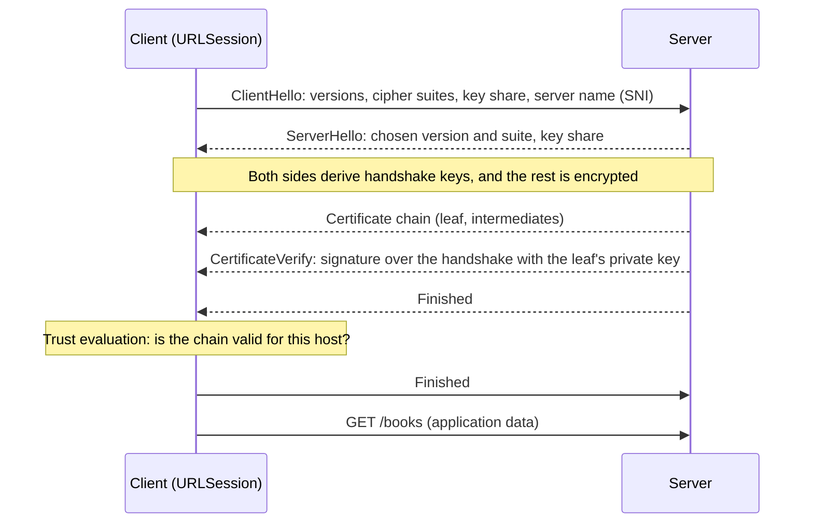

HTTPS promises three things: nobody on the path can read the traffic, nobody can change it undetected, and the server at the other end is the one the URL names. Encryption delivers the first two. The third, **server authentication**, comes from certificate trust evaluation, and it is the only one of the three that apps routinely break themselves, usually with a few lines of code copied to make a test server work.

This article runs a real TLS server on the loopback interface with a certificate from a private certificate authority, so every step of trust evaluation can be observed: the default failure, a custom anchor, the hostname check that a common shortcut silently disables, public-key pinning verified against `openssl`, and TLS version negotiation. It then covers App Transport Security, the system policy that decides which of these an app is allowed to relax.

<!--more-->

The examples use Swift 6 language mode and were compiled and run with the Swift 6.4 toolchain from Xcode 27.1 on macOS 26. They use `LocalServer`, the loopback HTTP server from the [appendix of the first article](/swift-http-methods-status-codes-headers/#appendix-the-local-server-used-in-this-series), whose `start(tls:)` parameter turns it into an HTTPS server; paste that code first, then the blocks below in order, into one `main.swift`. The certificate files are generated with the shell commands in the next section and must be in the working directory when the program runs.

<!-- check-uses: local-server -->

## What the handshake proves

In a TLS 1.3 handshake ([RFC 8446](https://www.rfc-editor.org/rfc/rfc8446)), client and server agree on keys in one round trip, and the server proves its identity by sending a certificate chain and signing the handshake with the private key that matches the first certificate:



The signature proves the server holds the private key for the leaf certificate. The chain proves that someone the client trusts vouched for the binding between that key and the host name. Trust evaluation checks the second claim, and Apple's [Preventing Insecure Network Connections](https://developer.apple.com/documentation/security/preventing-insecure-network-connections) lists what the default evaluation requires of the leaf certificate:

1. It has an intact signature from the next certificate in the chain.
2. It is not expired, and neither is anything above it.
3. It has a name that matches the server's DNS name, in its Subject Alternative Name extension.
4. It chains, certificate by certificate, to an **anchor**: a root certificate in the system trust store, or one the user or an administrator installed.

If any check fails, the connection fails, and no HTTP request is sent.

## A server with a private certificate authority

The commands below create a certificate authority, `Library Test CA`, and a server certificate it signs for the IP address `127.0.0.1`, then bundle the server's key and chain into a PKCS #12 file. They work with the LibreSSL `openssl` that ships with macOS and with OpenSSL 3:

```sh
openssl ecparam -name prime256v1 -genkey -noout -out ca.key
openssl req -x509 -new -key ca.key -sha256 -days 30 -subj "/CN=Library Test CA" -out ca.pem
openssl ecparam -name prime256v1 -genkey -noout -out server.key
openssl req -new -key server.key -subj "/CN=127.0.0.1" -out server.csr
printf "subjectAltName=IP:127.0.0.1\nextendedKeyUsage=serverAuth\nbasicConstraints=CA:FALSE\nkeyUsage=digitalSignature\n" > ext.cnf
openssl x509 -req -in server.csr -CA ca.pem -CAkey ca.key -CAcreateserial -days 30 -sha256 -extfile ext.cnf -out server.pem
openssl pkcs12 -export -inkey server.key -in server.pem -certfile ca.pem -passout pass:test -out server.p12
openssl x509 -in ca.pem -outform der -out ca.der

# The pin used later in this article: base64 SHA-256 of the server's SubjectPublicKeyInfo
openssl x509 -in server.pem -noout -pubkey | openssl pkey -pubin -outform der | openssl dgst -sha256 -binary | base64
```

The keys are P-256 elliptic-curve keys and the signatures use SHA-256, which meets the App Transport Security requirements discussed below. The Swift side imports the PKCS #12 file into memory, without touching the keychain, and hands the identity to Network framework's TLS options:

```swift
import Foundation
import Network
import Security
import CryptoKit
import Synchronization

func serverIdentity() throws -> sec_identity_t {
    let p12 = try Data(contentsOf: URL(fileURLWithPath: "server.p12"))
    var items: CFArray?
    let options: [String: Any] = [kSecImportExportPassphrase as String: "test",
                                  kSecImportToMemoryOnly as String: true]
    guard SecPKCS12Import(p12 as CFData, options as CFDictionary, &items) == errSecSuccess,
          let first = (items as? [[String: Any]])?.first,
          let identity = first[kSecImportItemIdentity as String] else {
        throw URLError(.clientCertificateRejected)
    }
    return sec_identity_create(identity as! SecIdentity)!
}

func tlsOptions(maximum: tls_protocol_version_t = .TLSv13) throws -> NWProtocolTLS.Options {
    let options = NWProtocolTLS.Options()
    sec_protocol_options_set_local_identity(options.securityProtocolOptions, try serverIdentity())
    sec_protocol_options_set_max_tls_protocol_version(options.securityProtocolOptions, maximum)
    return options
}

let server = try await LocalServer.start(tls: try tlsOptions()) { _ in .text("secure hello") }
let testCA = SecCertificateCreateWithData(nil, try Data(contentsOf: URL(fileURLWithPath: "ca.der")) as CFData)!
assert(server.baseURL.scheme == "https")
```

## The default evaluation refuses

The test CA is not in the system trust store, so default evaluation fails before any request is sent:

```swift
func attempt(_ url: URL, delegate: (any URLSessionTaskDelegate)? = nil,
             configuration: URLSessionConfiguration = .ephemeral) async -> Result<String, URLError> {
    let session = URLSession(configuration: configuration)
    defer { session.invalidateAndCancel() }
    do {
        let (data, _) = try await session.data(for: URLRequest(url: url), delegate: delegate)
        return .success(String(decoding: data, as: UTF8.self))
    } catch let error as URLError {
        return .failure(error)
    } catch {
        return .failure(URLError(.unknown))
    }
}

guard case .failure(let untrusted) = await attempt(server.baseURL) else { fatalError("expected a trust failure") }
assert(untrusted.code == .serverCertificateUntrusted)  // -1202
assert(server.requests.isEmpty)                         // no HTTP request reached the server
```

This is the behavior you want in production. A server presenting a certificate the device does not trust is indistinguishable from an attacker presenting one. The question is what to do in the cases where the certificate is legitimate but not publicly trusted: a staging server, a corporate CA, a device on the local network.

## Evaluating trust yourself

A delegate that implements the authentication challenge method receives a challenge with the method `NSURLAuthenticationMethodServerTrust` for every new TLS connection. The challenge carries a `SecTrust` object, which holds the server's chain and the policy to evaluate it against. The delegate below replaces the anchors with the test CA, evaluates, and records what happened:

```swift
final class TrustDelegate: NSObject, URLSessionTaskDelegate, Sendable {
    enum Policy: Sendable { case sslWithHostname, basicX509WithoutHostname }

    let anchors: [SecCertificate]
    let policy: Policy
    let pins: Set<String>
    let log = Mutex<[String]>([])

    init(anchors: [SecCertificate], policy: Policy = .sslWithHostname, pins: Set<String> = []) {
        (self.anchors, self.policy, self.pins) = (anchors, policy, pins)
    }

    func urlSession(_ session: URLSession, task: URLSessionTask,
                    didReceive challenge: URLAuthenticationChallenge) async -> (URLSession.AuthChallengeDisposition, URLCredential?) {
        let space = challenge.protectionSpace
        guard space.authenticationMethod == NSURLAuthenticationMethodServerTrust, let trust = space.serverTrust else {
            return (.performDefaultHandling, nil)
        }
        if policy == .basicX509WithoutHostname {
            SecTrustSetPolicies(trust, SecPolicyCreateBasicX509())  // DON'T: drops the hostname check
        }
        SecTrustSetAnchorCertificates(trust, anchors as CFArray)
        SecTrustSetAnchorCertificatesOnly(trust, true)

        var error: CFError?
        guard SecTrustEvaluateWithError(trust, &error) else {
            log.withLock { $0.append("rejected \(space.host): \(error.map { CFErrorGetCode($0) } ?? 0)") }
            return (.cancelAuthenticationChallenge, nil)
        }
        if !pins.isEmpty {
            let chain = SecTrustCopyCertificateChain(trust) as? [SecCertificate] ?? []
            let presented = Set(chain.compactMap(spkiPin))
            guard !presented.isDisjoint(with: pins) else {
                log.withLock { $0.append("pin mismatch \(space.host)") }
                return (.cancelAuthenticationChallenge, nil)
            }
        }
        log.withLock { $0.append("trusted \(space.host)") }
        return (.useCredential, URLCredential(trust: trust))
    }
}
```

`spkiPin` is defined in the pinning section below. With the test CA as the only anchor, the request succeeds:

```swift
let anchored = TrustDelegate(anchors: [testCA])
guard case .success(let body) = await attempt(server.baseURL, delegate: anchored) else { fatalError() }
assert(body == "secure hello")
assert(anchored.log.withLock { $0 } == ["trusted 127.0.0.1"])
```

`SecTrustSetAnchorCertificatesOnly(trust, true)` makes the test CA the *only* acceptable anchor for this evaluation. Passing `false` would add it to the system's roots, which is what you want for a corporate CA in an app that also talks to public servers.

Two practical notes. Returning `.cancelAuthenticationChallenge` fails the task with `URLError.cancelled` (`-999`), the same code as a user cancellation, which the `isCancellation` helper from earlier articles would hide from the user. A trust failure should be reported as an `APIError.insecure`, so a delegate that rejects trust should record why, as this one does, for the error mapping to use. And the delegate runs once per *connection*, not per request; requests that reuse a connection skip it.

### The hostname check is the point

The most common mistake in custom trust code is replacing the evaluation policy. `SecPolicyCreateBasicX509()` checks signatures, dates, and the chain, and nothing else. It does not check that the certificate was issued for the host being contacted. The same server, reached through the name `localhost` instead of the address its certificate names, shows the difference:

```swift
let localhost = URL(string: "https://localhost:\(server.port)/")!

let correct = TrustDelegate(anchors: [testCA])
guard case .failure(let mismatch) = await attempt(localhost, delegate: correct) else { fatalError() }
assert(mismatch.code == .cancelled)
assert(correct.log.withLock { $0 } == ["rejected localhost: -67602"])  // errSecHostNameMismatch

let broken = TrustDelegate(anchors: [testCA], policy: .basicX509WithoutHostname)
guard case .success = await attempt(localhost, delegate: broken) else { fatalError() }
assert(broken.log.withLock { $0 } == ["trusted localhost"])  // accepted a certificate for another name
```

The certificate was issued for `127.0.0.1`. The default SSL policy, which the challenge's trust object already carries, rejected it for `localhost` with `errSecHostNameMismatch` (`-67602`). The basic X.509 policy accepted it. In production that means accepting *any* certificate the anchor ever issued, for any host. If the anchor is a public CA, that is any certificate on the internet, including one an attacker obtained for their own domain. Never replace the policy; adjust the anchors, and if you must create a policy, use `SecPolicyCreateSSL(true, host as CFString)`.

## Pinning: trusting less than the system does

Custom anchors *extend* trust. Pinning *restricts* it: in addition to passing normal evaluation, the server must present a specific key the app expects. It protects against a misissued certificate from a public CA, or a CA installed on the device by someone else, at the cost of operational risk discussed below.

The usual pin is the SHA-256 hash of a certificate's **SubjectPublicKeyInfo** (SPKI), the DER structure that holds the algorithm and the public key. Pinning the key rather than the whole certificate lets the server renew its certificate without changing the pin, as long as it keeps the key. `SecKeyCopyExternalRepresentation` returns only the raw key bytes, so for a P-256 key the fixed DER header that identifies the algorithm is prepended to rebuild the SPKI:

```swift
/// Base64 SHA-256 of the certificate's SubjectPublicKeyInfo, as computed by
/// `openssl x509 -pubkey | openssl pkey -pubin -outform der | openssl dgst -sha256 -binary | base64`.
func spkiPin(_ certificate: SecCertificate) -> String? {
    guard let key = SecCertificateCopyKey(certificate),
          let attributes = SecKeyCopyAttributes(key) as? [String: Any],
          attributes[kSecAttrKeyType as String] as? String == kSecAttrKeyTypeECSECPrimeRandom as String,
          attributes[kSecAttrKeySizeInBits as String] as? Int == 256,
          let raw = SecKeyCopyExternalRepresentation(key, nil) as Data? else { return nil }
    // DER prefix of SubjectPublicKeyInfo for id-ecPublicKey with the prime256v1 curve.
    let p256Header = Data([0x30, 0x59, 0x30, 0x13, 0x06, 0x07, 0x2A, 0x86, 0x48, 0xCE, 0x3D, 0x02, 0x01,
                           0x06, 0x08, 0x2A, 0x86, 0x48, 0xCE, 0x3D, 0x03, 0x01, 0x07, 0x03, 0x42, 0x00])
    return Data(SHA256.hash(data: p256Header + raw)).base64EncodedString()
}

let serverPEM = try String(contentsOf: URL(fileURLWithPath: "server.pem"), encoding: .utf8)
let serverDER = Data(base64Encoded: serverPEM.split(separator: "\n").filter { !$0.hasPrefix("-----") }.joined())!
let expectedPin = spkiPin(SecCertificateCreateWithData(nil, serverDER as CFData)!)!
print("pin:", expectedPin)  // matches the openssl command's output

let pinned = TrustDelegate(anchors: [testCA], pins: [expectedPin])
guard case .success = await attempt(server.baseURL, delegate: pinned) else { fatalError() }

let wrongPin = TrustDelegate(anchors: [testCA], pins: [Data(repeating: 0, count: 32).base64EncodedString()])
guard case .failure = await attempt(server.baseURL, delegate: wrongPin) else { fatalError() }
assert(wrongPin.log.withLock { $0 } == ["pin mismatch 127.0.0.1"])
```

For the certificate generated in this run, the Swift function and the `openssl` pipeline both produced `yht36Q+cOe4NciA3nSKI/A0IxIu9AUw18ec1GOrFKkU=`. Each run of the shell commands creates a new key and therefore a new pin. Other key types have other headers; RSA keys of each size have their own, which is why most pinning libraries carry a small table of them.

The pin check runs *after* normal evaluation, never instead of it. A pin match on an expired certificate, or on a certificate for another host, must still fail.

### The risk is locking yourself out

A pin is a promise that the server will present a particular key for as long as any installed version of the app is in use. Breaking that promise makes the app unable to connect, and there is no server-side fix, because the app refuses the server. Two numbers frame the risk. Collisions are not one of them: finding a different key with the same SHA-256 hash takes on the order of $$2^{128}$$ work by the birthday bound, and a specific preimage $$2^{256}$$. The real constraints are operational:

$$
\text{pin lifetime} \;\ge\; t_{\text{oldest supported app version}} \qquad\text{and}\qquad \text{certificate lifetime} \;\le\; 398\ \text{days (and shrinking)}
$$

Publicly trusted TLS certificates are limited to 398 days today, and the CA/Browser Forum has adopted a schedule that reduces the maximum to 47 days by 2029. Every renewal is a chance for operations to generate a new key without knowing an app pins the old one. The practices that keep pinning safe follow from that:

- Pin **at least two keys**: the current one and a backup key that is generated, stored offline, and not yet in use. If the current key is lost or compromised, the server moves to the backup.
- Prefer pinning an **intermediate CA's key**, which changes far less often than leaf keys, if your CA lets you rely on it.
- Treat pins as a coordinated release between server operations and the app, with a monitoring alert for pin failures.

Since iOS 14, the declarative alternative is the `NSPinnedDomains` key in the app's `Info.plist`, under `NSAppTransportSecurity`. It takes, per domain, an `NSPinnedCAIdentities` or `NSPinnedLeafIdentities` array of dictionaries whose `SPKI-SHA256-BASE64` value is exactly the pin computed above. ATS then enforces the pin for every connection to that domain, including from frameworks you do not control, without any delegate code.

## TLS versions

ATS requires TLS 1.2 or later, and `URLSessionConfiguration.tlsMinimumSupportedProtocolVersion` defaults to 1.2, as [Choosing a `URLSession` Configuration](/swift-urlsession-configuration/) measured. A session can raise the minimum. Against a server limited to TLS 1.2, a client that requires 1.3 fails during the handshake:

```swift
let tls12Server = try await LocalServer.start(tls: try tlsOptions(maximum: .TLSv12)) { _ in .text("tls 1.2") }

let modernOnly = URLSessionConfiguration.ephemeral
modernOnly.tlsMinimumSupportedProtocolVersion = .TLSv13
guard case .failure(let versionError) = await attempt(tls12Server.baseURL, delegate: TrustDelegate(anchors: [testCA]),
                                                      configuration: modernOnly) else { fatalError() }
assert(versionError.code == .secureConnectionFailed)  // -1200

guard case .success(let legacyBody) = await attempt(tls12Server.baseURL, delegate: TrustDelegate(anchors: [testCA])) else {
    fatalError()
}
assert(legacyBody == "tls 1.2")
```

`secureConnectionFailed` (`-1200`) is the generic handshake failure: version mismatch, no common cipher suite, or a server that closed the connection mid-handshake. It is distinct from the `serverCertificate…` family, which means the handshake worked and the certificate was rejected.

## App Transport Security

ATS is the system policy behind these defaults. It applies to every connection an app makes through the URL Loading System, `URLSession` and everything built on it, in apps linked against iOS 9 or macOS 10.11 and later. It requires, beyond the default trust evaluation:

| Requirement | Value |
|---|---|
| Protocol | TLS 1.2 or later |
| Certificate key | RSA of at least 2048 bits, or ECC of at least 256 bits |
| Certificate signature hash | SHA-2 with a digest of at least 256 bits |
| Symmetric cipher | AES-128 or AES-256 |
| Key exchange | Forward secrecy through ECDHE |

A plain `http://` URL, or a server that fails one of these, is blocked with `URLError.appTransportSecurityRequiresSecureConnection` (`-1022`) and a console message naming the requirement. ATS does **not** apply to lower-level APIs: connections made with Network framework or BSD sockets are the app's own responsibility, which is why the command-line examples in this series can talk to plain HTTP servers and why custom protocols over Network framework need their own TLS configuration.

Apple's documentation states the most important constraint on the code in this article: with ATS enabled, a delegate can no longer *loosen* trust evaluation, for example to accept a self-signed certificate; it can only *tighten* it, for example with pinning. Custom anchors in code are therefore a tool for test harnesses, developer tools, and processes outside ATS. In a shipping app, a private CA is trusted by installing it on managed devices through a configuration profile, which makes it a system anchor.

Exceptions are declared in `Info.plist`, as narrowly as possible:

```xml
<key>NSAppTransportSecurity</key>
<dict>
    <key>NSAllowsLocalNetworking</key>
    <true/>
    <key>NSExceptionDomains</key>
    <dict>
        <key>legacy-catalog.example.org</key>
        <dict>
            <key>NSIncludesSubdomains</key>
            <false/>
            <key>NSExceptionAllowsInsecureHTTPLoads</key>
            <true/>
        </dict>
    </dict>
</dict>
```

| Key | Effect | App Review justification |
|---|---|---|
| `NSAllowsArbitraryLoads` | Disables ATS for all connections | Required |
| `NSAllowsArbitraryLoadsForMedia` | Disables ATS for AVFoundation media | Required |
| `NSAllowsArbitraryLoadsInWebContent` | Disables ATS inside web views | Required |
| `NSAllowsLocalNetworking` | Allows unqualified names, `.local` names, and IP addresses | Not required |
| `NSExceptionDomains` › `NSExceptionAllowsInsecureHTTPLoads` | Plain HTTP for one domain | Required |
| `NSExceptionDomains` › `NSExceptionMinimumTLSVersion` | Older TLS for one domain | Required |
| `NSPinnedDomains` | Adds pins; strengthens security | Not required |

Local networking changed recently. From iOS 10 to iOS 16 and macOS 10.12 to macOS 13, ATS allowed connections to IP addresses, unqualified names, and `.local` names by default. Since iOS 17 and macOS 14, it no longer allows IP addresses by default, so an app that talks to a device at `192.168.1.20` needs `NSAllowsLocalNetworking` or a specific exception. The `nscurl --ats-diagnostics https://host` command on a Mac tries a server against each combination of ATS exceptions and reports which ones it needs, which is the fastest way to answer "why does ATS block this?"

## Summary

- TLS proves the server holds the key for its certificate; trust evaluation proves the certificate is valid for the host: signature, dates, name, and a chain to an anchor.
- An untrusted chain fails with `serverCertificateUntrusted` (`-1202`) before any HTTP is sent. A handshake failure, such as a version mismatch, is `secureConnectionFailed` (`-1200`).
- A trust delegate can set anchors and evaluate; rejecting returns `-999`, so record the reason for error mapping.
- Never replace the SSL policy with `SecPolicyCreateBasicX509()`: measured, it accepted a certificate for the wrong host name.
- Pin SPKI hashes after normal evaluation, with a backup key, and plan for certificate lifetimes that are shrinking toward 47 days. `NSPinnedDomains` does it declaratively.
- ATS enforces TLS 1.2+, strong keys, SHA-2, AES, and forward secrecy for the URL Loading System, not for Network framework. With ATS on, delegates may tighten trust but not loosen it. IP addresses need `NSAllowsLocalNetworking` since iOS 17.

## Exercise

Generate a second CA, `Rogue CA`, and a certificate for `127.0.0.1` signed by it. Start a second TLS `LocalServer` with that identity and show that the anchored delegate rejects it, while a delegate that adds the rogue CA to the system anchors (`SecTrustSetAnchorCertificatesOnly(trust, false)`) together with the test CA accepts both servers. Then add the test server's pin and show that pinning rejects the rogue server even when its CA is trusted. Finally, extend `spkiPin` to RSA 2048 keys by looking up the correct DER header, and verify the result against `openssl` for an RSA certificate.

## Further reading

- Apple's [Preventing Insecure Network Connections](https://developer.apple.com/documentation/security/preventing-insecure-network-connections) and [Performing Manual Server Trust Authentication](https://developer.apple.com/documentation/foundation/performing-manual-server-trust-authentication).
- [Identity Pinning: How to configure server certificates for your app](https://developer.apple.com/news/?id=g9ejcf8y), Apple Developer News, on `NSPinnedDomains`.
- [RFC 8446: The Transport Layer Security (TLS) Protocol Version 1.3](https://www.rfc-editor.org/rfc/rfc8446) and [RFC 7469: Public Key Pinning Extension for HTTP](https://www.rfc-editor.org/rfc/rfc7469), which defines the SPKI pin format.
- The CA/Browser Forum's [Baseline Requirements](https://cabforum.org/working-groups/server/baseline-requirements/), which set certificate lifetimes.

Previous: [Refreshing Credentials Without Duplicate Requests](/swift-token-refresh/). Next: [Handling Logout During an In-Flight Request](/swift-logout-in-flight-requests/).

Return to the [Networking roadmap](/swift-networking/).
