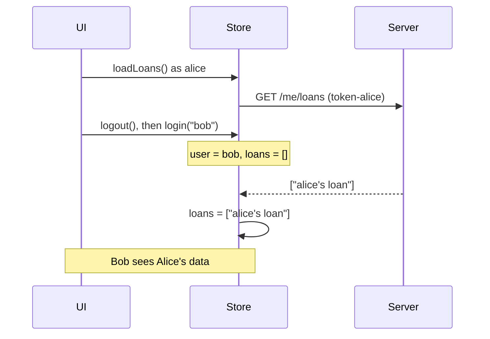
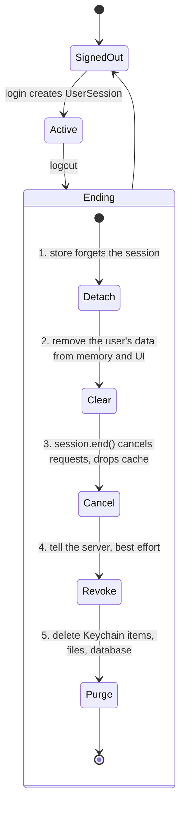

Logging out looks like the simplest feature in an app: delete the token, show the sign-in screen. The bugs live in everything that was already happening when the user tapped the button. A request for the user's loans was in flight; its response arrives two seconds later and writes Alice's loans into the store, which by then belongs to Bob, who just signed in on the same family iPad. A response was cached with Alice's profile; Bob's first request for his profile is answered from the cache. A refresh was in progress; it completes after logout and puts a valid token back.

None of these show up in a test that logs out an idle app. All of them are privacy bugs, because the data of one person is shown to another. This article reproduces three of them against a local server, then builds a user session object whose lifetime bounds every request, cache entry, and credential made on the user's behalf, so that ending the session ends all of them.

<!--more-->

The examples use Swift 6 language mode and were compiled and run with the Swift 6.4 toolchain from Xcode 27.1 on macOS 26. They send requests to `LocalServer`, the loopback HTTP server from the [appendix of the first article](/swift-http-methods-status-codes-headers/#appendix-the-local-server-used-in-this-series); paste that code first, then the blocks below in order, into one `main.swift`.

<!-- check-uses: local-server -->

## Something is almost always in flight

It is tempting to treat "logout during a request" as an edge case. Little's law, from [Concurrency vs. Parallelism](/swift-concurrency-vs-parallelism/), says otherwise. If an app issues requests at an average rate $$\lambda$$ and each takes $$W$$ on average, the average number in flight at any moment is:

$$
L = \lambda W
$$

An app that polls, prefetches, and syncs at two requests per second with a typical mobile latency of 600 ms has $$L = 1.2$$ requests in flight on average. If arrivals are roughly Poisson, the chance that *nothing* is in flight at the moment of logout is about $$e^{-L} \approx 30\%$$. In the other 70% of logouts, something will complete after the user has gone, and the code that handles its result has to know that.

## The test server

The server identifies the user by the bearer token. Its profile response is cacheable for a minute, the loans response is slow, and logout is an endpoint, because the server must revoke the refresh token too:

```swift
import Foundation
import Synchronization

let server = try await LocalServer.start { request in
    let user = request.header("Authorization")?.replacing("Bearer token-", with: "") ?? "nobody"
    switch request.path {
    case "/me/profile":
        return .json(#"{"name":"\#(user)"}"#, headers: [("Cache-Control", "max-age=60")])
    case "/me/profile-vary":
        return .json(#"{"name":"\#(user)"}"#, headers: [("Cache-Control", "max-age=60"), ("Vary", "Authorization")])
    case "/me/loans":
        return HTTPResponse(status: 200, headers: [("Content-Type", "application/json")],
                            body: [.bytes(Data(#"["\#(user)'s loan"]"#.utf8))], delay: .milliseconds(400))
    case "/auth/logout":
        return HTTPResponse(status: 204)
    default:
        return .text("not found", status: 404)
    }
}

func get(_ path: String, as user: String, session: URLSession) async throws -> String {
    var request = URLRequest(url: server.baseURL.appending(path: path))
    request.setValue("Bearer token-\(user)", forHTTPHeaderField: "Authorization")
    let (data, _) = try await session.data(for: request)
    return String(decoding: data, as: UTF8.self)
}
```

## Bug 1: a late response writes into the next user's state

The naive store keeps the current user's data in one place and loads it with a plain `async` method. Logout clears the store; a new sign-in starts loading the new user's data:

```swift
@MainActor
final class NaiveStore {
    var user: String?
    var loans: [String] = []

    func loadLoans(session: URLSession) async throws {
        guard let user else { return }
        let body = try await get("me/loans", as: user, session: session)
        loans = try JSONDecoder().decode([String].self, from: Data(body.utf8))
    }

    func logout() { user = nil; loans = [] }
    func login(_ name: String) { user = name }
}

let naive = NaiveStore()
naive.login("alice")
let aliceLoad = Task { try await naive.loadLoans(session: .shared) }
try await Task.sleep(for: .milliseconds(100))  // Alice's request is on the wire
naive.logout()
naive.login("bob")
try await aliceLoad.value                      // the response arrives
assert(naive.user == "bob")
assert(naive.loans == ["alice's loan"])        // Bob now sees Alice's loans
```

Nothing here is a data race. The store is main-actor isolated, and every access is serialized. The bug is a **race condition across a suspension point**, the kind [Actor Reentrancy Across Suspension Points](/swift-actor-reentrancy/) describes: the facts that were true before `await` (who the user is) were not true after it, and the code did not check.



## Bug 2: the cache answers for the wrong user

`URLCache` stores responses keyed by URL. Two users requesting `/me/profile` request the same URL, and a cacheable response for the first one is a valid cached answer for the second:

```swift
func profileLeak(path: String) async throws -> (alice: String, bob: String, serverHits: Int) {
    let configuration = URLSessionConfiguration.default
    configuration.urlCache = URLCache(memoryCapacity: 1_000_000, diskCapacity: 0)
    let shared = URLSession(configuration: configuration)
    defer { shared.finishTasksAndInvalidate() }
    let before = server.requests.count
    let alice = try await get(path, as: "alice", session: shared)
    // ... alice logs out, bob logs in, same session and cache ...
    let bob = try await get(path, as: "bob", session: shared)
    return (alice, bob, server.requests.count - before)
}

let leaked = try await profileLeak(path: "me/profile")
assert(leaked.alice == #"{"name":"alice"}"#)
assert(leaked.bob == #"{"name":"alice"}"#)   // served from cache, with a different Authorization
assert(leaked.serverHits == 1)

let varied = try await profileLeak(path: "me/profile-vary")
assert(varied.bob == #"{"name":"bob"}"#)     // Vary: Authorization made the cache check the header
assert(varied.serverHits == 2)
```

| Response headers | Bob's first `/me/profile` | Server requests |
|---|---|---|
| `Cache-Control: max-age=60` | Alice's profile, from cache | 1 |
| `Cache-Control: private, max-age=60` | Alice's profile, from cache | 1 |
| `Cache-Control: no-store` | Bob's profile | 2 |
| `Cache-Control: max-age=60`, `Vary: Authorization` | Bob's profile | 2 |

`private` does not help, because it means "only a private cache may store this," and `URLCache` *is* a private cache: one that belongs to a single client. [RFC 9111](https://www.rfc-editor.org/rfc/rfc9111#section-3.5) restricts *shared* caches from reusing responses to authenticated requests; a private cache is assumed to serve one user. That assumption fails on shared devices, on any device where a second account can sign in, and in apps that let one person switch between accounts.

Two fixes exist on the server, `Vary: Authorization` and `no-store` for personal data, and one belongs to the client: never let two users share a cache. The design below makes that structural.

## Bug 3: work that resurrects the session

The third bug is subtler. A token refresh in flight at logout completes afterwards and stores a fresh token, so the app is signed in again, invisibly, as the previous user. The same happens with any background work that holds credentials: a sync task that retries with "the current token," or an upload that re-authenticates. The coordinator in [Refreshing Credentials Without Duplicate Requests](/swift-token-refresh/) moves to `.signedOut` on failure, but a refresh that *succeeds* after logout needs the session itself to have ended. The fix below gives each signed-in user an object whose end is final.

## A session object with a lifetime

The idea is to make "the user's session" a concrete object that owns everything done on the user's behalf, and to derive every request from it:

- its own `URLSession`, with an ephemeral configuration and its own cache, so invalidating it cancels every request and drops every cached response;
- the user's credentials;
- an `isActive` flag, flipped exactly once, that every commit checks.

```swift
final class UserSession: Sendable {
    let user: String
    let token: String
    let urlSession: URLSession
    private let active = Mutex(true)

    init(user: String) {
        self.user = user
        self.token = "token-\(user)"
        let configuration = URLSessionConfiguration.ephemeral  // memory-only cache, cookies, credentials
        configuration.urlCache = URLCache(memoryCapacity: 2_000_000, diskCapacity: 0)
        configuration.httpAdditionalHeaders = ["Accept": "application/json"]
        self.urlSession = URLSession(configuration: configuration)
    }

    var isActive: Bool { active.withLock { $0 } }

    /// Ends the session: no further commits, every in-flight request cancelled, all storage dropped.
    func end() {
        active.withLock { $0 = false }
        urlSession.invalidateAndCancel()
    }

    func get(_ path: String) async throws -> Data {
        guard isActive else { throw CancellationError() }
        var request = URLRequest(url: server.baseURL.appending(path: path))
        request.setValue("Bearer \(token)", forHTTPHeaderField: "Authorization")
        return try await urlSession.data(for: request).0
    }
}
```

The token lives in the session object, not in a global. Code that has a `UserSession` can make requests as that user; code that does not, cannot. When the session ends, `invalidateAndCancel()` cancels every task the `URLSession` owns, and each throws `URLError.cancelled`. A `URLSession` that has been invalidated cannot create new tasks, and Apple documents that trying to do so is a programming error, which is why `get` checks `isActive` first.

The store now commits a result only if the session that produced it is still the current one. The check runs *after* the `await`, at the moment of commit, which is the only moment when the answer matters:

```swift
@MainActor
final class Store {
    private(set) var session: UserSession?
    private(set) var loans: [String] = []
    private(set) var discardedResponses = 0

    func login(_ user: String) { session = UserSession(user: user) }

    func loadLoans() async {
        guard let session else { return }
        do {
            let data = try await session.get("me/loans")
            guard session === self.session, session.isActive else {
                discardedResponses += 1  // belongs to a session that has ended
                return
            }
            loans = try JSONDecoder().decode([String].self, from: data)
        } catch {
            // Cancellation is expected after logout; other errors would be shown for the current session.
        }
    }

    func logout() async {
        guard let ending = session else { return }
        session = nil        // 1. no new work can start for this user
        loans = []           // 2. nothing of theirs is on screen
        ending.end()         // 3. cancel in-flight requests, drop cache, cookies, credentials
        await revokeOnServer(token: ending.token)  // 4. best effort, on a session of its own
    }

    private func revokeOnServer(token: String) async {
        var request = URLRequest(url: server.baseURL.appending(path: "auth/logout"))
        request.httpMethod = "POST"
        request.setValue("Bearer \(token)", forHTTPHeaderField: "Authorization")
        request.timeoutInterval = 5
        _ = try? await URLSession(configuration: .ephemeral).data(for: request)
    }
}
```

Running the same sequence as before, with Alice's load in flight when she logs out and Bob signs in:

```swift
let store = Store()
store.login("alice")
let inFlight = Task { await store.loadLoans() }
try await Task.sleep(for: .milliseconds(100))
await store.logout()
store.login("bob")
await inFlight.value
assert(store.loans.isEmpty)   // Alice's response never reached Bob's state
assert(store.discardedResponses == 0)  // it was cancelled before it could even arrive
assert(store.session?.user == "bob")

await store.loadLoans()
assert(store.loans == ["bob's loan"])
assert(server.requests.last { $0.path == "/auth/logout" }?.header("Authorization") == "Bearer token-alice")
```

Alice's request was cancelled by `end()`, so in this run its result never arrived at all. The identity check after `await` is still needed, because cancellation is not instantaneous: a response that had fully arrived before `invalidateAndCancel()` may still be delivered. A test with a response that completes before the session ends, but whose commit happens after, exercises that path:

```swift
let racing = Store()
racing.login("alice")
let aliceSession = racing.session!
let early = try await aliceSession.get("me/profile")  // completed while alice was signed in
await racing.logout()
racing.login("bob")
// Committing `early` now must be refused: it was produced by a session that has ended.
let wouldCommit = aliceSession === racing.session && aliceSession.isActive
assert(!wouldCommit)
assert(String(decoding: early, as: UTF8.self) == #"{"name":"alice"}"#)
```

The check is identity of the session object, not equality of user names. If Alice logs out and logs back in, her old session and her new one are different objects, and a response from the old one is still discarded. A user-name comparison would let it through, and with it any state that was meant to be reset by signing out, such as a changed password or revoked permissions.

Bob's session has its own `URLCache`, so the cache leak from bug 2 cannot happen between them either:

```swift
let alice = UserSession(user: "alice")
let aliceProfile = try await alice.get("me/profile")
alice.end()
let bob = UserSession(user: "bob")
let bobProfile = try await bob.get("me/profile")
assert(String(decoding: aliceProfile, as: UTF8.self) == #"{"name":"alice"}"#)
assert(String(decoding: bobProfile, as: UTF8.self) == #"{"name":"bob"}"#)
bob.end()
```

## Ending a session, in order

The order of the steps in `logout()` is deliberate. Each step closes a door before the next one could be walked through:



1. **Detach first.** Once the store no longer holds the session, no new request can be made as that user, and every commit check fails.
2. **Clear visible state** before any `await`, so the next frame does not show the previous user's data.
3. **Cancel and drop.** `end()` cancels requests and releases the session's memory-only cache, cookies, and credential storage.
4. **Revoke on the server** with the old token, on a separate `URLSession`, because the user's own session has just been invalidated. This is best effort: if the device is offline, the local logout must still complete. The refresh token, not the short-lived access token, is the one that matters to revoke; [RFC 7009](https://www.rfc-editor.org/rfc/rfc7009) defines a standard revocation endpoint.
5. **Purge persistent data**: Keychain items, downloaded files, the local database. This is the step that takes the longest, and it is safe to do last because nothing can read the data anymore.

## Writes that were in flight

Reads that finish after logout can simply be discarded. Writes are different: a `POST` that was sent before logout may already have been applied by the server, and cancelling it locally does not undo that. [Separating Transport Errors from Application Failures](/swift-transport-vs-application-errors/) called this an outcome that is *unknown*.

There are three reasonable policies, and an app should choose one per kind of write:

| Policy | When it fits | What logout does |
|---|---|---|
| Wait briefly | Small writes the user just made, such as a rating | Delay logout until pending writes finish, with a short timeout |
| Hand to the system | Large uploads | Let a background `URLSession` finish them; the result is reconciled at next sign-in by the same user |
| Discard and reconcile | Everything else | Cancel; when the same user signs in again, fetch the server's state rather than replaying |

The policy that does not fit anything is "queue it and send it later as whoever is signed in." An offline outbox, as in [Offline Behavior and Reachability Assumptions](/swift-offline-reachability/), belongs to one user's session and must be deleted or kept aside with it, never replayed with another user's token.

## Summary

- At logout, something is usually in flight: on average $$\lambda W$$ requests, and with Poisson arrivals at least one about $$1 - e^{-\lambda W}$$ of the time.
- A response that completes after logout must not be committed. Check, after the `await`, that the session that made the request is still the current one, by identity.
- `URLCache` keys by URL. Measured: a second user received the first user's cached profile, even with `private`; only `no-store` or `Vary: Authorization` prevented it.
- Give each signed-in user a session object that owns an ephemeral `URLSession` with its own cache, and the user's credentials. Ending it cancels every request and drops all storage at once.
- Log out in order: detach, clear visible state, cancel, revoke on the server best effort, then purge persistent data.
- Decide per kind of write whether to wait, hand off, or discard and reconcile. Never replay one user's queued writes as another.

## Exercise

Add a `TokenCoordinator` from the token refresh article to `UserSession`, and write a test in which a refresh is in flight when the user logs out. Make the server's refresh endpoint slow, call `logout()` while it is pending, and assert that when the refresh completes, the new token is not stored anywhere and no further request is made with it. Then add a "switch account" feature that keeps two `UserSession` objects alive at once and verify, using `server.requests`, that every request carried the token of the session that made it.

## Further reading

- [RFC 9111: HTTP Caching](https://www.rfc-editor.org/rfc/rfc9111), §3.5 on storing responses to authenticated requests, and §4.1 on `Vary`.
- [RFC 7009: OAuth 2.0 Token Revocation](https://www.rfc-editor.org/rfc/rfc7009).
- Apple's documentation for [`invalidateAndCancel()`](https://developer.apple.com/documentation/foundation/urlsession/invalidateandcancel()) and [`URLCache`](https://developer.apple.com/documentation/foundation/urlcache).

Previous: [App Transport Security and TLS Trust](/swift-ats-tls-trust/). Next: [Redacting Sensitive Data from Network Logs](/swift-redacting-network-logs/).

Return to the [Networking roadmap](/swift-networking/).
