Every request ends in one of three ways: it completes, it fails, or somebody stops waiting for it. The third way is the one most clients leave to chance. The default request timeout is 60 seconds, which is longer than anyone will look at a spinner, and the default resource timeout is seven days. Meanwhile, the screen that started the request may have been closed a minute ago, and the request is still running, holding a connection, burning data, and preparing to write its result into a view model nobody is looking at.

This article separates the three questions that decide when a request stops: how long the network may be silent (an idle timeout), how long the whole operation may take (a deadline), and who still cares about the result (the request's owner). It measures what `URLSession`'s two timeout settings actually do, builds a deadline that spans retries, and shows how to tie a request's lifetime to the object that needs its result.

<!--more-->

The examples use Swift 6 language mode and were compiled and run with the Swift 6.4 toolchain from Xcode 27.1 on macOS 26. They send requests to `LocalServer`, the loopback HTTP server from the [appendix of the first article](/swift-http-methods-status-codes-headers/#appendix-the-local-server-used-in-this-series); paste that code first, then the blocks below in order, into one `main.swift`. The [Cooperative Cancellation](/swift-cooperative-cancellation/) article covers the cancellation model used here.

<!-- check-uses: local-server -->

## Two clocks in `URLSession`

`URLSessionConfiguration` has two timeouts, and their names suggest more similarity than there is:

- `timeoutIntervalForRequest` is an **idle** timer. It starts when the request starts and **resets every time data arrives**. It fires when the connection has been silent for that long: no connection established, no response headers, or no body bytes.
- `timeoutIntervalForResource` is a **total** timer for the whole transfer. It does not reset. Its default, 604,800 seconds, is a week, because it was designed for background downloads.

A server that trickles a body, one byte every 0.6 seconds for eight bytes, separates the two:

```swift
import Foundation

let server = try await LocalServer.start { request in
    switch request.path {
    case "/trickle":
        var pieces: [HTTPResponse.Piece] = []
        for _ in 0..<8 { pieces += [.bytes(Data("x".utf8)), .pause(.milliseconds(600))] }
        return HTTPResponse(status: 200, headers: [("Content-Type", "application/octet-stream"), ("Content-Length", "8")],
                            body: pieces)
    case "/late-headers":
        return HTTPResponse(status: 200, body: [.bytes(Data("ok".utf8))], delay: .milliseconds(1500))
    case "/search":
        let delay = Int(request.query["delay"] ?? "100") ?? 100
        return HTTPResponse(status: 200, headers: [("Content-Type", "application/json")],
                            body: [.bytes(Data(#"["\#(request.query["q"] ?? "")"]"#.utf8))], delay: .milliseconds(delay))
    case "/flaky":
        return HTTPResponse(status: 503, delay: .milliseconds(Int(request.query["delay"] ?? "300") ?? 300))
    default:
        return .text("not found", status: 404)
    }
}

func seconds(_ duration: Duration) -> Double {
    Double(duration.components.seconds) + Double(duration.components.attoseconds) / 1e18
}

func timed(_ path: String, request: TimeInterval, resource: TimeInterval) async -> (code: Int, seconds: Double) {
    let configuration = URLSessionConfiguration.ephemeral
    configuration.timeoutIntervalForRequest = request
    configuration.timeoutIntervalForResource = resource
    let session = URLSession(configuration: configuration)
    defer { session.invalidateAndCancel() }
    let start = ContinuousClock.now
    do {
        _ = try await session.data(from: server.baseURL.appending(path: path))
        return (200, seconds(ContinuousClock.now - start))
    } catch {
        return ((error as? URLError)?.code.rawValue ?? 0, seconds(ContinuousClock.now - start))
    }
}

let neverIdle = await timed("trickle", request: 1, resource: 60)
let totalCap = await timed("trickle", request: 1, resource: 2)
let tooQuiet = await timed("trickle", request: 0.5, resource: 60)
let slowHeaders = await timed("late-headers", request: 1, resource: 60)

assert(neverIdle.code == 200 && neverIdle.seconds > 4)            // 4.4 s with a 1 s request timeout
assert(totalCap.code == -1001 && totalCap.seconds < 2.6)          // the total cap fired
assert(tooQuiet.code == -1001 && tooQuiet.seconds < 0.7)          // a 0.6 s gap exceeded 0.5 s
assert(slowHeaders.code == -1001 && abs(slowHeaders.seconds - 1) < 0.2)
```

| Server behavior | Request timeout | Resource timeout | Outcome (measured) |
|---|---|---|---|
| 1 byte every 0.6 s, 8 bytes | 1 s | 60 s | Completes after 4.43 s |
| 1 byte every 0.6 s, 8 bytes | 1 s | 2 s | `timedOut` after 2.28 s |
| 1 byte every 0.6 s, 8 bytes | 0.5 s | 60 s | `timedOut` after 0.51 s |
| Headers after 1.5 s | 1 s | 60 s | `timedOut` after 1.01 s |

The first row is the important one. A request timeout of one second did not stop a request that took more than four, because the server never went quiet for a full second. A slow, steady response, from a struggling server or a congested link, is invisible to the idle timer. The second row shows the resource timer catching it, about 0.3 seconds after its nominal two seconds; it is checked less precisely than the idle timer.

```mermaid
gantt
    accTitle: The idle timer resets with each byte while the resource timer runs continuously
    dateFormat x
    axisFormat %L ms
    section Bytes arriving
    byte 1 :milestone, 0, 0
    byte 2 :milestone, 600, 600
    byte 3 :milestone, 1200, 1200
    byte 4 :milestone, 1800, 1800
    section Idle timer, 1 s
    running :0, 600
    reset :600, 1200
    reset :1200, 1800
    reset :1800, 2400
    section Resource timer, 2 s
    running :0, 2000
    fires :milestone, 2000, 2000
```



Two consequences follow. A request timeout bounds how long the user waits for *nothing to happen*, which is useful for detecting a dead connection. It does not bound how long the user waits, period. And the resource timeout, the one that does, is a session-wide setting, so it cannot express "this search is useless after three seconds, but this upload may take five minutes." That needs a deadline per operation.

## A deadline per operation

A **deadline** is a point in time after which the result is no longer wanted. The simplest correct implementation races the operation against a sleep in a task group and cancels the loser:

```swift
struct DeadlineExceeded: Error, Equatable {}

func withDeadline<Value: Sendable>(
    _ duration: Duration,
    _ operation: @escaping @Sendable () async throws -> Value
) async throws -> Value {
    try await withThrowingTaskGroup(of: Value.self) { group in
        group.addTask { try await operation() }
        group.addTask {
            try await Task.sleep(for: duration)
            throw DeadlineExceeded()
        }
        defer { group.cancelAll() }
        return try await group.next()!
    }
}

let trickleURL = server.baseURL.appending(path: "trickle")
let deadlineStart = ContinuousClock.now
do {
    _ = try await withDeadline(.seconds(1)) { try await URLSession.shared.data(from: trickleURL) }
    assertionFailure("the deadline should have won")
} catch {
    assert(error as? DeadlineExceeded == DeadlineExceeded())
}
assert(seconds(ContinuousClock.now - deadlineStart) < 1.2)
```

The deadline fired after one second, on the request that the idle timer let run for four. When the sleep wins, `group.next()` throws `DeadlineExceeded`, the `defer` cancels the request, and the request's own `URLError.cancelled` is discarded with the group. Callers see one clear error that means "too slow," distinct from "the user cancelled," which matters for the error mapping in [Separating Transport Errors from Application Failures](/swift-transport-vs-application-errors/).

The task group waits for both children before returning, so the function cannot return while the request is still running. That is the structured-concurrency guarantee from [Structured Concurrency and Child-Task Lifetimes](/swift-structured-concurrency/), and it is why this is preferable to a timer that cancels a stored task. Swift Evolution has accepted a standard `withDeadline` ([SE-0526](https://github.com/swiftlang/swift-evolution/blob/main/proposals/0526-deadline.md)) built on the same idea; until it ships in your toolchain, the version above is a dozen lines.

## Deadlines across retries

Retries make timeouts compound. A client with a 10-second timeout that retries three times with backoffs of 1 and 2 seconds can keep the user waiting for:

$$
T_{\max} = n\,\tau + \sum_{i=1}^{n-1} b_i = 3 \times 10 + (1 + 2) = 33\ \text{seconds}
$$

That is not a number anyone chose. The fix is to choose the overall deadline $$D$$ first, from what the user will tolerate, and derive everything else from the time that remains. Each attempt gets the remaining budget, or less, as its own timeout:

```swift
struct Deadline: Sendable {
    let end: ContinuousClock.Instant
    init(after duration: Duration) { end = .now + duration }
    var remaining: Duration { max(.zero, end - .now) }
    var hasPassed: Bool { remaining == .zero }
}

func searchWithRetries(_ query: String, delay: Int, deadline: Deadline, perAttempt cap: Duration = .seconds(1)) async throws -> (Data, Int) {
    var attempt = 0
    while true {
        attempt += 1
        let budget = min(cap, deadline.remaining)
        guard budget > .milliseconds(50) else { throw DeadlineExceeded() }  // not enough time to be useful

        var components = URLComponents(url: server.baseURL.appending(path: "flaky"), resolvingAgainstBaseURL: false)!
        components.queryItems = [URLQueryItem(name: "q", value: query), URLQueryItem(name: "delay", value: "\(delay)")]
        var request = URLRequest(url: components.url!)
        request.timeoutInterval = seconds(budget)
        // Tell the server how long the client will wait, so it can give up too.
        request.setValue("\(Int(seconds(budget) * 1000))", forHTTPHeaderField: "X-Client-Deadline-Ms")

        let attemptRequest = request
        let (data, response) = try await withDeadline(budget) { try await URLSession.shared.data(for: attemptRequest) }
        if (response as! HTTPURLResponse).statusCode != 503 { return (data, attempt) }
        try await Task.sleep(for: min(.milliseconds(200) * attempt, deadline.remaining))
    }
}

let budgetStart = ContinuousClock.now
let flakyBefore = server.requests.count
do {
    _ = try await searchWithRetries("dune", delay: 300, deadline: Deadline(after: .seconds(2)))
    assertionFailure("the server always answers 503")
} catch {
    assert(error is DeadlineExceeded)
}
let budgetElapsed = seconds(ContinuousClock.now - budgetStart)
let attemptsMade = server.requests.count - flakyBefore
assert(budgetElapsed < 2.2)                      // the overall deadline held
assert(attemptsMade >= 3 && attemptsMade <= 4)   // as many attempts as fit in two seconds
let advertised = server.requests.last { $0.path == "/flaky" }?.header("X-Client-Deadline-Ms").flatMap { Int($0) } ?? 0
assert(advertised > 0 && advertised < 1000)      // later attempts advertise the shrinking budget
```

The loop never exceeded its two-second budget, however many attempts it made. The last attempt's advertised deadline was less than a second, because the remaining budget was. Sending the deadline to the server is the client half of **deadline propagation**, which gRPC makes standard with its `grpc-timeout` header: a server that knows the client will give up after 400 ms can stop work at 400 ms instead of finishing a result nobody will read.

[Retry Policies, Backoff, and Idempotency](/swift-retry-backoff-idempotency/) adds jitter and the rules for which failures to retry; the deadline is the frame they fit in.

### Choosing the numbers

Deadlines come from the user's side: how long will someone wait for this before the wait itself is the failure? A few seconds for a search, longer for a save the user explicitly asked for, minutes for an upload with a progress bar. Idle timeouts come from the network's side: a connection that has been silent for longer than the slow tail of normal latency is probably dead. If $$L$$ is the time between bytes, choose the idle timeout $$\tau$$ so that the false-timeout rate $$P(L > \tau)$$ is small, for example at the 99.9th percentile of measured gaps. [Reading `URLSessionTaskMetrics`](/swift-urlsessiontaskmetrics/) shows how to collect those measurements from real traffic.

A timeout is also a statement about **outcome**. When a client stops waiting, the server does not know. A `GET` that timed out is harmless to repeat. A `POST` that timed out may have been applied, and the client must treat its outcome as unknown rather than failed, as the `outcomeIsUnknown` property in the error model expresses.

## Cancellation follows ownership

A deadline answers "how long is the result useful?" Cancellation answers "is anyone still interested?" In Swift concurrency, a request is cancelled when the task awaiting it is cancelled, as [Requests and Responses with `async` and `await`](/swift-urlsession-async-await/) measured. So the question becomes: who owns the task?

| Owner | Example | The request ends when |
|---|---|---|
| A view | SwiftUI `.task { }` loading a screen's data | The view disappears, or `.task(id:)`'s value changes |
| A model | A search model's current query | The model starts a new query or is deallocated |
| The app | A sync engine, an outbox | The app decides; survives screens |
| The system | A background `URLSession` transfer | The transfer completes, even if the app is terminated |

Most bugs come from requests whose owner is wrong. A "Send" button whose request is started in `.task` is cancelled when the user navigates away, so the message is lost. A search started in an unstructured `Task { }` that nobody stores is never cancelled, so the result of the previous query arrives after the current one. The fix is the same in both cases: decide who owns the request, and give that owner the `Task`.

### A model that owns its request

A search model owns one request at a time. Starting a new search cancels the previous one, and so does the model going away:

```swift
@MainActor
final class SearchModel {
    private(set) var results: [String] = []
    private(set) var cancelled = 0
    private var current: Task<Void, Never>?

    func search(_ query: String, delay: Int = 300) {
        current?.cancel()
        current = Task { [weak self] in
            var components = URLComponents(url: server.baseURL.appending(path: "search"), resolvingAgainstBaseURL: false)!
            components.queryItems = [URLQueryItem(name: "q", value: query), URLQueryItem(name: "delay", value: "\(delay)")]
            do {
                let (data, _) = try await URLSession.shared.data(from: components.url!)
                let decoded = try JSONDecoder().decode([String].self, from: data)
                self?.results = decoded
            } catch let error as URLError where error.code == .cancelled {
                self?.cancelled += 1
            } catch {}
        }
    }

    func waitForCurrent() async { await current?.value }

    deinit { current?.cancel() }
}

let search = SearchModel()
search.search("du")
search.search("dun")
search.search("dune")
await search.waitForCurrent()
assert(search.results == ["dune"])
assert(search.cancelled == 2)  // the two superseded requests were cancelled, not merely ignored
```

Two details deserve attention. The task captures `self` **weakly**. A `Task { }` started from a method retains everything it captures until it finishes, so a strong capture keeps the model alive for as long as the request runs, and the model's `deinit`, which is supposed to cancel the request, cannot run until the request is over:

```swift
@MainActor
final class LeakyModel {
    var result = ""
    func load() {
        Task { // strong capture of self
            guard let (data, _) = try? await URLSession.shared.data(from: server.baseURL.appending(path: "late-headers")) else { return }
            self.result = String(decoding: data, as: UTF8.self)
        }
    }
}

weak var leaky: LeakyModel?
do {
    let model = LeakyModel()
    leaky = model
    model.load()
}
try await Task.sleep(for: .milliseconds(200))
assert(leaky != nil)  // the screen is gone, but the model lives on until the request finishes
try await Task.sleep(for: .milliseconds(1500))
assert(leaky == nil)  // released only after the response arrived
```

And cancellation is not the same as ignoring. The superseded searches in `SearchModel` were cancelled, so their connections were released and their responses never decoded. A model that merely ignores old results, by checking a sequence number, still pays for every request. [Coalescing Duplicate Requests and Rejecting Stale Results](/swift-request-coalescing/) and the concurrency roadmap's [Rejecting Stale Results After Request Replacement](/swift-rejecting-stale-results/) cover the cases where both are needed, because some results arrive too fast to cancel.

### Work that must outlive the screen

For work the user expects to finish regardless of navigation, such as sending a message, saving an edit, or uploading a photo, the owner must be something that outlives the screen: an app-level service that holds the task, or a background `URLSession` for transfers large enough that the app may be suspended. Making that choice explicit in the code is what prevents a request from being cancelled by a view's lifecycle that has nothing to do with it. [Background Transfers and App Relaunch](/swift-background-transfers/) covers the system-owned case.

## Summary

- `timeoutIntervalForRequest` is an idle timer that resets with every byte; a steady trickle never trips it. Measured: a four-second response completed under a one-second request timeout.
- `timeoutIntervalForResource` is a total timer for the session, checked less precisely (it fired 0.28 s late in the measurement).
- Express per-operation limits as a deadline: race the request against a sleep in a task group and cancel the loser. Report `DeadlineExceeded` separately from user cancellation.
- Choose an overall deadline first, give each retry the remaining budget, and advertise it to the server. Without that, timeouts and retries compound to $$n\tau + \sum b_i$$.
- A timed-out write has an unknown outcome.
- Every request needs an owner whose lifetime matches the result's usefulness. Cancel superseded requests rather than ignoring them, capture `self` weakly in stored tasks, and move work that must finish out of view-owned tasks.

## Exercise

Add a `/progressive` route that sends headers immediately and a 1 MB body at 100 KB per second. Write a download function that has a 30-second deadline but also fails if throughput drops below 50 KB/s for more than three consecutive seconds, using `bytes(for:)` to measure throughput as it goes. Test it against the route at full speed, at 40 KB/s, and with a two-second stall in the middle, and decide which of the three should succeed.

## Further reading

- Apple's documentation for [`timeoutIntervalForRequest`](https://developer.apple.com/documentation/foundation/urlsessionconfiguration/timeoutintervalforrequest) and [`timeoutIntervalForResource`](https://developer.apple.com/documentation/foundation/urlsessionconfiguration/timeoutintervalforresource).
- [SE-0526: `withDeadline`](https://github.com/swiftlang/swift-evolution/blob/main/proposals/0526-deadline.md).
- gRPC's [Deadlines guide](https://grpc.io/docs/guides/deadlines/), on deadline propagation between client and server.

Previous: [Redacting Sensitive Data from Network Logs](/swift-redacting-network-logs/). Next: [Retry Policies, Backoff, and Idempotency](/swift-retry-backoff-idempotency/).

Return to the [Networking roadmap](/swift-networking/).
