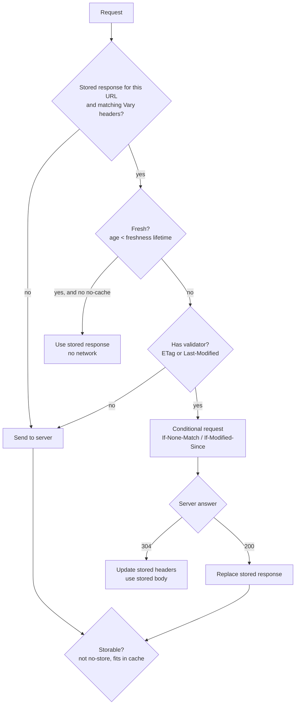

The fastest request is one that is never sent, and the second fastest is one whose answer is "nothing changed." HTTP has a complete, standardized design for both: servers say how long a response stays fresh, clients reuse it for that long, and when it goes stale they ask the server to confirm it with a small conditional request instead of downloading it again. `URLSession` implements that design through `URLCache`, and most apps use it without knowing what it is doing, which is how they end up with screens that never update, or with a cache that never helps.

This article measures `URLCache`'s behavior against the rules in [RFC 9111](https://www.rfc-editor.org/rfc/rfc9111): freshness from `Cache-Control` and `Age`, validation with `ETag` and `Last-Modified`, the heuristic that caches responses nobody asked to cache, what `no-cache` and `no-store` really mean, and the size limit that silently skips large responses. It then shows how a client chooses, per request, between freshness and availability.

<!--more-->

The examples use Swift 6 language mode and were compiled and run with the Swift 6.4 toolchain from Xcode 27.1 on macOS 26. They send requests to `LocalServer`, the loopback HTTP server from the [appendix of the first article](/swift-http-methods-status-codes-headers/#appendix-the-local-server-used-in-this-series); paste that code first, then the blocks below in order, into one `main.swift`.

<!-- check-uses: local-server -->

## Fresh, stale, and validated

Every stored response is either **fresh**, meaning it may be used without contacting the server, or **stale**. A stale response is not useless: if it carries a **validator**, the client can send a **conditional request** asking "has this changed?", and the server can answer `304 Not Modified` with no body. The full decision for one request looks like this:



The **freshness lifetime** comes from the response. In order of precedence, RFC 9111 §4.2.1 uses `s-maxage` (shared caches only), then `max-age`, then `Expires` minus `Date`, and finally a heuristic. The response's **age** is how long ago the origin server generated it, which includes time spent in other caches on the way, reported in the `Age` header:

$$
\text{fresh} \iff \text{current\_age} < \text{freshness\_lifetime},
\qquad
\text{current\_age} = \max(0,\ t_{\text{response}} - \text{Date}) + \text{Age} + t_{\text{resident}}
$$

where $$t_{\text{resident}}$$ is how long the response has been in this cache. The RFC's exact formula also corrects for request latency; the version above is the part that matters for reasoning about apps.

## A server that speaks caching

The test server takes its caching headers from the query string, so each scenario is one URL. Without caching, every response body contains a random number, so a reused response is recognizable. It answers `If-None-Match: "v1"` with `304`:

```swift
import Foundation

func httpDate(_ date: Date) -> String {
    let formatter = DateFormatter()
    formatter.locale = Locale(identifier: "en_US_POSIX")
    formatter.timeZone = TimeZone(identifier: "GMT")
    formatter.dateFormat = "EEE, dd MMM yyyy HH:mm:ss 'GMT'"
    return formatter.string(from: date)
}

let server = try await LocalServer.start { request in
    var headers: [(name: String, value: String)] = [("Content-Type", "application/json"), ("Date", httpDate(.now))]
    if let cacheControl = request.query["cc"] { headers.append(("Cache-Control", cacheControl)) }
    if request.query["etag"] != nil { headers.append(("ETag", #""v1""#)) }
    if let days = request.query["lastModifiedDaysAgo"].flatMap(Double.init) {
        headers.append(("Last-Modified", httpDate(.now - days * 86_400)))
    }
    if let age = request.query["age"] { headers.append(("Age", age)) }
    if request.header("If-None-Match") == #""v1""# {
        return HTTPResponse(status: 304, headers: headers)
    }
    let size = Int(request.query["size"] ?? "0") ?? 0
    let body = size > 0 ? String(repeating: "x", count: size) : #"{"n":\#(Int.random(in: 0..<1_000_000_000))}"#
    return HTTPResponse(status: 200, headers: headers, body: [.bytes(Data(body.utf8))])
}

func cachingSession(memory: Int = 10_000_000) -> URLSession {
    let configuration = URLSessionConfiguration.default
    configuration.urlCache = URLCache(memoryCapacity: memory, diskCapacity: 0)
    return URLSession(configuration: configuration)
}

func resource(_ parameters: [String: String]) -> URL {
    var components = URLComponents(url: server.baseURL.appending(path: "catalog"), resolvingAgainstBaseURL: false)!
    components.queryItems = parameters.sorted { $0.key < $1.key }.map { URLQueryItem(name: $0.key, value: $0.value) }
    return components.url!
}

struct TwoFetches {
    var serverHits: Int
    var conditionalHeaders: [String?]
    var sameBody: Bool
    var secondStatus: Int
}

func fetchTwice(_ parameters: [String: String], pause: Duration = .zero,
                session: URLSession = cachingSession()) async throws -> TwoFetches {
    let url = resource(parameters)
    let before = server.requests.count
    let (first, _) = try await session.data(from: url)
    try await Task.sleep(for: pause)
    let (second, response) = try await session.data(from: url)
    let hits = server.requests.dropFirst(before)
    return TwoFetches(serverHits: hits.count, conditionalHeaders: hits.map { $0.header("If-None-Match") },
                      sameBody: first == second, secondStatus: (response as! HTTPURLResponse).statusCode)
}
```

## Freshness: `max-age` and `Age`

A response with `max-age=2` is fresh for two seconds. A second request within that window is answered from the cache, and the server never sees it. After it, the response is stale, and because it has an `ETag`, `URLSession` sends a conditional request:

```swift
let fresh = try await fetchTwice(["cc": "max-age=2", "etag": "1"])
assert(fresh.serverHits == 1 && fresh.sameBody)

let stale = try await fetchTwice(["cc": "max-age=1", "etag": "1"], pause: .milliseconds(1500))
assert(stale.serverHits == 2)
assert(stale.conditionalHeaders == [nil, #""v1""#])   // the second request was conditional
assert(stale.sameBody && stale.secondStatus == 200)   // the 304 was turned into the cached 200
```

The last line is easy to miss and important. The server answered `304 Not Modified` with no body, and the app received a `200` with the full cached body. `URLSession` merges the two transparently, which is what most code wants, and it means code that checks for `304` itself will never see one on a session with a cache.

`Age` shortens the lifetime. A response with `max-age=60` that already spent 59 seconds in a CDN has one second left when it arrives; one that spent 100 seconds is stale on arrival:

```swift
let almostExpired = try await fetchTwice(["cc": "max-age=60", "age": "59", "etag": "1"], pause: .milliseconds(1500))
assert(almostExpired.serverHits == 2 && almostExpired.conditionalHeaders.last == #""v1""#)

let staleOnArrival = try await fetchTwice(["cc": "max-age=60", "age": "100", "etag": "1"])
assert(staleOnArrival.serverHits == 2)
```

An app that wonders why a resource with `max-age=3600` is revalidated after a few minutes should look at the `Age` header its CDN sends.

## Validators: `ETag` and `Last-Modified`

An `ETag` is an opaque identifier for one version of a representation, and a client sends it back in `If-None-Match`. `Last-Modified` is a timestamp, sent back in `If-Modified-Since`. `ETag` is the stronger of the two: it does not depend on clock resolution, it can distinguish two versions modified within the same second, and it can be computed from content, such as a hash of the body. When a server sends both, `URLSession` uses both.

A response with an `ETag` but no freshness information is stored, immediately stale, and revalidated on every use. That is often exactly right for data that changes unpredictably: every request costs a round trip, but unchanged data costs a few hundred bytes instead of the full body. A response with neither freshness information nor a validator is not reused at all:

```swift
let validatorOnly = try await fetchTwice(["etag": "1"])
assert(validatorOnly.serverHits == 2 && validatorOnly.conditionalHeaders == [nil, #""v1""#] && validatorOnly.sameBody)

let nothing = try await fetchTwice([:])
assert(nothing.serverHits == 2 && nothing.conditionalHeaders == [nil, nil] && !nothing.sameBody)
```

The savings from validation are easy to estimate. If a response of $$B$$ bytes is requested $$n$$ times and changes with probability $$p$$ between requests, unconditional fetches transfer $$nB$$ bytes, while conditional ones transfer about:

$$
B + (n-1)\big(p\,B + (1-p)\,h\big)
$$

where $$h$$ is the size of a `304` response, a few hundred bytes of headers. For a 200 KB catalog checked 50 times a day that changes twice, that is 10 MB without validation and about 0.6 MB with it.

## The heuristic: caching nobody asked for

A response with no `Cache-Control` and no `Expires` still has a freshness lifetime if it has `Last-Modified`. RFC 9111 §4.2.2 lets caches assign a **heuristic** lifetime and suggests 10% of the time since the last modification:

$$
\text{heuristic\_lifetime} = 0.1 \times (\text{Date} - \text{Last-Modified})
$$

A document last modified ten days ago is treated as fresh for a day:

```swift
let heuristic = try await fetchTwice(["lastModifiedDaysAgo": "10"])
assert(heuristic.serverHits == 1 && heuristic.sameBody)  // cached, though no header asked for it
```

This is the source of the classic "the app shows old data until tomorrow" bug: a server, or a static file host, sends `Last-Modified` and nothing else, and every client caches for 10% of the file's age. The fix is on the server: always send an explicit `Cache-Control`.

## What `no-cache` and `no-store` mean

The two directives are named confusingly:

- `no-cache` means **store it, but validate before every use**. It is equivalent to `max-age=0, must-revalidate` for a private cache.
- `no-store` means **do not store it at all**. It is the only directive that keeps a response out of the cache.

```swift
let noCache = try await fetchTwice(["cc": "no-cache", "etag": "1"])
assert(noCache.serverHits == 2 && noCache.conditionalHeaders == [nil, #""v1""#] && noCache.sameBody)

let noStore = try await fetchTwice(["cc": "no-store", "etag": "1"])
assert(noStore.serverHits == 2 && noStore.conditionalHeaders == [nil, nil] && !noStore.sameBody)

let mustRevalidate = try await fetchTwice(["cc": "max-age=0, must-revalidate", "etag": "1"])
assert(mustRevalidate.serverHits == 2 && mustRevalidate.conditionalHeaders.last == #""v1""#)
```

| Response headers | Second request | Server requests | Body |
|---|---|---|---|
| `max-age=2`, `ETag` (within 2 s) | From cache | 1 | Same |
| `max-age=1`, `ETag` (after 1.5 s) | Conditional, `304` | 2 | Same |
| `max-age=60`, `Age: 100`, `ETag` | Conditional | 2 | Same |
| `ETag` only | Conditional | 2 | Same |
| `Last-Modified` 10 days ago only | From cache (heuristic) | 1 | Same |
| none | Unconditional | 2 | New |
| `no-cache`, `ETag` | Conditional | 2 | Same |
| `no-store`, `ETag` | Unconditional | 2 | New |

Personal data that must never touch disk needs `no-store`. `private` only keeps it out of *shared* caches, which [Handling Logout During an In-Flight Request](/swift-logout-in-flight-requests/) showed is not enough on a device that more than one person uses.

## Responses that are silently not cached

`URLCache` has one rule that is not in the RFC. Apple's documentation for `urlSession(_:dataTask:willCacheResponse:)` lists the conditions for storing a response, including that it must be "no larger than about 5% of the disk cache size." The measurement shows the same rule applying to a memory-only cache, against its memory capacity:

```swift
let small = try await fetchTwice(["cc": "max-age=60", "size": "40000"], session: cachingSession(memory: 1_000_000))
let large = try await fetchTwice(["cc": "max-age=60", "size": "60000"], session: cachingSession(memory: 1_000_000))
assert(small.serverHits == 1)  // 40 KB is 4% of 1 MB: cached
assert(large.serverHits == 2)  // 60 KB is 6% of 1 MB: not cached, and no error anywhere
```

With the shared cache's capacities measured in [Choosing a `URLSession` Configuration](/swift-urlsession-configuration/), 512 KB in memory and 20 MB on disk in that process, the largest cacheable response is about 1 MB on disk and 25 KB in memory. An app whose catalog response grew from 800 KB to 1.2 MB loses its caching overnight with no error. Size the cache from the largest response you want cached:

$$
\text{capacity} \ge 20 \times \text{largest response}
$$

## Choosing per request: freshness or availability

The default `cachePolicy`, `.useProtocolCachePolicy`, follows the server's headers. Each request can override it, and the overrides express a product decision about what matters more for that request, current data or any data:

| `URLRequest.CachePolicy` | Uses a stored response | Contacts the server |
|---|---|---|
| `.useProtocolCachePolicy` | When fresh, or after a `304` | When stale or absent |
| `.reloadIgnoringLocalCacheData` | Never | Always, unconditionally |
| `.returnCacheDataElseLoad` | Whenever one exists, even stale | Only if none is stored |
| `.returnCacheDataDontLoad` | Whenever one exists, even stale | Never; fails if none is stored |

The two "return cache data" policies are how an app shows *something* immediately and when offline. A stale response remains in the cache after its lifetime ends, and these policies use it anyway:

```swift
let offlineSession = cachingSession()
let catalogURL = resource(["cc": "max-age=1", "etag": "1"])
let (original, _) = try await offlineSession.data(from: catalogURL)
try await Task.sleep(for: .milliseconds(1200))   // now stale

let hitsBefore = server.requests.count
var offline = URLRequest(url: catalogURL)
offline.cachePolicy = .returnCacheDataDontLoad
let (shown, _) = try await offlineSession.data(for: offline)
assert(shown == original && server.requests.count == hitsBefore)   // stale data, no network

var forced = URLRequest(url: catalogURL)
forced.cachePolicy = .reloadIgnoringLocalCacheData
let (reloaded, _) = try await offlineSession.data(for: forced)
assert(reloaded != original && server.requests.last?.header("If-None-Match") == nil)  // pull-to-refresh

var missing = URLRequest(url: resource(["cc": "max-age=60", "never": "fetched"]))
missing.cachePolicy = .returnCacheDataDontLoad
do {
    _ = try await offlineSession.data(for: missing)
    assertionFailure("nothing is cached for this URL")
} catch let error as URLError {
    assert(error.code == .resourceUnavailable)  // -1008
}
```

A common pattern built from these is **stale-while-revalidate** on the client: show the result of a `.returnCacheDataDontLoad` request at once, then issue a normal request and update the screen if the data changed. The server-side directive with the same name, `stale-while-revalidate` from [RFC 5861](https://www.rfc-editor.org/rfc/rfc5861), lets shared caches do the same; whether `URLCache` honors it is worth measuring on your target OS before relying on it. [Offline Behavior and Reachability Assumptions](/swift-offline-reachability/) builds the client-side version into a repository.

To tell whether a response came from the cache, look at [`URLSessionTaskMetrics`](/swift-urlsessiontaskmetrics/): a transaction whose `resourceFetchType` is `.localCache` was served without the network. The status code cannot tell you, since a `304` is reported as `200`.

## Summary

- A response is fresh while its age, including the `Age` header, is below its lifetime from `max-age` or `Expires`. Fresh responses are reused without contacting the server.
- Stale responses with an `ETag` or `Last-Modified` are revalidated with a conditional request. `URLSession` turns a `304` into the cached `200`, so the app never sees `304`.
- Without `Cache-Control`, a `Last-Modified` header produces a heuristic lifetime of 10% of the document's age. Always send explicit `Cache-Control`.
- `no-cache` stores and revalidates every time; `no-store` is the only directive that prevents storage.
- Measured: `URLCache` skipped a response larger than about 5% of the cache's capacity, silently. Size caches at about 20 times the largest response.
- Choose freshness or availability per request with `cachePolicy`; `.returnCacheDataDontLoad` serves stale data offline and fails with `resourceUnavailable` when nothing is stored.

## Exercise

Add a `/catalog` route that returns a different `ETag` once every five requests, and a client that implements stale-while-revalidate: it returns the cached body immediately through an `AsyncStream`, then yields the revalidated body only if the `ETag` changed. Measure, over 50 requests, how many bytes the server sent with plain fetches, with conditional fetches, and with your client, and compare the numbers with the formula above.

## Further reading

- [RFC 9111: HTTP Caching](https://www.rfc-editor.org/rfc/rfc9111) and [RFC 9110 §8.8](https://www.rfc-editor.org/rfc/rfc9110#section-8.8) on validators.
- Apple's [Accessing cached data](https://developer.apple.com/documentation/foundation/accessing-cached-data) and [`urlSession(_:dataTask:willCacheResponse:)`](https://developer.apple.com/documentation/foundation/urlsessiondatadelegate/urlsession(_:datatask:willcacheresponse:completionhandler:)).
- Mark Nottingham, [*Caching Tutorial for Web Authors and Webmasters*](https://www.mnot.net/cache_docs/).

Previous: [Retry Policies, Backoff, and Idempotency](/swift-retry-backoff-idempotency/). Next: [Offline Behavior and Reachability Assumptions](/swift-offline-reachability/).

Return to the [Networking roadmap](/swift-networking/).
