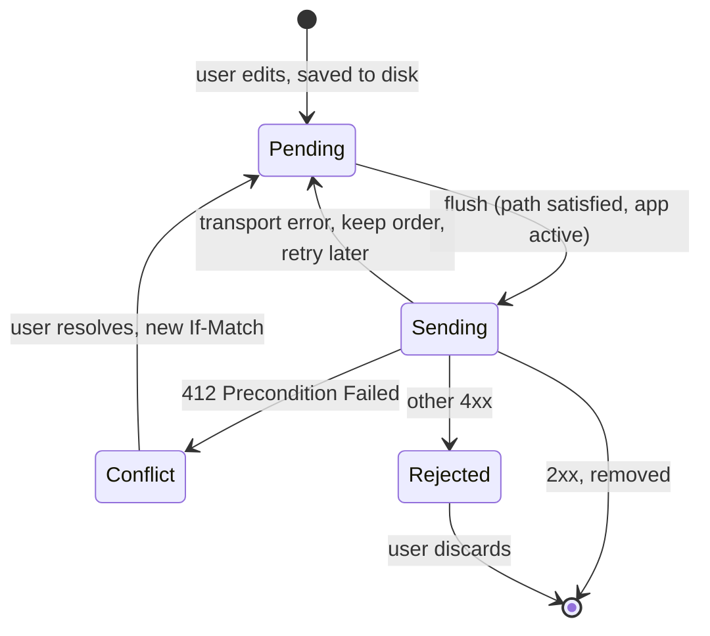

"Check whether the network is reachable before making a request" is one of the most persistent pieces of networking advice, and one of the least useful. A reachability check answers a question about the device's interfaces at one instant. The question the app needs answered is whether a particular request to a particular server will succeed in the next few seconds, and no local check can answer that. Devices report a satisfied path behind captive portals, and report an unsatisfied one for a moment while switching from Wi-Fi to cellular, after which the request would have worked.

This article treats connectivity as something to react to rather than predict. It shows what `NWPathMonitor` can and cannot tell an app, measures a surprising interaction between `waitsForConnectivity` and servers that are simply down, and builds the two pieces an offline-capable client needs: reads that show the last known data immediately, and writes that are kept in a durable outbox and sent, exactly once, when the network allows.

<!--more-->

The examples use Swift 6 language mode and were compiled and run with the Swift 6.4 toolchain from Xcode 27.1 on macOS 26. They send requests to `LocalServer`, the loopback HTTP server from the [appendix of the first article](/swift-http-methods-status-codes-headers/#appendix-the-local-server-used-in-this-series); paste that code first, then the blocks below in order, into one `main.swift`.

<!-- check-uses: local-server -->

## What a path can tell you

Network framework's `NWPathMonitor` reports the system's view of the network path: whether any interface can carry traffic, which interfaces exist, and their properties. Since iOS 17 and macOS 14 it is an `AsyncSequence` of `NWPath` values, so observing it is a loop:

```swift
import Foundation
import Network
import Synchronization

let monitor = NWPathMonitor()
var firstPath: NWPath?
for await path in monitor {
    firstPath = path
    break
}
let path = firstPath!
print(path.status, path.availableInterfaces.map(\.type), "expensive:", path.isExpensive,
      "constrained:", path.isConstrained, "quality:", path.linkQuality)
assert(path.status == .satisfied)
```

On the Mac used for this article, the first path arrived in under a millisecond: `satisfied`, over Wi-Fi, not expensive, not constrained, and with a `linkQuality` of `.good`. The properties are worth knowing:

| Property | Meaning | Use it for |
|---|---|---|
| `status` | `.satisfied`, `.unsatisfied`, or `.requiresConnection` (e.g. on-demand VPN) | UI hints, triggering a retry when it becomes satisfied |
| `isExpensive` | Cellular or a personal hotspot | Deferring large optional downloads |
| `isConstrained` | Low Data Mode is on | Skipping prefetching, lowering image quality |
| `linkQuality` (iOS 26, macOS 26) | `.minimal`, `.moderate`, `.good`, or `.unknown` | Choosing a lighter payload or fewer concurrent requests |
| `unsatisfiedReason` | Why the path is down, e.g. cellular denied for the app | Telling the user what to change |

What a path cannot tell you is just as important. A satisfied path means a packet can leave the device. It says nothing about whether DNS resolves, whether the network is a hotel Wi-Fi that redirects everything to a login page, whether the server is up, or whether a firewall between the two drops the traffic. An unsatisfied path, observed during a handover, can turn satisfied a few hundred milliseconds later.

## Why preflight checks fail

A preflight check, "if the path is satisfied, send the request; otherwise show an offline error," has two failure modes. It shows "offline" during a brief unsatisfied moment when the request would have succeeded after a short wait. And it sends requests that fail anyway, because a satisfied path does not imply a reachable server. Both come from the gap between the check and the use, the classic time-of-check-to-time-of-use problem.

The size of the gap matters less than one might expect. If connectivity changes are modeled as a Poisson process with rate $$\mu$$, the probability that the state changes between a check and a request sent $$\Delta t$$ later is $$1 - e^{-\mu \Delta t}$$, which is small for a request sent immediately. The real problem is that the check measures the wrong thing even when nothing changes. The only reliable test of whether a request will succeed is to send it.

So the guidance reverses: send the request, and use the path monitor for two things it is good at. One is **explaining** a failure: if a request fails with a transport error and the path is unsatisfied, "You're offline" is accurate; if the path is satisfied, "Couldn't reach the library" is. The other is **timing** a retry: when the path becomes satisfied, it is a good moment to flush pending work.

## `waitsForConnectivity` waits for more than connectivity

`URLSessionConfiguration.waitsForConnectivity` makes a task wait for a usable network instead of failing at once with `notConnectedToInternet`. When it waits, the delegate's `urlSession(_:taskIsWaitingForConnectivity:)` is called, once, which is the place to show "Waiting for network." The task then starts when connectivity appears, or fails when the **resource** timeout expires.

The question is what counts as "no connectivity." The test below points a waiting session at two things that are not network outages: a port with nothing listening, and a host name that does not exist. Without waiting, the first fails in about 30 ms and the second in about 100 ms, as measured in [Separating Transport Errors from Application Failures](/swift-transport-vs-application-errors/):

```swift
final class WaitingObserver: NSObject, URLSessionTaskDelegate, Sendable {
    let waits = Mutex(0)
    func urlSession(_ session: URLSession, taskIsWaitingForConnectivity task: URLSessionTask) {
        waits.withLock { $0 += 1 }
    }
}

let gone = try await LocalServer.start { _ in .text("") }
let refusedURL = gone.baseURL
gone.stop()
try await Task.sleep(for: .milliseconds(100))

let waitingConfiguration = URLSessionConfiguration.ephemeral
waitingConfiguration.waitsForConnectivity = true
waitingConfiguration.timeoutIntervalForResource = 3
let observer = WaitingObserver()
let waitingSession = URLSession(configuration: waitingConfiguration, delegate: observer, delegateQueue: nil)

func elapsedFailure(_ url: URL) async -> (URLError.Code?, Duration) {
    let start = ContinuousClock.now
    do {
        _ = try await waitingSession.data(from: url)
        return (nil, ContinuousClock.now - start)
    } catch {
        return ((error as? URLError)?.code, ContinuousClock.now - start)
    }
}

let (refusedCode, refusedTime) = await elapsedFailure(refusedURL)
let (dnsCode, dnsTime) = await elapsedFailure(URL(string: "https://library.invalid/books")!)
print("refused: \(refusedCode as Any) after \(refusedTime); unknown host: \(dnsCode as Any) after \(dnsTime)")
assert(refusedCode == .timedOut && refusedTime > .seconds(3))
assert(dnsCode == .timedOut && dnsTime > .seconds(3))
assert(observer.waits.withLock { $0 } == 2)
waitingSession.invalidateAndCancel()
```

Both requests waited for "connectivity" until the three-second resource timeout, between 3.3 and 4.0 seconds across runs, and failed with `timedOut` instead of the specific error. The delegate was told each time that the task was waiting. With the default resource timeout of seven days, a waiting task pointed at a server that is down never fails within the life of the screen that started it.

Two rules follow. Never enable `waitsForConnectivity` without also setting `timeoutIntervalForResource` to the longest time anyone will wait for that request. And use it for requests whose purpose survives a wait, such as syncing an outbox or downloading content for later, not for requests a user is staring at. For the latter, fail fast and say why.

## Reads: show what you have, then refresh

An offline-capable screen shows the last known data immediately and replaces it when fresh data arrives. Expressed as a stream of states, the screen's model consumes a sequence like *cached → fresh* when online, and *cached → failed (with cached data still shown)* when offline:

```swift
let online = Mutex(true)
let server = try await LocalServer.start { request in
    guard online.withLock({ $0 }) else { return .drop }  // stands in for an unreachable network
    return .json(#"{"title":"Dune","copies":\#(Int.random(in: 1...9))}"#, headers: [("Cache-Control", "max-age=0"), ("ETag", #""v1""#)])
}

enum Loaded<Value: Sendable>: Sendable {
    case cached(Value)
    case fresh(Value)
    case failed(cached: Value?, error: URLError.Code)
}

func cacheThenNetwork(_ url: URL, session: URLSession) -> AsyncStream<Loaded<Data>> {
    AsyncStream { continuation in
        let task = Task {
            var cachedRequest = URLRequest(url: url)
            cachedRequest.cachePolicy = .returnCacheDataDontLoad
            let cached = try? await session.data(for: cachedRequest).0
            if let cached { continuation.yield(.cached(cached)) }
            do {
                var refresh = URLRequest(url: url)
                refresh.cachePolicy = .reloadIgnoringLocalCacheData
                continuation.yield(.fresh(try await session.data(for: refresh).0))
            } catch let error as URLError {
                continuation.yield(.failed(cached: cached, error: error.code))
            } catch {}
            continuation.finish()
        }
        continuation.onTermination = { _ in task.cancel() }
    }
}

let readConfiguration = URLSessionConfiguration.default
readConfiguration.urlCache = URLCache(memoryCapacity: 2_000_000, diskCapacity: 0)
let readSession = URLSession(configuration: readConfiguration)
let bookURL = server.baseURL.appending(path: "books/b-7")

var onlineStates: [String] = []
for await state in cacheThenNetwork(bookURL, session: readSession) {
    switch state {
    case .cached: onlineStates.append("cached")
    case .fresh: onlineStates.append("fresh")
    case .failed: onlineStates.append("failed")
    }
}
assert(onlineStates == ["fresh"])  // nothing cached on the first visit

online.withLock { $0 = false }
var offlineStates: [String] = []
var shownWhileOffline: Data?
for await state in cacheThenNetwork(bookURL, session: readSession) {
    switch state {
    case .cached(let data): offlineStates.append("cached"); shownWhileOffline = data
    case .fresh: offlineStates.append("fresh")
    case .failed(let cached, let code): offlineStates.append("failed \(code.rawValue) cached:\(cached != nil)")
    }
}
assert(offlineStates == ["cached", "failed -1005 cached:true"])
assert(shownWhileOffline != nil)
online.withLock { $0 = true }
```

The second visit, made while the server was unreachable, showed the cached book first and then reported the failure while keeping it on screen. The response had `max-age=0`, so it was stale the moment it was stored, and `.returnCacheDataDontLoad` used it anyway, which is exactly the trade an offline screen wants: old data, clearly labeled, beats no data. [HTTP Caching with `Cache-Control` and `ETag`](/swift-http-caching-etag/) covers the cache policies in detail; a production version would also keep a timestamp so the screen can say "Updated 3 hours ago."

The test's "offline" is a server that drops connections, which produces `networkConnectionLost`. On a device without connectivity the code would be `notConnectedToInternet`; the stream handles both the same way.

## Writes: a durable outbox

Writes cannot be shown from a cache. An offline-capable app must keep the user's change, show it as pending, and send it later. The structure for that is an **outbox**: a persistent, ordered queue of pending writes, each carrying everything needed to send it again correctly:

- an **idempotency key**, created when the user acted, so a write whose response was lost is not applied twice ([Retry Policies, Backoff, and Idempotency](/swift-retry-backoff-idempotency/));
- the **version** the user edited, sent as `If-Match`, so a write made against stale data is detected rather than silently overwriting someone else's change;
- its own **state**, so a conflict or a permanent rejection is shown to the user instead of retried forever.



The server below stores one book with a version number. It honors `If-Match`, answers `412 Precondition Failed` when the version has moved on, and replays recorded results for idempotency keys it has already seen:

```swift
final class LibraryBackend: Sendable {
    struct State {
        var title = "Dune"
        var version = 1
        var applied: [String: String] = [:]  // idempotency key -> response body
        var writes = 0
    }
    let state = Mutex(State())

    func handle(_ request: HTTPRequest) -> HTTPResponse {
        state.withLock { state in
            let etag = #""v\#(state.version)""#
            switch request.method {
            case "GET":
                return .json(#"{"title":"\#(state.title)"}"#, headers: [("ETag", etag)])
            case "PUT":
                if let key = request.header("Idempotency-Key"), let body = state.applied[key] {
                    return .json(body)
                }
                guard request.header("If-Match") == etag else {
                    return .json(#"{"error":"stale version"}"#, status: 412, headers: [("ETag", etag)])
                }
                state.title = (try? JSONDecoder().decode([String: String].self, from: request.body))?["title"] ?? state.title
                state.version += 1
                state.writes += 1
                let body = #"{"title":"\#(state.title)","version":\#(state.version)}"#
                if let key = request.header("Idempotency-Key") { state.applied[key] = body }
                return .json(body, headers: [("ETag", #""v\#(state.version)""#)])
            default:
                return .text("method not allowed", status: 405)
            }
        }
    }
}
```

The outbox is an actor that persists its items to a JSON file after every change, so a pending write survives the app being terminated. Flushing sends items in order, stops at the first transport failure so later writes cannot overtake earlier ones, and moves items that the server rejected out of the queue:

```swift
struct PendingWrite: Codable, Equatable, Sendable {
    enum Status: String, Codable, Sendable { case pending, conflict, rejected }
    let key: String          // idempotency key, created once
    let path: String
    let body: Data
    let ifMatch: String
    var status: Status = .pending
    var attempts = 0
}

actor Outbox {
    private(set) var items: [PendingWrite] = []
    let file: URL

    init(file: URL) {
        self.file = file
        items = (try? JSONDecoder().decode([PendingWrite].self, from: Data(contentsOf: file))) ?? []
    }

    func enqueue(path: String, body: Data, ifMatch: String) throws {
        items.append(PendingWrite(key: UUID().uuidString, path: path, body: body, ifMatch: ifMatch))
        try persist()
    }

    /// Sends pending writes in order. Returns the number sent successfully.
    func flush(to baseURL: URL, session: URLSession) async throws -> Int {
        var sent = 0
        var index = 0
        while index < items.count {
            guard items[index].status == .pending else { index += 1; continue }
            var request = URLRequest(url: baseURL.appending(path: items[index].path))
            request.httpMethod = "PUT"
            request.httpBody = items[index].body
            request.setValue("application/json", forHTTPHeaderField: "Content-Type")
            request.setValue(items[index].key, forHTTPHeaderField: "Idempotency-Key")
            request.setValue(items[index].ifMatch, forHTTPHeaderField: "If-Match")
            items[index].attempts += 1
            let status: Int
            do {
                status = (try await session.data(for: request).1 as! HTTPURLResponse).statusCode
            } catch is URLError {
                try persist()
                return sent  // keep order: stop at the first transport failure
            }
            switch status {
            case 200..<300: items.remove(at: index); sent += 1
            case 412: items[index].status = .conflict; index += 1
            default: items[index].status = .rejected; index += 1
            }
            try persist()
        }
        return sent
    }

    private func persist() throws {
        try JSONEncoder().encode(items).write(to: file, options: .atomic)
    }
}
```

The test edits the title twice while the server is unreachable, restarts the outbox from its file as if the app had been terminated, and flushes when the server is back. A third edit was made against an old version to produce a conflict:

```swift
let backend = LibraryBackend()
let backendOnline = Mutex(false)
let library = try await LocalServer.start { request in
    backendOnline.withLock { $0 } ? backend.handle(request) : .drop
}
let outboxFile = FileManager.default.temporaryDirectory.appending(path: "outbox-\(UUID().uuidString).json")
let syncSession = URLSession(configuration: .ephemeral)

let outbox = Outbox(file: outboxFile)
try await outbox.enqueue(path: "books/b-7", body: Data(#"{"title":"Dune Messiah"}"#.utf8), ifMatch: #""v1""#)
let offlineSent = try await outbox.flush(to: library.baseURL, session: syncSession)
assert(offlineSent == 0)
let attemptsWhileOffline = await outbox.items.first?.attempts
assert(attemptsWhileOffline == 1)

// The app is terminated and relaunched: the outbox is restored from disk.
let restored = Outbox(file: outboxFile)
let restoredCount = await restored.items.count
assert(restoredCount == 1)
try await restored.enqueue(path: "books/b-7", body: Data(#"{"title":"Children of Dune"}"#.utf8), ifMatch: #""v2""#)
try await restored.enqueue(path: "books/b-7", body: Data(#"{"title":"Stale edit"}"#.utf8), ifMatch: #""v1""#)

backendOnline.withLock { $0 = true }  // in an app: the path became satisfied, or the app came to the foreground
let flushed = try await restored.flush(to: library.baseURL, session: syncSession)
assert(flushed == 2)
let remaining = await restored.items
assert(remaining.map(\.status) == [.conflict])           // the stale edit is waiting for the user
assert(backend.state.withLock { ($0.title, $0.version, $0.writes) } == ("Children of Dune", 3, 2))

// Flushing again, e.g. after a lost response, sends nothing twice.
let again = try await restored.flush(to: library.baseURL, session: syncSession)
assert(again == 0 && backend.state.withLock { $0.writes } == 2)
try? FileManager.default.removeItem(at: outboxFile)
```

The first edit was attempted while offline, survived the restart, and was applied in order before the second. The stale third edit was not applied: the server answered `412`, and the outbox kept it as a conflict for the user to resolve, because "the last writer wins" would have replaced *Children of Dune* with a title based on a version of the book that no longer exists. The second edit's `If-Match` of `"v2"` assumed the first edit would succeed; an outbox that queues several edits to the same resource has to make that assumption, and a conflict is how it learns the assumption failed.

## Telling the user the truth

The point of all this is a UI that never lies about state:

- Show pending writes as pending ("Saved on this device"), not as done, and as done only after the server confirmed them.
- Show conflicts as decisions the user must make, with both versions, not as errors.
- Say *why* something is unavailable when you know: "You're offline," "Low Data Mode is on," "Couldn't reach the library." The path monitor's `status` and `isConstrained`, and `URLError.networkUnavailableReason`, are what make those messages accurate.
- Do not block the UI on connectivity. Reading cached data and queueing writes keeps the app useful on a train, and a satisfied path is merely a good moment to flush, not a precondition for doing anything.

The outbox belongs to one signed-in user. [Handling Logout During an In-Flight Request](/swift-logout-in-flight-requests/) explains why it must be deleted, or set aside, at logout, and never flushed with another user's credentials.

## Summary

- `NWPathMonitor` is an `AsyncSequence` (iOS 17+) reporting status, interfaces, `isExpensive`, `isConstrained`, and, since iOS 26, `linkQuality`. It says whether packets can leave the device, not whether a server is reachable.
- Do not preflight requests. Send them, use the path to explain failures, and use path changes to time retries.
- Measured: with `waitsForConnectivity`, a refused connection and an unknown host both waited until the resource timeout instead of failing in milliseconds. Always set `timeoutIntervalForResource`, and keep waiting for work whose purpose survives a wait.
- Reads: show cached data at once with `.returnCacheDataDontLoad`, then refresh, keeping the cached data on screen if the refresh fails.
- Writes: a durable outbox with idempotency keys and `If-Match` versions, flushed in order, stopping at transport failures, and surfacing `412` conflicts to the user.

## Exercise

Connect the outbox to `NWPathMonitor`: write an actor that iterates the monitor, and flushes the outbox when the path changes from unsatisfied to satisfied, with a short delay and at most one flush at a time. Test it by injecting a sequence of fake paths, since a test cannot toggle the real network. Then add coalescing to `enqueue`: when two pending writes target the same resource and neither has been attempted, merge them into one, and verify with the backend's `writes` counter that the merged version produces one write instead of two.

## Further reading

- Apple's [`NWPathMonitor`](https://developer.apple.com/documentation/network/nwpathmonitor) and [`waitsForConnectivity`](https://developer.apple.com/documentation/foundation/urlsessionconfiguration/waitsforconnectivity) documentation.
- [Introducing Network.framework: A modern alternative to Sockets](https://developer.apple.com/videos/play/wwdc2018/715/), WWDC18, which introduced path monitoring and explains why preflight reachability checks are discouraged.
- Martin Kleppmann et al., [*Local-First Software*](https://www.inkandswitch.com/local-first/), on designing apps that work offline by default.

Previous: [HTTP Caching with `Cache-Control` and `ETag`](/swift-http-caching-etag/). Next: [Coalescing Duplicate Requests and Rejecting Stale Results](/swift-request-coalescing/).

Return to the [Networking roadmap](/swift-networking/).
