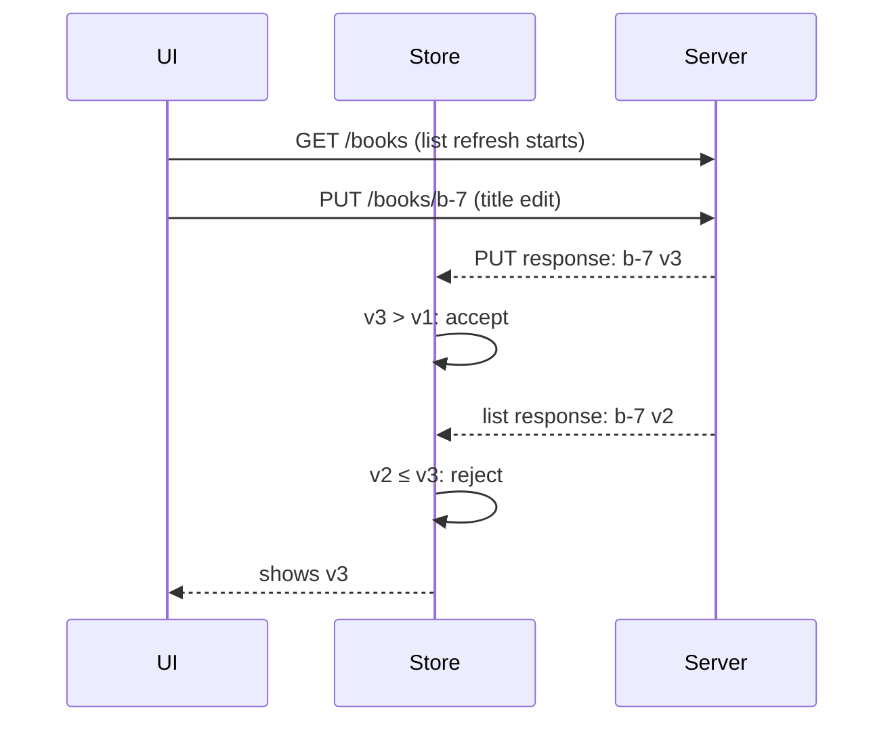

Apps send the same request many times without meaning to. Thirty table cells each ask for the same author's avatar. A detail screen and its header both load the current user. A prefetch threshold is crossed five times during one fling. A pull-to-refresh fires while the screen's initial load is still running. Each of those requests is correct in isolation, and together they multiply load on the server, burn the user's data, and compete with each other for the six connections a host gets.

The opposite problem arrives with the responses. Requests that overlap can complete in any order, so the response to an old search can land after the response to the current one, and an entity fetched before an edit can overwrite the edited version. This article solves both: a **coalescer** that turns concurrent identical requests into one network fetch while letting each caller cancel independently, and two ways of **rejecting stale results**, by request generation and by entity version. Along the way it derives how many fetches coalescing saves and checks the formula against a measurement.

<!--more-->

The examples use Swift 6 language mode and were compiled and run with the Swift 6.4 toolchain from Xcode 27.1 on macOS 26. They send requests to `LocalServer`, the loopback HTTP server from the [appendix of the first article](/swift-http-methods-status-codes-headers/#appendix-the-local-server-used-in-this-series); paste that code first, then the blocks below in order, into one `main.swift`. The concurrency roadmap's [Rejecting Stale Results After Request Replacement](/swift-rejecting-stale-results/) covers the language-level side of the second half.

<!-- check-uses: local-server -->

## When two requests are the same request

Coalescing is safe only for requests that are interchangeable: sending one and giving its response to every caller must be indistinguishable from sending each. That rules out everything except safe methods, `GET` and `HEAD`, and it means the key must include everything that can change the response:

| Part of the key | Why |
|---|---|
| Method | Only `GET` and `HEAD` are coalesced |
| URL, normalized | Sorted query items, lowercased host ([URLs, Query Parameters, and Percent Encoding](/swift-urls-query-percent-encoding/)) |
| The caller's identity | Alice's `/me` is not Bob's `/me`; never share a response across credentials |
| `Accept`, `Accept-Language`, and any header the server varies on | Different representations of the same URL |

The identity part is the one that is easy to forget and dangerous to get wrong: a coalescer keyed only by URL leaks one user's response to another in exactly the way [Handling Logout During an In-Flight Request](/swift-logout-in-flight-requests/) showed `URLCache` doing.

## A coalescer with independent cancellation

The simplest coalescer stores an in-flight `Task` per key and lets every caller `await` its value. That has the cancellation flaw identified in [Refreshing Credentials Without Duplicate Requests](/swift-token-refresh/): awaiting a `Task`'s value does not respond to the *waiter's* cancellation, so a screen that is dismissed keeps waiting, and the shared request can never be cancelled even when every waiter is gone.

The version below gives each waiter its own continuation. The shared fetch resumes all of them when it finishes. A waiter that is cancelled resumes its own continuation immediately with `CancellationError` and leaves, and the last waiter to leave cancels the fetch:

```swift
import Foundation
import Synchronization

actor RequestCoalescer {
    struct Key: Hashable, Sendable {
        let method: String
        let url: String
        let identity: String
        let accept: String
    }

    private final class Entry {
        var fetch: Task<Void, Never>?
        var waiters: [UUID: CheckedContinuation<(Data, HTTPURLResponse), any Error>] = [:]
    }

    private var entries: [Key: Entry] = [:]
    private let session: URLSession
    private(set) var fetches = 0
    private(set) var joins = 0
    private(set) var abandonedFetches = 0

    init(session: URLSession) { self.session = session }

    func data(for request: URLRequest, identity: String) async throws -> (Data, HTTPURLResponse) {
        let method = request.httpMethod ?? "GET"
        guard method == "GET" || method == "HEAD" else { return try await fetch(request) }
        let key = Key(method: method, url: Self.normalized(request.url), identity: identity,
                      accept: request.value(forHTTPHeaderField: "Accept") ?? "")
        let id = UUID()
        return try await withTaskCancellationHandler {
            try await withCheckedThrowingContinuation { continuation in
                guard !Task.isCancelled else { return continuation.resume(throwing: CancellationError()) }
                if let entry = entries[key] {
                    entry.waiters[id] = continuation
                    joins += 1
                } else {
                    let entry = Entry()
                    entry.waiters[id] = continuation
                    entries[key] = entry
                    fetches += 1
                    entry.fetch = Task { await self.complete(entry, key: key, request: request) }
                }
            }
        } onCancel: {
            Task { await self.leave(id, key: key) }
        }
    }

    private func complete(_ entry: Entry, key: Key, request: URLRequest) async {
        let result: Result<(Data, HTTPURLResponse), any Error>
        do { result = .success(try await fetch(request)) } catch { result = .failure(error) }
        if entries[key] === entry { entries[key] = nil }  // later callers start a new fetch
        for waiter in entry.waiters.values { waiter.resume(with: result) }
        entry.waiters.removeAll()
    }

    private func leave(_ id: UUID, key: Key) {
        guard let entry = entries[key], let waiter = entry.waiters.removeValue(forKey: id) else { return }
        waiter.resume(throwing: CancellationError())
        if entry.waiters.isEmpty {
            entry.fetch?.cancel()  // nobody is waiting any more
            entries[key] = nil
            abandonedFetches += 1
        }
    }

    private func fetch(_ request: URLRequest) async throws -> (Data, HTTPURLResponse) {
        let (data, response) = try await session.data(for: request)
        return (data, response as! HTTPURLResponse)
    }

    static func normalized(_ url: URL?) -> String {
        guard let url, var components = URLComponents(url: url, resolvingAgainstBaseURL: false) else { return "" }
        components.host = components.host?.lowercased()
        components.queryItems = components.queryItems?.sorted { ($0.name, $0.value ?? "") < ($1.name, $1.value ?? "") }
        if components.queryItems?.isEmpty == true { components.queryItems = nil }
        return components.string ?? url.absoluteString
    }
}
```

A few points about the design, each of which closes a specific hole:

- **Registration happens on the actor, synchronously.** The continuation closure runs on the actor, so the check for an existing entry and the insertion of a new one cannot interleave with another caller. The cancellation handler, which runs synchronously wherever the cancel came from, can only *schedule* `leave`, and `leave` runs after registration has finished.
- **The entry is removed when the fetch completes**, before resuming waiters. A caller that arrives a moment later starts a fresh fetch. The coalescer deduplicates concurrent requests; it is not a cache, and it never serves a completed response to a new caller. Errors are shared with the waiters of that fetch, and are not remembered.
- **Identity checks with `===`.** If an entry was abandoned and a new one created for the same key, a late completion of the old fetch must not delete the new entry.
- **The fetch is an unstructured task owned by the coalescer**, so no single waiter's cancellation cancels it. Only `leave` does, when the waiter count reaches zero.

## Fifty callers, one request

The server below counts requests and takes 200 ms to answer. Fifty concurrent callers ask for the same author:

```swift
let server = try await LocalServer.start { request in
    switch request.path {
    case "/authors/a-1", "/me":
        let user = request.header("Authorization") ?? "anonymous"
        return HTTPResponse(status: 200, headers: [("Content-Type", "application/json")],
                            body: [.bytes(Data(#"{"for":"\#(user)","n":\#(Int.random(in: 0..<1_000_000))}"#.utf8))],
                            delay: .milliseconds(200))
    case "/failing":
        return HTTPResponse(status: 503, delay: .milliseconds(100))
    case "/search":
        let delay = Int(request.query["delay"] ?? "0") ?? 0
        return HTTPResponse(status: 200, headers: [("Content-Type", "application/json")],
                            body: [.bytes(Data(#"["\#(request.query["q"] ?? "")"]"#.utf8))], delay: .milliseconds(delay))
    default:
        return .text("not found", status: 404)
    }
}

let coalescer = RequestCoalescer(session: URLSession(configuration: .ephemeral))
let authorURL = server.baseURL.appending(path: "authors/a-1")

let bodies = try await withThrowingTaskGroup(of: Data.self) { group in
    for _ in 0..<50 {
        group.addTask { try await coalescer.data(for: URLRequest(url: authorURL), identity: "alice").0 }
    }
    var collected: [Data] = []
    for try await body in group { collected.append(body) }
    return collected
}

assert(server.requests.filter { $0.path == "/authors/a-1" }.count == 1)
assert(Set(bodies).count == 1 && bodies.count == 50)   // every caller got the same response
let (fetchCount, joinCount) = (await coalescer.fetches, await coalescer.joins)
assert(fetchCount == 1 && joinCount == 49)
```

One request reached the server, and all fifty callers received the same body. Without the coalescer, `URLSession` would have queued 50 requests behind its per-host connection limit, and the last caller would have waited about $$\lceil 50/6 \rceil \times 200$$ ms, nearly two seconds, for the same bytes.

Identity is part of the key, so different users never share a fetch, even for the same URL at the same moment:

```swift
func me(_ user: String) -> URLRequest {
    var request = URLRequest(url: server.baseURL.appending(path: "me"))
    request.setValue("Bearer \(user)", forHTTPHeaderField: "Authorization")
    return request
}
async let alice = coalescer.data(for: me("alice"), identity: "alice")
async let bob = coalescer.data(for: me("bob"), identity: "bob")
let (aliceMe, bobMe) = try await (alice.0, bob.0)
assert(String(decoding: aliceMe, as: UTF8.self).contains("Bearer alice"))
assert(String(decoding: bobMe, as: UTF8.self).contains("Bearer bob"))
```

### Cancelling one caller, then all of them

Ten callers wait for the same fetch. One is cancelled 50 ms in, which must not affect the other nine. Then a separate group of callers is cancelled entirely, which must cancel the network request:

```swift
let waiters = (0..<10).map { _ in
    Task { try await coalescer.data(for: URLRequest(url: authorURL), identity: "carol") }
}
try await Task.sleep(for: .milliseconds(50))
let cancelStart = ContinuousClock.now
waiters[0].cancel()

let cancelledResult = await waiters[0].result
let timeToLeave = ContinuousClock.now - cancelStart
if case .failure(let error) = cancelledResult { assert(error is CancellationError) } else { assertionFailure() }
assert(timeToLeave < .milliseconds(50))  // left immediately, not after the 200 ms fetch
var survivors = 0
for waiter in waiters.dropFirst() where (try? await waiter.value) != nil { survivors += 1 }
assert(survivors == 9)

let abandoned = (0..<5).map { _ in
    Task { try await coalescer.data(for: URLRequest(url: authorURL), identity: "dave") }
}
try await Task.sleep(for: .milliseconds(50))
for task in abandoned { task.cancel() }
for task in abandoned { _ = await task.result }
let abandonedCount = await coalescer.abandonedFetches
assert(abandonedCount == 1)  // the last waiter to leave cancelled the shared fetch
```

The cancelled waiter returned at once, and the other nine received their response when it arrived. When all five of the second group were cancelled, the coalescer cancelled the fetch itself, so the connection was released instead of downloading a response nobody would read.

Errors are shared too, and are not remembered, so the next request after a failure tries again:

```swift
let failingURL = server.baseURL.appending(path: "failing")
async let firstFailure = coalescer.data(for: URLRequest(url: failingURL), identity: "alice")
async let secondFailure = coalescer.data(for: URLRequest(url: failingURL), identity: "alice")
let statuses = try await [firstFailure.1.statusCode, secondFailure.1.statusCode]
assert(statuses == [503, 503] && server.requests.filter { $0.path == "/failing" }.count == 1)
_ = try await coalescer.data(for: URLRequest(url: failingURL), identity: "alice")
assert(server.requests.filter { $0.path == "/failing" }.count == 2)  // a new fetch after completion
```

A `503` is a response, so both callers received it as one, and the retry policy from [Retry Policies, Backoff, and Idempotency](/swift-retry-backoff-idempotency/) decides what happens next. Put retries *inside* the coalesced fetch, not around it, so that fifty callers retrying do not become fifty retries.

## How much coalescing saves

Suppose requests for one key arrive as a Poisson process with rate $$\lambda$$, and each fetch takes $$W$$. A fetch starts with the first request that finds no fetch in flight and absorbs every request that arrives during its $$W$$. After it completes, the next fetch starts with the next arrival, which takes on average $$1/\lambda$$. Each cycle therefore lasts $$W + 1/\lambda$$ on average and contains exactly one fetch, so the rate of network fetches is:

$$
\lambda_{\text{fetch}} = \frac{1}{W + 1/\lambda} = \frac{\lambda}{1 + \lambda W},
\qquad
\frac{\lambda_{\text{fetch}}}{\lambda} = \frac{1}{1 + \lambda W}
$$

The product $$\lambda W$$ is the number of requests that would be in flight without coalescing, by Little's law. When it is small, coalescing saves little, because duplicates rarely overlap. When it is large, as for an avatar shown in 30 visible cells, it removes almost all of them. The simulation below sends Poisson arrivals at 40 per second for two seconds to a route that takes 200 ms, so $$\lambda W = 8$$ and the formula predicts that one request in nine reaches the server:

```swift
func poissonArrivals(rate: Double, duration: Double) -> [Double] {
    var times: [Double] = []
    var t = 0.0
    while true {
        t += -log(Double.random(in: Double.ulpOfOne..<1)) / rate
        if t >= duration { return times }
        times.append(t)
    }
}

let arrivals = poissonArrivals(rate: 40, duration: 2)
let rateCoalescer = RequestCoalescer(session: URLSession(configuration: .ephemeral))
let rateURL = server.baseURL.appending(path: "authors/a-1")
let beforeRate = server.requests.count
let rateStart = ContinuousClock.now
try await withThrowingTaskGroup(of: Void.self) { group in
    for time in arrivals {
        group.addTask {
            try await Task.sleep(until: rateStart + .milliseconds(Int(time * 1000)))
            _ = try await rateCoalescer.data(for: URLRequest(url: rateURL), identity: "erin")
        }
    }
    try await group.waitForAll()
}
let networkFetches = server.requests.count - beforeRate
let predicted = Double(arrivals.count) / (1 + 40 * 0.2)
print("\(arrivals.count) requests, \(networkFetches) fetches, predicted \(predicted)")
assert(Double(networkFetches) > predicted * 0.6 && Double(networkFetches) < predicted * 1.5)
```

Seven runs of this simulation sent between 65 and 91 requests and made 7 or 8 network fetches, against predictions of 7.2 to 10.1. The measured counts sit at or slightly below the prediction for two reasons: the real round trip is a little longer than the server's 200 ms delay, and a longer $$W$$ means fewer, larger cycles; and a two-second window holds only about nine cycles, so the last one is often cut short. Either way, about nine in ten requests never reached the server.

## Rejecting stale results

Coalescing removes duplicates of the *same* request. Stale results come from *different* requests whose responses arrive out of order. There are two kinds, and they need different defenses.

### Superseded requests: generations

A search field sends a request for every pause in typing. The request for `"du"` is slow, the request for `"dune"` is fast, and the slow one finishes last. A model that assigns whatever arrives shows the results for the query the user no longer has:

```swift
@MainActor
final class SearchModel {
    private(set) var results: [String] = []
    private var generation = 0

    func searchNaively(_ query: String, delay: Int) async throws {
        results = try await fetchSearch(query, delay: delay)
    }

    func search(_ query: String, delay: Int) async throws {
        generation += 1
        let mine = generation
        let found = try await fetchSearch(query, delay: delay)
        guard mine == generation else { return }  // a newer search started while this one ran
        results = found
    }

    private func fetchSearch(_ query: String, delay: Int) async throws -> [String] {
        var components = URLComponents(url: server.baseURL.appending(path: "search"), resolvingAgainstBaseURL: false)!
        components.queryItems = [URLQueryItem(name: "q", value: query), URLQueryItem(name: "delay", value: "\(delay)")]
        let (data, _) = try await URLSession.shared.data(from: components.url!)
        return try JSONDecoder().decode([String].self, from: data)
    }
}

let naiveSearch = SearchModel()
async let slowNaive: Void = naiveSearch.searchNaively("du", delay: 300)
try await Task.sleep(for: .milliseconds(20))
async let fastNaive: Void = naiveSearch.searchNaively("dune", delay: 20)
_ = try await (slowNaive, fastNaive)
assert(naiveSearch.results == ["du"])     // the stale response won

let guardedSearch = SearchModel()
async let slow: Void = guardedSearch.search("du", delay: 300)
try await Task.sleep(for: .milliseconds(20))
async let fast: Void = guardedSearch.search("dune", delay: 20)
_ = try await (slow, fast)
assert(guardedSearch.results == ["dune"]) // the generation check discarded "du"
```

The generation counter records which request is current, and the check after `await` discards any response that is not. It complements cancellation rather than replacing it: [Timeouts, Cancellation, and Request Lifetimes](/swift-network-timeouts-cancellation/) cancelled superseded searches to save their bandwidth, and the generation check catches the responses that complete before the cancellation takes effect.

### Out-of-order entity updates: versions

The second kind of staleness concerns one entity fetched by different paths. The user edits a book's title; the `PUT` returns version 3. Meanwhile, a list refresh that started before the edit returns the book at version 2, and arrives after the `PUT`. Neither response is superseded by request order, because they came from different requests. The defense is a version that increases with every change, typically a server-provided revision number, an `updatedAt` timestamp, or an `ETag` that encodes a revision, and a store that only moves forward:

```swift
struct BookRecord: Equatable, Sendable {
    let id: String
    let title: String
    let version: Int
}

@MainActor
final class BookStore {
    private(set) var books: [String: BookRecord] = [:]
    private(set) var rejected = 0

    /// Accepts a record only if it is newer than what the store already holds.
    func merge(_ record: BookRecord) {
        if let existing = books[record.id], existing.version >= record.version {
            rejected += 1
            return
        }
        books[record.id] = record
    }
}

let store = BookStore()
store.merge(BookRecord(id: "b-7", title: "Dune", version: 1))
store.merge(BookRecord(id: "b-7", title: "Dune (Deluxe Edition)", version: 3))  // the PUT response
store.merge(BookRecord(id: "b-7", title: "Dune", version: 2))                    // the late list refresh
assert(store.books["b-7"]?.title == "Dune (Deluxe Edition)")
assert(store.rejected == 1)
```

The rule is a **monotonic merge**: a record replaces the stored one only if its version is greater. It makes the store's state independent of the order in which responses arrive, which is the only property that survives real networks. It needs the server to provide a version that orders all changes to an entity. A client-side timestamp does not work, because it orders requests, not changes.



## Summary

- Coalesce only `GET` and `HEAD`, keyed by method, normalized URL, the caller's identity, and the headers the server varies on.
- Give each waiter its own continuation so a cancelled caller leaves at once, and cancel the shared fetch when the last waiter leaves. Remove the entry when the fetch completes; a coalescer is not a cache.
- Measured: 50 concurrent callers produced one request; one cancelled waiter left immediately while nine others completed; abandoning all waiters cancelled the fetch.
- With Poisson arrivals at rate $$\lambda$$ and fetch time $$W$$, coalescing reduces fetches to $$\lambda/(1+\lambda W)$$; at $$\lambda W = 8$$, about one request in nine reached the server.
- Reject superseded responses with a generation check after `await`, alongside cancellation.
- Reject out-of-order entity updates with a monotonic merge on a server-provided version.

## Exercise

Add the coalescer as a transport decorator in front of the retry policy, and write a test in which 20 callers request a resource whose first fetch fails with `503` and whose retry succeeds. Assert that the server sees exactly two requests and that all 20 callers receive the successful response. Then add a `maxAge` option that lets the coalescer serve a just-completed response to callers that arrive within, say, 100 ms after completion, measure how many extra fetches it saves in the Poisson simulation, and explain in a comment why this turns the coalescer into a cache with all the invalidation questions of [HTTP Caching](/swift-http-caching-etag/).

## Further reading

- The Go [`singleflight`](https://pkg.go.dev/golang.org/x/sync/singleflight) package, a widely used implementation of the same idea.
- [SE-0300: Continuations for interfacing async tasks with synchronous code](https://github.com/swiftlang/swift-evolution/blob/main/proposals/0300-continuation.md), and the concurrency roadmap's [Continuation Ownership, Cancellation, and Double Resume](/swift-continuation-ownership/).
- Martin Kleppmann, *Designing Data-Intensive Applications*, chapter 5, on ordering and versioning concurrent writes.

Previous: [Offline Behavior and Reachability Assumptions](/swift-offline-reachability/). Next: [Uploading Files and Multipart Form Data](/swift-multipart-uploads/).

Return to the [Networking roadmap](/swift-networking/).
