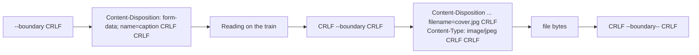

Uploading a file looks like a request with a large body, and for small files that is all it is. The details start to matter as files grow and as servers ask for more than a file. A profile photo upload usually needs the image, its file name, and a caption in one request, which is what `multipart/form-data` is for. A video from the camera roll is hundreds of megabytes, and loading it into a `Data` value before sending it can get an app terminated for memory use. And a user who watches a progress bar expects it to move.

This article builds a multipart body by hand, following [RFC 7578](https://www.rfc-editor.org/rfc/rfc7578), and verifies it with a parser on the server side. It measures the memory cost of building a 100 MB body in memory against streaming it through a file, including a trap in the streaming version that makes it as expensive as the in-memory one. It reports progress from the session delegate, and it ends with when *not* to use multipart at all.

<!--more-->

The examples use Swift 6 language mode and were compiled and run with the Swift 6.4 toolchain from Xcode 27.1 on macOS 26. They send requests to `LocalServer`, the loopback HTTP server from the [appendix of the first article](/swift-http-methods-status-codes-headers/#appendix-the-local-server-used-in-this-series); paste that code first, then the blocks below in order, into one `main.swift`.

<!-- check-uses: local-server -->

## The shape of a multipart body

A `multipart/form-data` body is a sequence of **parts**, each with its own small header section and content, separated by a **boundary** string that the client chooses and announces in the request's `Content-Type`:

```text
POST /uploads HTTP/1.1
Content-Type: multipart/form-data; boundary=Boundary-5C1A...
Content-Length: 1843

--Boundary-5C1A...
Content-Disposition: form-data; name="caption"

Reading on the train
--Boundary-5C1A...
Content-Disposition: form-data; name="photo"; filename="cover.jpg"
Content-Type: image/jpeg

<binary bytes of the file>
--Boundary-5C1A...--
```

The rules are few and strict, and each one is a bug in a hand-written encoder somewhere:

- Every line break in the framing is `CRLF`, `\r\n`, never a bare `\n`.
- Each part starts with `--` followed by the boundary, then `CRLF`.
- A part's headers end with an empty line. `Content-Disposition: form-data; name="..."` is required; `filename` marks a file; `Content-Type` defaults to `text/plain` if omitted.
- The `CRLF` *before* each boundary line belongs to the delimiter, not to the preceding content. A file that ends without a newline must not gain one.
- The body ends with `--` boundary `--`.



### Choosing a boundary

The boundary must not occur inside any part's content, because the receiver would take that occurrence as the end of the part. Scanning every file for the boundary would require reading it twice, so encoders instead choose a boundary long and random enough that a collision is not a practical concern. With a boundary containing $$k$$ random bits, the chance that it appears at any given position of arbitrary content is at most $$2^{-k}$$, so over a body of $$n$$ bytes:

$$
P(\text{collision}) \;\le\; n \cdot 2^{-k}
$$

A UUID has 122 random bits. For a terabyte of uploads, $$n = 10^{12}$$, the bound is $$10^{12} \times 2^{-122} \approx 2 \times 10^{-25}$$. Random boundaries are safe; fixed ones such as `"----boundary"` are not, because they can appear in content the app does not control, including a previous multipart body uploaded as a file.

## An encoder

The encoder writes to any destination that accepts bytes, so the same code builds a body in memory or streams it into a file:

```swift
import Foundation
import CryptoKit
import Synchronization

struct MultipartForm {
    enum Part {
        case field(name: String, value: String)
        case file(name: String, filename: String, contentType: String, source: URL)
    }

    let boundary = "Boundary-\(UUID().uuidString)"
    var parts: [Part] = []

    var contentType: String { "multipart/form-data; boundary=\(boundary)" }

    /// RFC 7578 §4.2 and the HTML standard: quote names and escape ", CR and LF by percent-encoding.
    static func quoted(_ value: String) -> String {
        let escaped = value.replacing("\"", with: "%22").replacing("\r", with: "%0D").replacing("\n", with: "%0A")
        return "\"\(escaped)\""
    }

    func write(to sink: (Data) throws -> Void) throws {
        let crlf = Data("\r\n".utf8)
        for part in parts {
            try sink(Data("--\(boundary)\r\n".utf8))
            switch part {
            case .field(let name, let value):
                try sink(Data("Content-Disposition: form-data; name=\(Self.quoted(name))\r\n\r\n".utf8))
                try sink(Data(value.utf8))
            case .file(let name, let filename, let contentType, let source):
                try sink(Data(("Content-Disposition: form-data; name=\(Self.quoted(name)); filename=\(Self.quoted(filename))\r\n"
                               + "Content-Type: \(contentType)\r\n\r\n").utf8))
                let reader = try FileHandle(forReadingFrom: source)
                defer { try? reader.close() }
                while try autoreleasepool(invoking: {
                    guard let chunk = try reader.read(upToCount: 1 << 20), !chunk.isEmpty else { return false }
                    try sink(chunk)
                    return true
                }) {}
            }
            try sink(crlf)
        }
        try sink(Data("--\(boundary)--\r\n".utf8))
    }

    func data() throws -> Data {
        var body = Data()
        try write { body.append($0) }
        return body
    }

    func writeFile() throws -> URL {
        let url = FileManager.default.temporaryDirectory.appending(path: "upload-\(UUID().uuidString).multipart")
        FileManager.default.createFile(atPath: url.path, contents: nil)
        let writer = try FileHandle(forWritingTo: url)
        defer { try? writer.close() }
        try write { try writer.write(contentsOf: $0) }
        return url
    }
}
```

File names are UTF-8 inside the quotes. RFC 7578 explicitly says the `filename*` syntax from other headers is not used in `multipart/form-data`, and servers that accept form uploads from browsers expect what browsers send: raw UTF-8, with `"`, CR, and LF percent-encoded. The `autoreleasepool` around each chunk read is not decoration; the measurement below shows what happens without it.

## A server that checks the bytes

A parser on the server side splits the body at the boundary and reports each part's headers and the SHA-256 of its content, so the test can compare exact bytes, not just sizes:

```swift
struct ReceivedPart: Equatable {
    var disposition: String
    var contentType: String?
    var sha256: String
    var text: String?
}

func parseMultipart(_ body: Data, contentType: String?) -> [ReceivedPart]? {
    guard let contentType, let range = contentType.range(of: "boundary=") else { return nil }
    let boundary = String(contentType[range.upperBound...])
    let delimiter = Data("\r\n--\(boundary)".utf8)
    let framed = Data("\r\n".utf8) + body                      // the first delimiter has no leading CRLF
    var parts: [ReceivedPart] = []
    var cursor = framed.startIndex
    guard let first = framed.range(of: delimiter, in: cursor..<framed.endIndex) else { return nil }
    cursor = first.upperBound
    while true {
        if framed[cursor...].starts(with: Data("--".utf8)) { return parts }   // closing delimiter
        guard framed[cursor...].starts(with: Data("\r\n".utf8)) else { return nil }
        cursor += 2
        guard let headerEnd = framed.range(of: Data("\r\n\r\n".utf8), in: cursor..<framed.endIndex),
              let next = framed.range(of: delimiter, in: headerEnd.upperBound..<framed.endIndex) else { return nil }
        let headers = String(decoding: framed[cursor..<headerEnd.lowerBound], as: UTF8.self).components(separatedBy: "\r\n")
        let content = framed[headerEnd.upperBound..<next.lowerBound]
        let disposition = headers.first { $0.lowercased().hasPrefix("content-disposition:") } ?? ""
        let type = headers.first { $0.lowercased().hasPrefix("content-type:") }.map { String($0.dropFirst(13)).trimmingCharacters(in: .whitespaces) }
        parts.append(ReceivedPart(disposition: String(disposition.dropFirst(20)).trimmingCharacters(in: .whitespaces),
                                  contentType: type,
                                  sha256: SHA256.hash(data: content).map { String(format: "%02x", $0) }.joined(),
                                  text: content.count < 200 ? String(data: content, encoding: .utf8) : nil))
        cursor = next.upperBound
    }
}

let received = Mutex<[ReceivedPart]>([])
let server = try await LocalServer.start { request in
    guard request.path == "/uploads", let parts = parseMultipart(request.body, contentType: request.header("Content-Type")) else {
        return .text("malformed multipart body", status: 400)
    }
    received.withLock { $0 = parts }
    return .json(#"{"parts":\#(parts.count),"bytes":\#(request.body.count)}"#, status: 201)
}
```

## Sending a small upload

A caption and a small file with a non-ASCII name that contains quotes. The test file deliberately ends without a newline, to catch an encoder that adds one:

```swift
let workspace = FileManager.default.temporaryDirectory.appending(path: "uploads-\(UUID().uuidString)")
try FileManager.default.createDirectory(at: workspace, withIntermediateDirectories: true)
let coverFile = workspace.appending(path: "cover.jpg")
let coverBytes = Data((0..<5_000).map { UInt8(truncatingIfNeeded: $0 &* 7) }) + Data("--Boundary-".utf8)
try coverBytes.write(to: coverFile)

var form = MultipartForm()
form.parts = [
    .field(name: "caption", value: "Reading on the train ☕"),
    .file(name: "photo", filename: #"résumé "final".jpg"#, contentType: "image/jpeg", source: coverFile),
]

var request = URLRequest(url: server.baseURL.appending(path: "uploads"))
request.httpMethod = "POST"
request.setValue(form.contentType, forHTTPHeaderField: "Content-Type")
let (_, response) = try await URLSession.shared.upload(for: request, from: try form.data())
assert((response as! HTTPURLResponse).statusCode == 201)

let parts = received.withLock { $0 }
assert(parts.count == 2)
assert(parts[0].disposition == #"form-data; name="caption""# && parts[0].text == "Reading on the train ☕")
assert(parts[1].disposition == #"form-data; name="photo"; filename="résumé %22final%22.jpg""#)
assert(parts[1].contentType == "image/jpeg")
assert(parts[1].sha256 == SHA256.hash(data: coverBytes).map { String(format: "%02x", $0) }.joined())
```

The file's hash matches byte for byte, including its last bytes, which look like the start of a boundary on purpose. Content that resembles the delimiter is harmless as long as it does not contain the whole delimiter, `CRLF` followed by `--` and the exact boundary, which a random boundary guarantees in practice.

## Large files: memory is the constraint

`upload(for:from:)` takes a `Data`, so the whole body is in memory, and building it with `Data(contentsOf:)` and `append` holds the file twice for a moment. For a 100 MB video that is the difference between a smooth upload and the system terminating an app extension, whose memory limits are far lower than an app's. `upload(for:fromFile:)` streams the body from disk instead. The cost of each approach, measured with the process's physical footprint, the number the system uses for memory limits:

```swift
func physicalFootprint() -> Int {
    var info = task_vm_info_data_t()
    var count = mach_msg_type_number_t(MemoryLayout<task_vm_info_data_t>.size / MemoryLayout<natural_t>.size)
    let result = withUnsafeMutablePointer(to: &info) {
        $0.withMemoryRebound(to: integer_t.self, capacity: Int(count)) {
            task_info(mach_task_self_, task_flavor_t(TASK_VM_INFO), $0, &count)
        }
    }
    precondition(result == KERN_SUCCESS)
    return Int(info.phys_footprint)
}

let videoFile = workspace.appending(path: "video.mov")
FileManager.default.createFile(atPath: videoFile.path, contents: nil)
let videoWriter = try FileHandle(forWritingTo: videoFile)
let megabyte = Data((0..<1_048_576).map { UInt8(truncatingIfNeeded: $0 &* 31) })
for _ in 0..<100 { try autoreleasepool { try videoWriter.write(contentsOf: megabyte) } }
try videoWriter.close()

var videoForm = MultipartForm()
videoForm.parts = [.file(name: "video", filename: "video.mov", contentType: "video/quicktime", source: videoFile)]

let beforeInMemory = physicalFootprint()
var inMemoryBody: Data? = try videoForm.data()
let inMemoryCost = physicalFootprint() - beforeInMemory
inMemoryBody = nil

let beforeStreaming = physicalFootprint()
let bodyFile = try videoForm.writeFile()
let streamingCost = physicalFootprint() - beforeStreaming

print("in memory: +\(inMemoryCost / 1_000_000) MB, streamed to a file: +\(streamingCost / 1_000_000) MB")
assert(inMemoryCost > 100_000_000)
assert(streamingCost < 10_000_000)
```

| Building a 100 MB multipart body | Footprint increase (measured) |
|---|---|
| `Data(contentsOf:)` for the file, then `append` into a body `Data` | 209 MB |
| The encoder above writing into a `Data` (`videoForm.data()`) | 108 MB |
| Streamed to a file, chunked reads without `autoreleasepool` | 105 MB |
| Streamed to a file, chunked reads inside `autoreleasepool` (`videoForm.writeFile()`) | under 1 MB |

The first row holds the file twice for a moment: once as read, once as copied into the body. The second holds the body once, which is the minimum for any `Data`-based upload. The third is the trap.

Reading the file in 1 MB chunks looks like streaming, but each chunk returned by `FileHandle.read(upToCount:)` is released only when the enclosing autorelease pool drains. In a loop on one thread, that happens only after the loop, so every chunk stays alive and the "streaming" version holds the whole file in memory anyway. On the main thread of an app the pool drains once per run-loop pass, which does not help a loop that runs within one pass. Wrapping each iteration in `autoreleasepool` releases each chunk before the next is read.

The body file is then sent with `upload(for:fromFile:)`, which also streams, and sets `Content-Length` from the file's size. The server's hash of the received part confirms the 100 MB arrived intact:

```swift
var videoRequest = URLRequest(url: server.baseURL.appending(path: "uploads"))
videoRequest.httpMethod = "POST"
videoRequest.setValue(videoForm.contentType, forHTTPHeaderField: "Content-Type")
let (_, videoResponse) = try await URLSession.shared.upload(for: videoRequest, fromFile: bodyFile)
assert((videoResponse as! HTTPURLResponse).statusCode == 201)

let videoPart = received.withLock { $0 }.first
let expectedVideoHash = try autoreleasepool { SHA256.hash(data: try Data(contentsOf: videoFile)) }
assert(videoPart?.sha256 == expectedVideoHash.map { String(format: "%02x", $0) }.joined())
try FileManager.default.removeItem(at: bodyFile)
```

## Reporting progress

The session delegate's `urlSession(_:task:didSendBodyData:totalBytesSent:totalBytesExpectedToSend:)` reports upload progress. Measured against `LocalServer`, it was called exactly **once** for the 100 MB upload, with the full size: over the loopback interface the whole body was accepted in a fraction of a second, and progress callbacks are delivered at a limited rate. To see what a user on a real network sees, the server below reads at a fixed rate, 256 KB every 10 ms, about 25 MB/s, and records how much it has received:

```swift
import Network

final class ByteCounter: Sendable {
    let value = Mutex(0)
}

final class SlowSink: Sendable {
    let received = ByteCounter()
    private let listener: NWListener
    var port: Int { Int(listener.port!.rawValue) }

    init(bytesPerTick: Int, tick: Duration) async throws {
        let parameters = NWParameters.tcp
        parameters.requiredLocalEndpoint = .hostPort(host: .ipv4(.loopback), port: .any)
        listener = try NWListener(using: parameters)
        let received = self.received
        listener.newConnectionHandler = { connection in
            connection.start(queue: .global())
            Task {
                do {
                    var buffer = Data()
                    while buffer.range(of: Data("\r\n\r\n".utf8)) == nil {
                        guard let more = try await connection.receiveSome() else { return }
                        buffer += more
                    }
                    let headEnd = buffer.range(of: Data("\r\n\r\n".utf8))!
                    let head = String(decoding: buffer[..<headEnd.lowerBound], as: UTF8.self).lowercased()
                    let length = head.split(separator: "\r\n").first { $0.hasPrefix("content-length:") }
                        .flatMap { Int($0.dropFirst(15).trimmingCharacters(in: .whitespaces)) } ?? 0
                    received.value.withLock { $0 = buffer.count - headEnd.upperBound }
                    while received.value.withLock({ $0 }) < length {
                        try await Task.sleep(for: tick)
                        let chunk: Data? = try await withCheckedThrowingContinuation { continuation in
                            connection.receive(minimumIncompleteLength: 1, maximumLength: bytesPerTick) { data, _, _, error in
                                if let error { continuation.resume(throwing: error) } else { continuation.resume(returning: data) }
                            }
                        }
                        received.value.withLock { $0 += chunk?.count ?? 0 }
                    }
                    try await connection.sendAll(Data("HTTP/1.1 201 \r\nContent-Length: 0\r\n\r\n".utf8))
                } catch {
                    connection.cancel()
                }
            }
        }
        try await withCheckedThrowingContinuation { (continuation: CheckedContinuation<Void, any Error>) in
            let resumed = Mutex(false)
            listener.stateUpdateHandler = { state in
                if case .ready = state, resumed.withLock({ done in defer { done = true }; return !done }) {
                    continuation.resume()
                }
            }
            listener.start(queue: .global())
        }
    }
}

final class UploadProgress: NSObject, URLSessionTaskDelegate, Sendable {
    let events = Mutex<[(sent: Int64, expected: Int64, serverHad: Int, at: ContinuousClock.Instant)]>([])
    let sink: SlowSink
    init(sink: SlowSink) { self.sink = sink }

    func urlSession(_ session: URLSession, task: URLSessionTask, didSendBodyData bytesSent: Int64,
                    totalBytesSent: Int64, totalBytesExpectedToSend: Int64) {
        let serverHad = sink.received.value.withLock { $0 }
        events.withLock { $0.append((totalBytesSent, totalBytesExpectedToSend, serverHad, .now)) }
    }
}

let slowSink = try await SlowSink(bytesPerTick: 256 * 1024, tick: .milliseconds(10))
let twentyMegabytes = FileManager.default.temporaryDirectory.appending(path: "progress-\(UUID().uuidString).bin")
try Data(repeating: 7, count: 20_000_000).write(to: twentyMegabytes)
var progressRequest = URLRequest(url: URL(string: "http://127.0.0.1:\(slowSink.port)/uploads")!)
progressRequest.httpMethod = "POST"

let progress = UploadProgress(sink: slowSink)
let progressStart = ContinuousClock.now
let (_, progressResponse) = try await URLSession.shared.upload(for: progressRequest, fromFile: twentyMegabytes, delegate: progress)
assert((progressResponse as! HTTPURLResponse).statusCode == 201)

let events = progress.events.withLock { $0 }
let gaps = zip(events, events.dropFirst()).map { $1.at - $0.at }
print("\(events.count) events in \(ContinuousClock.now - progressStart); first: sent \(events[0].sent), server had \(events[0].serverHad)")
assert(events.count >= 4 && events.count <= 20)
assert(events.last?.sent == 20_000_000 && events.allSatisfy { $0.expected == 20_000_000 })
assert(zip(events, events.dropFirst()).allSatisfy { $0.sent <= $1.sent })   // monotonic
assert(gaps.allSatisfy { $0 > .milliseconds(80) })                         // rate-limited callbacks
assert(events[0].sent > Int64(events[0].serverHad))                          // sent runs ahead of received
try FileManager.default.removeItem(at: twentyMegabytes)
try FileManager.default.removeItem(at: workspace)
```

The 20 MB upload took about 1.1 seconds and produced seven progress events, never closer together than about 110 ms; the median gap was 150 ms. The first event reported 5,242,880 bytes sent 0.16 seconds in, when the server had read only 2 MB in this run: the difference was sitting in socket buffers on the way. Two consequences for a progress bar:

- It should animate between events rather than jump, because events arrive a few times per second at most, and on a fast network there may be only one.
- It runs ahead of the server and reaches 100% before the server has finished receiving, let alone processing. Keep the bar at "Processing…" until the response arrives.

When the body length is unknown, as with a stream body, `totalBytesExpectedToSend` is `NSURLSessionTransferSizeUnknown` (`-1`), and the bar can only be indeterminate.

## When not to use multipart

Multipart exists for browser forms, where one submission mixes text fields and files. An API designed for an app often has better options:

| Approach | When it fits | Why |
|---|---|---|
| `PUT` or `POST` the raw file, `Content-Type: image/jpeg` | One file, metadata in headers or the URL | No framing, no boundary, the body *is* the file |
| Upload to a **pre-signed URL**, then `POST` metadata as JSON | Large files to object storage (S3, GCS) | The file never passes through the API servers |
| Resumable upload protocols, such as [tus](https://tus.io) or the IETF's [resumable uploads](https://datatracker.ietf.org/doc/draft-ietf-httpbis-resumable-upload/) draft | Very large files on unreliable networks | An interrupted upload continues from where it stopped |
| `multipart/form-data` | Server already accepts browser forms, or several files plus fields in one request | Compatibility |

Resumability is the strongest argument against a single large request. A 500 MB upload that fails at 90% over cellular has to start again unless the protocol can resume it. Since iOS 17, `URLSession` supports the IETF resumable upload draft for servers that implement it, which [Background Transfers and App Relaunch](/swift-background-transfers/) touches on, and downloads have resumed for much longer, as [Download Progress, Resuming, and Temporary Files](/swift-download-progress-resume/) shows.

## Summary

- A multipart body is parts separated by `CRLF--boundary`, each with `Content-Disposition` and optional `Content-Type`, ending with `--boundary--`. The `CRLF` before a boundary belongs to the delimiter.
- Use a random boundary; a UUID's 122 random bits make collisions negligible, $$n \cdot 2^{-122}$$.
- Quote names, keep file names as UTF-8, and percent-encode `"`, CR, and LF; `filename*` is not used in form data.
- Measured for a 100 MB file: building the body in memory cost 209 MB; streaming it to a file cost 105 MB without `autoreleasepool` and 1 MB with it. Send it with `upload(for:fromFile:)`.
- Measured: `didSendBodyData` fired once for a 100 MB loopback upload and seven times, at least 110 ms apart, for 20 MB at 25 MB/s. It reports bytes handed to the network, ahead of what the server has read; the response, not 100%, means done.
- Prefer a raw-body upload, a pre-signed URL, or a resumable protocol when the API allows.

## Exercise

Add an `InputStream`-based part source to `MultipartForm` and send the body with `URLRequest.httpBodyStream` instead of a file. Check with `LocalServer` which framing `URLSession` uses on the wire (`HTTPRequest.headers` will show `Transfer-Encoding: chunked` or a `Content-Length`), and what `totalBytesExpectedToSend` reports. Then compute the exact `Content-Length` of the multipart body in advance from the parts' sizes, set it on the request, and verify that progress becomes determinate.

## Further reading

- [RFC 7578: Returning Values from Forms: multipart/form-data](https://www.rfc-editor.org/rfc/rfc7578) and [RFC 2046 §5.1](https://www.rfc-editor.org/rfc/rfc2046#section-5.1), which defines the multipart syntax.
- The HTML Standard's [multipart/form-data encoding algorithm](https://html.spec.whatwg.org/multipage/form-control-infrastructure.html#multipart-form-data), which defines the escaping browsers use.
- Apple's [Uploading data to a website](https://developer.apple.com/documentation/foundation/uploading-data-to-a-website) and [Reducing Your App's Memory Use](https://developer.apple.com/documentation/xcode/reducing-your-app-s-memory-use).

Previous: [Coalescing Duplicate Requests and Rejecting Stale Results](/swift-request-coalescing/). Next: [Download Progress, Resuming, and Temporary Files](/swift-download-progress-resume/).

Return to the [Networking roadmap](/swift-networking/).
