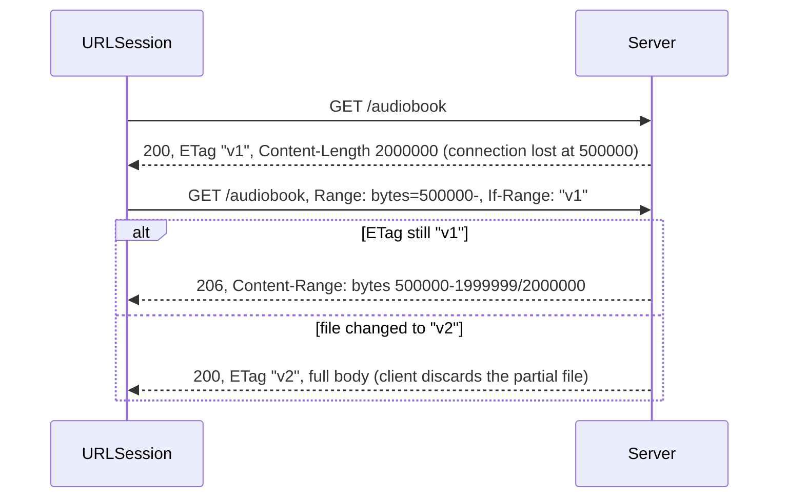

A large download has three needs that a small request does not. The user wants to see it progress. It must survive interruption, because a 400 MB audiobook over cellular will lose its connection at some point, and starting again from zero each time means it may never finish. And its result is a file, which lives somewhere with rules about how long it stays there.

HTTP makes resuming possible with **range requests**: a client that has the first 300 MB asks for the rest, and a server that still has the same version of the file sends only the rest. `URLSession` wraps this in **resume data**. This article implements range support on the test server, measures exactly when `URLSession` can produce resume data and what it sends when it resumes, including two behaviors of the `async` download API that decide which API to use, and ends with progress reporting and an ETA estimate that does not jump around.

<!--more-->

The examples use Swift 6 language mode and were compiled and run with the Swift 6.4 toolchain from Xcode 27.1 on macOS 26. They send requests to `LocalServer`, the loopback HTTP server from the [appendix of the first article](/swift-http-methods-status-codes-headers/#appendix-the-local-server-used-in-this-series); paste that code first, then the blocks below in order, into one `main.swift`.

<!-- check-uses: local-server -->

## Range requests

[RFC 9110 §14](https://www.rfc-editor.org/rfc/rfc9110#section-14) defines the mechanism. A client sends `Range: bytes=500000-` to ask for everything from byte 500,000. A server that supports it answers `206 Partial Content` with a `Content-Range` header saying which bytes the body contains. A server that does not, or that chooses not to, answers `200` with the whole representation, which the client must then use from the start.

Resuming safely needs one more piece: the client must know the bytes it already has belong to the *same version* of the file. Otherwise it would splice the first half of version 1 onto the second half of version 2. The `If-Range` header carries a validator, an `ETag` or a `Last-Modified` date, and means "send me the range if the representation still matches this; otherwise send me the whole new one":



The test server implements exactly that. It serves 2 MB in 100 KB pieces with a 20 ms pause between them, so a download takes about 400 ms and can be interrupted. A flag makes it cut the connection at a chosen byte, and query parameters remove its validator or its range support:

```swift
import Foundation
import Synchronization

let content = Data((0..<2_000_000).map { UInt8(truncatingIfNeeded: $0 &* 13) })
let currentETag = Mutex(#""v1""#)
let cutAt = Mutex<Int?>(nil)

let server = try await LocalServer.start { request in
    let etag = currentETag.withLock { $0 }
    let sendsValidator = request.query["novalidator"] == nil
    var start = 0
    var status = 200
    if let range = request.header("Range"), range.hasPrefix("bytes="), request.query["norange"] == nil {
        let ifRange = request.header("If-Range")
        if ifRange == nil || ifRange == etag {           // If-Range mismatch: send the whole new version
            start = Int(range.dropFirst(6).split(separator: "-").first ?? "0") ?? 0
            status = 206
        }
    }
    var headers: [(name: String, value: String)] = [("Content-Type", "application/octet-stream"),
                                                    ("Content-Length", "\(content.count - start)")]
    if sendsValidator { headers.append(("ETag", etag)) }
    if status == 206 { headers.append(("Content-Range", "bytes \(start)-\(content.count - 1)/\(content.count)")) }

    var pieces: [HTTPResponse.Piece] = []
    let limit = cutAt.withLock { cut in defer { cut = nil }; return cut }
    var offset = start
    while offset < content.count {
        let end = min(offset + 100_000, content.count)
        if let limit, end > limit {
            pieces += [.bytes(content[offset..<limit]), .close]   // the connection dies mid-body
            break
        }
        pieces += [.bytes(content[offset..<end]), .pause(.milliseconds(20))]
        offset = end
    }
    return HTTPResponse(status: status, headers: headers, body: pieces)
}
```

## A delegate-based downloader

`URLSession` has an `async` download API, and it is the right choice for small files. For large ones, the measurements later in this article show it lacks two things: it delivers no progress to a per-task delegate, and cancelling it produces no resume data. The full feature set is on `URLSessionDownloadTask` with a session delegate. The downloader below wraps one download at a time in `async` methods, so the rest of the code can still `await` it:

```swift
final class Downloader: NSObject, URLSessionDownloadDelegate, Sendable {
    struct Progress: Sendable { let written: Int64; let expected: Int64; let at: ContinuousClock.Instant }

    private let state = Mutex<(continuation: CheckedContinuation<URL, any Error>?, task: URLSessionDownloadTask?)>((nil, nil))
    let progress = Mutex<[Progress]>([])
    let resumedAt = Mutex<[Int64]>([])
    let lastTemporaryLocation = Mutex<URL?>(nil)
    let destinationDirectory: URL
    nonisolated(unsafe) private(set) var session: URLSession!  // assigned once, in init

    init(destination: URL) {
        destinationDirectory = destination
        super.init()
        session = URLSession(configuration: .ephemeral, delegate: self, delegateQueue: nil)
    }

    func download(_ url: URL) async throws -> URL { try await run(session.downloadTask(with: url)) }
    func resume(from data: Data) async throws -> URL { try await run(session.downloadTask(withResumeData: data)) }

    /// Cancels the current download and returns resume data if the server allows resuming.
    func pause() async -> Data? {
        guard let task = state.withLock({ $0.task }) else { return nil }
        return await task.cancelByProducingResumeData()
    }

    private func run(_ task: URLSessionDownloadTask) async throws -> URL {
        try await withCheckedThrowingContinuation { continuation in
            state.withLock { $0 = (continuation, task) }
            task.resume()
        }
    }

    private func finish(_ result: Result<URL, any Error>) {
        state.withLock { state in
            state.continuation?.resume(with: result)
            state = (nil, nil)
        }
    }

    // MARK: URLSessionDownloadDelegate

    func urlSession(_ session: URLSession, downloadTask: URLSessionDownloadTask, didFinishDownloadingTo location: URL) {
        lastTemporaryLocation.withLock { $0 = location }
        let status = (downloadTask.response as? HTTPURLResponse)?.statusCode ?? 0
        guard (200..<300).contains(status) else { return finish(.failure(URLError(.badServerResponse))) }
        do {
            let destination = destinationDirectory.appending(path: UUID().uuidString)
            try FileManager.default.moveItem(at: location, to: destination)  // must happen before returning
            finish(.success(destination))
        } catch {
            finish(.failure(error))
        }
    }

    func urlSession(_ session: URLSession, downloadTask: URLSessionDownloadTask, didWriteData bytesWritten: Int64,
                    totalBytesWritten: Int64, totalBytesExpectedToWrite: Int64) {
        progress.withLock { $0.append(Progress(written: totalBytesWritten, expected: totalBytesExpectedToWrite, at: .now)) }
    }

    func urlSession(_ session: URLSession, downloadTask: URLSessionDownloadTask, didResumeAtOffset fileOffset: Int64,
                    expectedTotalBytes: Int64) {
        resumedAt.withLock { $0.append(fileOffset) }
    }

    func urlSession(_ session: URLSession, task: URLSessionTask, didCompleteWithError error: (any Error)?) {
        if let error { finish(.failure(error)) }
    }
}
```

The move in `didFinishDownloadingTo` is the most important line. The documentation says the file at `location` is removed when that delegate method returns, so the file must be moved, or opened, before then. The test below checks that it really is gone afterwards.

## Pausing and resuming

The first test downloads for 150 ms, pauses with `cancelByProducingResumeData()`, and resumes. The server records what the resumed request asked for:

```swift
let downloads = FileManager.default.temporaryDirectory.appending(path: "downloads-\(UUID().uuidString)")
try FileManager.default.createDirectory(at: downloads, withIntermediateDirectories: true)
let downloader = Downloader(destination: downloads)
let fileURL = server.baseURL.appending(path: "audiobook")

async let firstAttempt = downloader.download(fileURL)
try await Task.sleep(for: .milliseconds(150))
let resumeData = await downloader.pause()
do {
    _ = try await firstAttempt
    assertionFailure("the download was paused")
} catch let error as URLError {
    assert(error.code == .cancelled)
}
assert(resumeData != nil)
print("resume data: \(resumeData!.count) bytes")

let beforeResume = server.requests.count
let completed = try await downloader.resume(from: resumeData!)
let resumeRequest = server.requests[beforeResume]
assert(resumeRequest.header("Range")?.hasPrefix("bytes=") == true && resumeRequest.header("Range") != "bytes=0-")
assert(resumeRequest.header("If-Range") == #""v1""#)
assert((try? Data(contentsOf: completed)) == content)
let offsets = downloader.resumedAt.withLock { $0 }
assert(offsets.count == 1 && offsets[0] > 0 && offsets[0] < 2_000_000)
print("resumed with \(resumeRequest.header("Range")!) at offset \(offsets[0])")

let temporary = downloader.lastTemporaryLocation.withLock { $0 }!
assert(!FileManager.default.fileExists(atPath: temporary.path))  // moved away before the method returned
```

In this run the resume data was 7,325 bytes, and the resumed request carried `Range: bytes=581660-` and `If-Range: "v1"`: the session had received 581,660 bytes before the pause, kept them in its temporary file, and asked only for the remaining 1.4 MB. The offset is not a multiple of the server's 100 KB pieces, because TCP delivers bytes in whatever segments the network produces. The delegate's `didResumeAtOffset` reported the same offset, and the assembled file matched the original byte for byte.

Resume data is an opaque blob. It is a property list that records, among other things, the URL, the validator, the byte count, and the path of the partial temporary file, but its format is private and has changed between OS versions. Store it as `Data`, do not parse it, and be prepared for it to stop working: if the system has purged the temporary file, resuming fails and the download must start again.

## When resume data exists

Resume data is a promise that the session can continue safely, so it is produced only when continuing can be made safe. Varying the server's behavior shows which conditions matter:

```swift
func pausedResumeData(_ url: URL) async -> Data? {
    async let attempt = downloader.download(url)
    try? await Task.sleep(for: .milliseconds(150))
    let data = await downloader.pause()
    _ = try? await attempt
    return data
}

let withoutValidator = await pausedResumeData(URL(string: fileURL.absoluteString + "?novalidator=1")!)
assert(withoutValidator == nil)          // no ETag or Last-Modified: nothing to check a resume against

cutAt.withLock { $0 = 700_000 }
var droppedResumeData: Data?
do {
    _ = try await downloader.download(fileURL)
    assertionFailure("the connection was cut")
} catch let error as URLError {
    assert(error.code == .networkConnectionLost)
    droppedResumeData = error.downloadTaskResumeData   // resume data arrives inside the error
}
assert(droppedResumeData != nil)
```

| Situation | Resume data | Resumed request |
|---|---|---|
| Paused with `cancelByProducingResumeData()`, `ETag` present | Yes, about 7 KB | `Range: bytes=N-`, `If-Range` with the `ETag` |
| Paused, no `ETag` or `Last-Modified` | `nil` | (must restart) |
| Paused, server does not send `Accept-Ranges` | Yes | Same as the first row; `Accept-Ranges` is not required |
| Connection lost mid-body | In `URLError.downloadTaskResumeData` | Same as the first row |
| Plain `cancel()` | None | (must restart) |

The validator is the requirement. Without one, the session cannot ask the server whether its partial bytes are still the right ones, so it refuses to offer a resume. That puts the decision on the server: any endpoint that serves large files should send an `ETag`, which costs nothing and enables both resuming and [caching](/swift-http-caching-etag/). Note that `Accept-Ranges` is advisory: the session resumes optimistically and falls back to the full body if the server answers `200`.

### The file changed in between

If the file is replaced on the server between the interruption and the resume, `If-Range` no longer matches, and the server sends the whole new version. The session notices the `200`, discards its partial file, and starts at zero:

```swift
currentETag.withLock { $0 = #""v2""# }     // the server now has a new version
downloader.resumedAt.withLock { $0.removeAll() }
let beforeChanged = server.requests.count
let restarted = try await downloader.resume(from: droppedResumeData!)
assert(server.requests[beforeChanged].header("If-Range") == #""v1""#)   // asked for the old version's range
assert(downloader.resumedAt.withLock { $0 } == [0])                      // and started over
assert((try? Data(contentsOf: restarted)) == content)
```

`didResumeAtOffset` reported `0`, which is how an app can tell a real resume from a restart, for example to reset an ETA estimate.

## The `async` API: simpler, with two gaps

`session.download(from:)` returns the downloaded file's URL and is the simplest way to fetch a file. Two measurements show what it gives up:

```swift
final class ProgressProbe: NSObject, URLSessionDownloadDelegate, Sendable {
    let calls = Mutex(0)
    func urlSession(_ session: URLSession, downloadTask: URLSessionDownloadTask, didFinishDownloadingTo location: URL) {
        calls.withLock { $0 += 1 }
    }
    func urlSession(_ session: URLSession, downloadTask: URLSessionDownloadTask, didWriteData bytesWritten: Int64,
                    totalBytesWritten: Int64, totalBytesExpectedToWrite: Int64) {
        calls.withLock { $0 += 1 }
    }
}

let probe = ProgressProbe()
let (asyncFile, _) = try await URLSession.shared.download(from: fileURL, delegate: probe)
assert(probe.calls.withLock { $0 } == 0)                    // no download delegate callbacks at all
assert(FileManager.default.fileExists(atPath: asyncFile.path))

let asyncTask = Task { try await URLSession.shared.download(from: fileURL) }
try await Task.sleep(for: .milliseconds(150))
asyncTask.cancel()
do {
    _ = try await asyncTask.value
} catch let error as URLError {
    assert(error.code == .cancelled && error.downloadTaskResumeData == nil)  // cancelling discards progress
}

cutAt.withLock { $0 = 700_000 }
do {
    _ = try await URLSession.shared.download(from: fileURL)
} catch let error as URLError {
    guard let data = error.downloadTaskResumeData else { fatalError("a lost connection should yield resume data") }
    let (resumedFile, response) = try await URLSession.shared.download(resumeFrom: data)
    assert((response as! HTTPURLResponse).statusCode == 206)
    assert((try? Data(contentsOf: resumedFile)) == content)
}
```

| `async` download API | Measured |
|---|---|
| Per-task `delegate:` with `URLSessionDownloadDelegate` methods | No `didWriteData`, no `didFinishDownloadingTo` |
| Cancelling the Swift task | `URLError.cancelled`, no resume data |
| Connection lost | Resume data in the error; `download(resumeFrom:)` continues with `206` |
| The returned file | Not deleted on return; move it promptly anyway |

The `async` API is therefore good for files that download in a few seconds, and fine for resuming after network failures. For a pause button or a progress bar, use the delegate-based task.

## Progress you can show

The downloader recorded every `didWriteData` call. Download progress behaves differently from the upload progress measured in [Uploading Files and Multipart Form Data](/swift-multipart-uploads/), which arrived at most every 110 ms. Here the 2 MB download produced 20 callbacks in 0.53 seconds, one for each 100 KB piece the server sent, so the callbacks track the data as it arrives:

```swift
downloader.progress.withLock { $0.removeAll() }
let progressStart = ContinuousClock.now
_ = try await downloader.download(fileURL)
let samples = downloader.progress.withLock { $0 }
print("\(samples.count) progress callbacks in \(ContinuousClock.now - progressStart)")
assert(!samples.isEmpty && samples.last?.written == 2_000_000 && samples.allSatisfy { $0.expected == 2_000_000 })
assert(zip(samples, samples.dropFirst()).allSatisfy { $0.written <= $1.written })
```

The fraction complete is simply `written / expected`. The estimated time remaining is harder, because the instantaneous rate between two callbacks is noisy: one burst of 300 KB in 50 ms suggests 6 MB/s, the next stall suggests zero, and an ETA computed from either jumps between "2 seconds" and "an hour." The standard remedy is an **exponentially weighted moving average** of the rate. Because callbacks arrive at irregular intervals, the weight of each new sample should depend on how much time it covers. With a time constant $$\tau$$:

$$
\alpha_i = 1 - e^{-\Delta t_i / \tau},
\qquad
\hat r_i = \alpha_i\, r_i + (1 - \alpha_i)\, \hat r_{i-1},
\qquad
\text{ETA} = \frac{\text{expected} - \text{written}}{\hat r_i}
$$

A sample covering a long interval moves the estimate a lot, a sample covering a short one moves it a little, and $$\tau$$ sets how quickly the estimate forgets: a few seconds is typical. The estimator below applies it to a synthetic sequence with a stall in the middle:

```swift
struct RateEstimator {
    let timeConstant: Double
    private(set) var rate: Double?   // bytes per second

    mutating func add(bytes: Double, over seconds: Double) {
        guard seconds > 0 else { return }
        let sample = bytes / seconds
        guard let previous = rate else { rate = sample; return }
        let alpha = 1 - exp(-seconds / timeConstant)
        rate = alpha * sample + (1 - alpha) * previous
    }

    func eta(remaining: Double) -> Double? { rate.flatMap { $0 > 0 ? remaining / $0 : nil } }
}

var estimator = RateEstimator(timeConstant: 3)
var naiveETAs: [Double] = []
var smoothETAs: [Double] = []
var remaining = 40_000_000.0
// 1 MB/s steady, then one second with no data, then 1 MB/s again; a sample every 250 ms.
let chunks = Array(repeating: 250_000.0, count: 12) + [0, 0, 0, 0] + Array(repeating: 250_000.0, count: 12)
for bytes in chunks {
    remaining -= bytes
    estimator.add(bytes: bytes, over: 0.25)
    smoothETAs.append(estimator.eta(remaining: remaining) ?? .infinity)
    naiveETAs.append(bytes > 0 ? remaining / (bytes / 0.25) : .infinity)
}
assert(naiveETAs.contains(.infinity))                   // the naive estimate jumped to "forever" during the stall
assert(smoothETAs.allSatisfy { $0.isFinite && $0 < 60 }) // the smoothed one stayed finite
let duringStall = smoothETAs[15]
print("smoothed ETA before stall \(smoothETAs[11]), at the end of the stall \(duringStall)")
assert(duringStall > smoothETAs[11] && duringStall < 2.5 * smoothETAs[11])  // it rose, but did not explode
```

During the one-second stall the naive estimate became infinite four times in a row. The smoothed one rose from 37 to 52 seconds, a factor of 1.4, and recovered as data resumed, which is what a person watching it expects. Reset the estimator when `didResumeAtOffset` reports a restart.

## Where the file should go

`didFinishDownloadingTo` hands over a file in a temporary location; the app decides where it lives next. On iOS the choice determines whether it is backed up and whether the system may delete it:

| Directory | Backed up | May be purged by the system | Use for |
|---|---|---|---|
| `tmp` | No | Yes, any time the app is not running | Files needed only briefly |
| `Library/Caches` | No | Yes, when storage is low | Re-downloadable content: covers, previews |
| `Application Support` | Yes, unless excluded | No | Content the user chose to keep offline |
| `Documents` | Yes | No | User-visible documents |

Downloaded content that can be fetched again, such as an audiobook the user can re-download, belongs in `Application Support` with `isExcludedFromBackup` set, so it neither fills the user's iCloud backup nor disappears when the device runs low on space. Resume data, which is small, should be stored alongside the record of the download, together with the time it was produced, since it is only useful while its partial file survives.

```swift
try FileManager.default.removeItem(at: downloads)
```

## Summary

- Range requests resume a download: `Range: bytes=N-` gets `206 Partial Content`; `If-Range` with the `ETag` makes the server send the whole new version instead if the file changed.
- Measured: pausing with `cancelByProducingResumeData()` gave about 7 KB of resume data, and resuming sent `Range: bytes=581660-`, exactly the bytes already received, with `If-Range: "v1"`. A changed `ETag` restarted the download at offset 0.
- Resume data requires a validator (`ETag` or `Last-Modified`), not `Accept-Ranges`. A lost connection delivers it in `URLError.downloadTaskResumeData`.
- The `async` download API sends no download delegate callbacks and produces no resume data on cancellation. Use a delegate-based `URLSessionDownloadTask` for progress and pause.
- The temporary file is deleted when `didFinishDownloadingTo` returns; move it first, and check the status code before keeping it.
- Smooth the transfer rate with a time-weighted EWMA, $$\alpha = 1 - e^{-\Delta t/\tau}$$, for an ETA that survives stalls.
- Keep re-downloadable files in Application Support excluded from backup, or in Caches if losing them is fine.

## Exercise

Add a `DownloadManager` actor that keeps several `Downloader`-style tasks keyed by URL, persists each one's resume data and destination to a JSON file when paused or interrupted, and on launch offers to resume each one. Test it against the server by interrupting three downloads at different offsets with `cutAt`, recreating the manager from its file, resuming all three concurrently, and asserting that every file matches `content` and that each resumed request's `Range` header matches the bytes that were already received.

## Further reading

- [RFC 9110 §14: Range Requests](https://www.rfc-editor.org/rfc/rfc9110#section-14) and §13.1.5 on `If-Range`.
- Apple's [Pausing and resuming downloads](https://developer.apple.com/documentation/foundation/pausing-and-resuming-downloads) and [`urlSession(_:downloadTask:didFinishDownloadingTo:)`](https://developer.apple.com/documentation/foundation/urlsessiondownloaddelegate/urlsession(_:downloadtask:didfinishdownloadingto:)).
- [Build robust and resumable file transfers](https://developer.apple.com/videos/play/wwdc2023/10006/), WWDC23.

Previous: [Uploading Files and Multipart Form Data](/swift-multipart-uploads/). Next: [Background Transfers and App Relaunch](/swift-background-transfers/).

Return to the [Networking roadmap](/swift-networking/).
