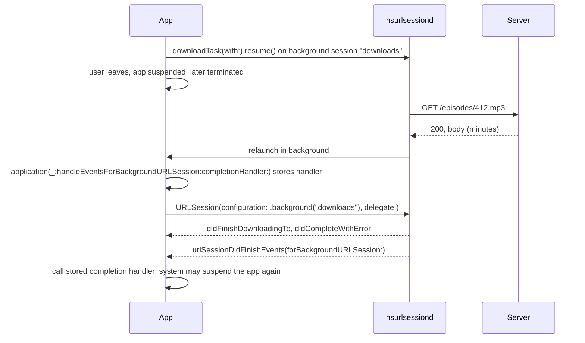

An iOS app gets a few seconds of execution after the user leaves it, and then it is suspended. A 600 MB podcast download or a batch of photo uploads does not fit in a few seconds. For that, `URLSession` offers **background sessions**: the app hands transfers to a system daemon, `nsurlsessiond`, which performs them whether the app is running, suspended, or terminated, and wakes the app when they finish.

The price is a different programming model. A background session accepts only some kinds of tasks, reports results only through a delegate, outlives the process that created it, and delivers events to a process that may not have existed when the transfer started. This article measures those rules on macOS, where a command-line tool can use background sessions too, including a transfer that keeps going after its process exits and is picked up by a new one. It then covers the app side on iOS: relaunch, the completion handler, mapping tasks back to app state, and the scheduling decisions the system makes on the user's behalf.

<!--more-->

The examples use Swift 6 language mode and were compiled with the Swift 6.4 toolchain from Xcode 27.1. The in-process examples ran on macOS 26 against `LocalServer`, the loopback HTTP server from the [appendix of the first article](/swift-http-methods-status-codes-headers/#appendix-the-local-server-used-in-this-series); paste that code first, then the unmarked blocks below in order, into one `main.swift`. The relaunch experiment uses two processes and is run from the shell as shown. The iOS app code was compiled against the iOS 26 SDK.

<!-- check-uses: local-server -->

## Who owns a background transfer

In an ordinary session, the app's process performs the transfer: its sockets, its memory, its lifetime. In a background session, the app's process only *describes* the transfer. The daemon performs it and keeps the results until the app collects them:



Everything in the model follows from that split. The daemon cannot call a closure in a process that no longer exists, so results go to a delegate that the next process provides. It cannot read a `Data` value that lived in the app's memory, so uploads must come from files. And the session is identified by a string the app chooses, because that string is the only thing a relaunched process can use to say "I am the owner of those transfers."

## What a background session accepts

Background sessions are available to command-line tools on macOS, which makes their rules easy to measure. A session is created with an identifier and a delegate. A download from the local server completes through the delegate, and its temporary file is in the daemon's directory, not the process's:

```swift
import Foundation
import Synchronization

final class BackgroundDelegate: NSObject, URLSessionDownloadDelegate, URLSessionDataDelegate, Sendable {
    let events = Mutex<[String]>([])
    let finished = Mutex<CheckedContinuation<Void, Never>?>(nil)
    let completedTasks = Mutex(0)
    let expectedTasks: Int

    init(expecting count: Int) { expectedTasks = count }

    func urlSession(_ session: URLSession, downloadTask: URLSessionDownloadTask, didFinishDownloadingTo location: URL) {
        let size = (try? FileManager.default.attributesOfItem(atPath: location.path)[.size] as? Int) ?? -1
        events.withLock { $0.append("downloaded \(downloadTask.taskDescription ?? "?") \(size) bytes at \(location.path)") }
    }

    func urlSession(_ session: URLSession, dataTask: URLSessionDataTask, didReceive data: Data) {
        events.withLock { $0.append("received \(dataTask.taskDescription ?? "?") \(data.count) bytes") }
    }

    func urlSession(_ session: URLSession, task: URLSessionTask, didCompleteWithError error: (any Error)?) {
        events.withLock { $0.append("completed \(task.taskDescription ?? "?") \(error.map { "\($0)" } ?? "ok")") }
        let done = completedTasks.withLock { count in count += 1; return count == expectedTasks }
        if done { finished.withLock { $0?.resume(); $0 = nil } }
    }
}

let server = try await LocalServer.start { request in
    .text("\(request.method) \(request.path) \(request.body.count) bytes")
}

let configuration = URLSessionConfiguration.background(withIdentifier: "com.example.library.transfers")
configuration.sessionSendsLaunchEvents = true
let delegate = BackgroundDelegate(expecting: 3)
let background = URLSession(configuration: configuration, delegate: delegate, delegateQueue: nil)

let uploadFile = FileManager.default.temporaryDirectory.appending(path: "upload-\(UUID().uuidString).bin")
try Data(repeating: 1, count: 1_000).write(to: uploadFile)
var uploadRequest = URLRequest(url: server.baseURL.appending(path: "uploads"))
uploadRequest.httpMethod = "POST"

await withCheckedContinuation { continuation in
    delegate.finished.withLock { $0 = continuation }
    let download = background.downloadTask(with: server.baseURL.appending(path: "episodes/412"))
    download.taskDescription = "episode-412"
    download.resume()
    let upload = background.uploadTask(with: uploadRequest, fromFile: uploadFile)
    upload.taskDescription = "photo-upload-7"
    upload.resume()
    let data = background.dataTask(with: server.baseURL.appending(path: "status"))
    data.taskDescription = "status-check"
    data.resume()
}

let events = delegate.events.withLock { $0 }
events.forEach { print($0) }
assert(events.contains { $0.hasPrefix("downloaded episode-412") && $0.contains("com.apple.nsurlsessiond/Downloads") })
assert(events.contains("received photo-upload-7 24 bytes") && events.contains("completed photo-upload-7 ok"))  // "POST /uploads 1000 bytes"
assert(events.contains("completed status-check ok"))
assert(server.requests.contains { $0.method == "POST" && $0.body.count == 1_000 })
try FileManager.default.removeItem(at: uploadFile)
```

The download's temporary file was in `~/Library/Caches/com.apple.nsurlsessiond/Downloads/<process name>/`, owned by the daemon. The upload from a file and the data task both completed while the process was running. Two other calls, which work on ordinary sessions, are not allowed. Each terminates the process with an Objective-C exception that Swift cannot catch, so they are shown here rather than run:

<!-- skip-check -->
```swift
// Each of these crashed the test process on macOS 26 with NSGenericException:

_ = try await background.download(from: url)
// "Completion handler blocks are not supported in background sessions. Use a delegate instead."

background.uploadTask(with: request, from: Data(repeating: 1, count: 1_000)).resume()
// "Upload tasks from NSData are not supported in background sessions."
```

| On a background session | Allowed | Notes |
|---|---|---|
| `downloadTask(with:)`, `downloadTask(withResumeData:)` | Yes | Continue while the app is suspended or terminated |
| `uploadTask(with:fromFile:)` | Yes | The daemon reads the file; it must stay in place until the upload completes |
| `uploadTask(with:from: Data)`, stream bodies | **Crash** | The daemon cannot read the app's memory |
| `dataTask(with:)` | Only while the app runs | Not continued while the app is suspended |
| Any `async` method, or completion-handler task | **Crash** | Results are delivered only to the session delegate |

The `async` restriction is the one most likely to surprise a Swift 6 codebase, where every other networking call is an `await`. The delegate is not optional plumbing here: it is the only channel through which results can reach a process that did not exist when the transfer started.

## A transfer that outlives its process

The decisive property is that the transfer continues when the process that started it is gone. The tool below takes a mode argument. In `start` mode it begins a download of a 2 MB file, from a server that sends 50 KB every 250 ms, waits two seconds, and exits. In `resume` mode, run afterwards as a new process, it creates a session with the **same identifier**, lists the tasks the daemon still holds for it, and waits for their events:

<!-- skip-check -->
```swift
// bgtool.swift — compile with: swiftc -swift-version 6 bgtool.swift -o bgtool
import Foundation
import Synchronization

final class Relaunched: NSObject, URLSessionDownloadDelegate, Sendable {
    let done = Mutex<CheckedContinuation<Void, Never>?>(nil)
    func urlSession(_ session: URLSession, downloadTask: URLSessionDownloadTask, didFinishDownloadingTo location: URL) {
        let size = (try? FileManager.default.attributesOfItem(atPath: location.path)[.size] as? Int) ?? -1
        print("finished", downloadTask.taskIdentifier, downloadTask.taskDescription ?? "-", size)
    }
    func urlSession(_ session: URLSession, task: URLSessionTask, didCompleteWithError error: (any Error)?) {
        print("complete", task.taskIdentifier, error.map { "\($0)" } ?? "nil")
        done.withLock { $0?.resume(); $0 = nil }
    }
}

let configuration = URLSessionConfiguration.background(withIdentifier: "com.example.library.relaunch")
let delegate = Relaunched()
let session = URLSession(configuration: configuration, delegate: delegate, delegateQueue: nil)

if CommandLine.arguments[1] == "start" {
    let task = session.downloadTask(with: URL(string: "http://127.0.0.1:8765/audiobook")!)
    task.taskDescription = "audiobook-42"
    task.resume()
    try await Task.sleep(for: .seconds(2))
    print("start process exiting")
    exit(0)
} else {
    let tasks = await session.allTasks
    print("relaunch sees:", tasks.map { "\($0.taskIdentifier) \($0.taskDescription ?? "-") received=\($0.countOfBytesReceived)" })
    await withCheckedContinuation { continuation in delegate.done.withLock { $0 = continuation } }
}
```

The server is a slow Python script on port 8765, so that it outlives both Swift processes. Running the two modes one after the other:

```text
$ ./bgtool start
start process exiting
$ ./bgtool resume
relaunch sees: ["1 audiobook-42 received=650000"]
finished 1 audiobook-42 2000000
complete 1 nil
```

The first process exited after receiving about 400 KB. When the second one connected a second later, the daemon had kept downloading and held 650 KB; the task kept its identifier and its `taskDescription`. The second process then received the finished 2 MB file through its own delegate, and the server's log showed a single request with no `Range` header: the transfer was never interrupted, only its owner was replaced.

On iOS the same thing happens without anyone running the second process: the system launches the app in the background when the daemon has events for it.

## The app side on iOS

When a background session's tasks finish while the app is not running, and the configuration's `sessionSendsLaunchEvents` is `true` (the default), the system launches the app in the background and calls the app delegate with the session's identifier and a completion handler. The app must recreate the session with that identifier, let the delegate process the events, and call the completion handler when they are done, which tells the system it may suspend the app again and update its snapshot. A SwiftUI app receives the same event through the `backgroundTask(.urlSession(_:))` scene modifier.

The pieces, compiled against the iOS 26 SDK:

<!-- skip-check -->
```swift
import SwiftUI
import UIKit

final class TransferService: NSObject, URLSessionDownloadDelegate, @unchecked Sendable {
    static let shared = TransferService()
    static let identifier = "com.example.library.downloads"

    // Set by the app delegate when the system relaunches the app for this session.
    @MainActor var pendingCompletionHandler: (() -> Void)?

    // Created eagerly at launch, so events for tasks started in a previous process are delivered.
    lazy var session: URLSession = {
        let configuration = URLSessionConfiguration.background(withIdentifier: Self.identifier)
        configuration.isDiscretionary = false            // user-initiated: start as soon as possible
        configuration.sessionSendsLaunchEvents = true
        return URLSession(configuration: configuration, delegate: self, delegateQueue: nil)
    }()

    func download(episode: Int, from url: URL) {
        let task = session.downloadTask(with: url)
        task.taskDescription = "episode-\(episode)"      // the key back into the app's own records
        task.countOfBytesClientExpectsToReceive = 600_000_000
        task.resume()
    }

    func urlSession(_ session: URLSession, downloadTask: URLSessionDownloadTask, didFinishDownloadingTo location: URL) {
        guard let episode = downloadTask.taskDescription,
              (downloadTask.response as? HTTPURLResponse)?.statusCode == 200 else { return }
        let destination = URL.applicationSupportDirectory.appending(path: "\(episode).mp3")
        try? FileManager.default.removeItem(at: destination)
        try? FileManager.default.moveItem(at: location, to: destination)  // before returning
        // Record completion in the app's database, keyed by `episode`.
    }

    func urlSession(_ session: URLSession, task: URLSessionTask, didCompleteWithError error: (any Error)?) {
        if let error = error as? URLError, let resumeData = error.downloadTaskResumeData {
            // Persist resumeData with the episode record, and retry later with downloadTask(withResumeData:).
            _ = resumeData
        }
    }

    func urlSessionDidFinishEvents(forBackgroundURLSession session: URLSession) {
        Task { @MainActor in
            pendingCompletionHandler?()
            pendingCompletionHandler = nil
        }
    }
}

final class AppDelegate: NSObject, UIApplicationDelegate {
    func application(_ application: UIApplication, didFinishLaunchingWithOptions launchOptions: [UIApplication.LaunchOptionsKey: Any]? = nil) -> Bool {
        _ = TransferService.shared.session   // reconnect to the daemon on every launch
        return true
    }

    func application(_ application: UIApplication, handleEventsForBackgroundURLSession identifier: String,
                     completionHandler: @escaping () -> Void) {
        guard identifier == TransferService.identifier else { return completionHandler() }
        TransferService.shared.pendingCompletionHandler = completionHandler
        _ = TransferService.shared.session
    }
}

@main
struct LibraryApp: App {
    @UIApplicationDelegateAdaptor(AppDelegate.self) var appDelegate
    var body: some Scene {
        WindowGroup { Text("Library") }
    }
}
```

The rules embedded in that code, in the order they matter:

1. **Recreate the session at every launch**, not only in the relaunch callback. A user who opens the app while transfers are pending needs the delegate connected, or the events wait.
2. **One session object per identifier per process.** Creating a second session with an identifier that is already in use is an error that the system logs and that leaves the second session unable to receive events. A singleton owning the session is the simplest way to guarantee it.
3. **Map tasks back to app state through stable data.** `taskDescription` survived the process change in the measurement above, and so did `taskIdentifier`, but the identifier is meaningful only within that session. A string such as `episode-412`, or a UUID stored in the app's database, connects a delegate callback to the record it belongs to.
4. **Move the file before `didFinishDownloadingTo` returns**, exactly as in [Download Progress, Resuming, and Temporary Files](/swift-download-progress-resume/). In a background relaunch, the app has only a short time to do so.
5. **Call the completion handler** on the main thread after `urlSessionDidFinishEvents(forBackgroundURLSession:)`. Not calling it costs the app background execution time, and the system takes that into account the next time.

## The system decides when

Background transfers are scheduled by the system with the battery, the network, and the user's habits in mind. The app influences that scheduling but does not control it:

| Setting | Effect |
|---|---|
| `isDiscretionary = true` | The system may wait for Wi-Fi and power. Transfers started while the app is in the background are treated as discretionary regardless. |
| `earliestBeginDate` on a task | The transfer will not start before this date, useful for scheduled prefetching. |
| `countOfBytesClientExpectsToSend` / `ToReceive` | Size estimates the scheduler uses to pick a good moment. |
| `allowsExpensiveNetworkAccess`, `allowsConstrainedNetworkAccess` | As for ordinary sessions; respect Low Data Mode for optional content. |
| `timeoutIntervalForResource` | How long the system keeps trying; the default is one week. |

Two consequences shape the product. First, a background download is not a fast download: it is a *reliable* one. A user waiting for an episode to start playing should get an ordinary session, or `isDiscretionary = false` with the transfer started while the app is in the foreground. Second, the system throttles how often an app is relaunched for background session events, so an app that queues hundreds of small transfers, each producing its own completion event, will see them delayed. Batch small items into fewer, larger transfers.

And one rule overrides everything: if the user force-quits the app from the app switcher, the system cancels its background transfers and does not relaunch it for them. The next time the app starts, those tasks complete with an error, which is another reason to keep resume data and the app's own record of what was in progress.

## Testing background transfers

Background behavior is hard to exercise from unit tests, but each part can be checked:

- **Delegate logic** runs the same in an ordinary session. Test it with `LocalServer` or a `URLProtocol` stub ([Isolating HTTP Fixtures with `URLProtocol`](/swift-urlprotocol-fixtures/)); note that custom protocol classes are not supported in background sessions, so the stub must use an ordinary configuration.
- **The process boundary** can be tested on macOS exactly as the `bgtool` experiment does: start, exit, reattach.
- **Relaunch on iOS** is tested on a device: start a transfer, background the app, and stop it from Xcode's debugger with "Debug › Detach", or terminate it with a memory warning simulation rather than a force-quit, which would cancel the transfer. Xcode can then attach to the app when the system relaunches it.

## Summary

- Background sessions hand transfers to `nsurlsessiond`, which continues them while the app is suspended or terminated and relaunches the app with the results.
- Measured on macOS 26: downloads, file uploads, and (while running) data tasks work; `async` methods and uploads from `Data` crash with uncatchable exceptions. Use a delegate and files.
- Measured: a download continued after its process exited, and a new process with the same session identifier saw the task, its `taskDescription`, and 650 KB already received, then received the complete file.
- On iOS, recreate the session at every launch, store the completion handler from `handleEventsForBackgroundURLSession`, and call it after `urlSessionDidFinishEvents`.
- Map tasks to app records with `taskDescription`, move files before the delegate method returns, and keep resume data for failures.
- The system schedules background transfers for reliability, not speed, throttles relaunches, and cancels everything on force-quit.

## Exercise

Extend `bgtool` with an `upload` mode that uploads a 5 MB file to the Python server, and a `status` mode that prints `countOfBytesSent` for every pending task. Start an upload, exit, run `status` twice a second apart, and confirm the counter advances while no process of yours is running. Then delete the source file while the upload is in progress and record what error the next process receives, and decide how an app should present that to a user who removed the photo they were uploading.

## Further reading

- Apple's [Downloading files in the background](https://developer.apple.com/documentation/foundation/downloading-files-in-the-background) and [`application(_:handleEventsForBackgroundURLSession:completionHandler:)`](https://developer.apple.com/documentation/uikit/uiapplicationdelegate/application(_:handleeventsforbackgroundurlsession:completionhandler:)).
- [Advances in App Background Execution](https://developer.apple.com/videos/play/wwdc2019/707/), WWDC19, on how the system schedules background work, including background URL sessions.
- [Build robust and resumable file transfers](https://developer.apple.com/videos/play/wwdc2023/10006/), WWDC23.

Previous: [Download Progress, Resuming, and Temporary Files](/swift-download-progress-resume/). Next: [WebSockets: Connection State and Reconnection](/swift-websockets-reconnection/).

Return to the [Networking roadmap](/swift-networking/).
