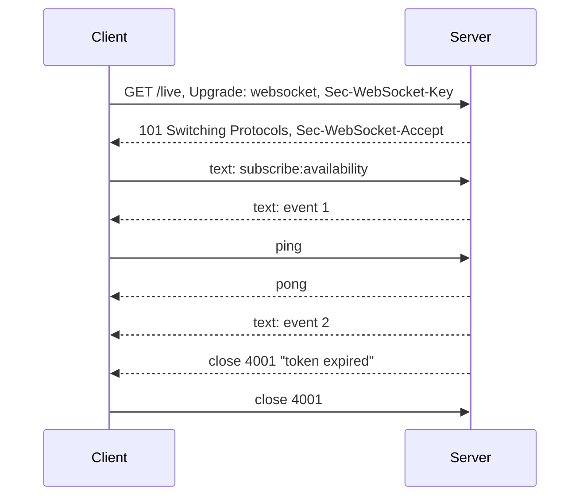
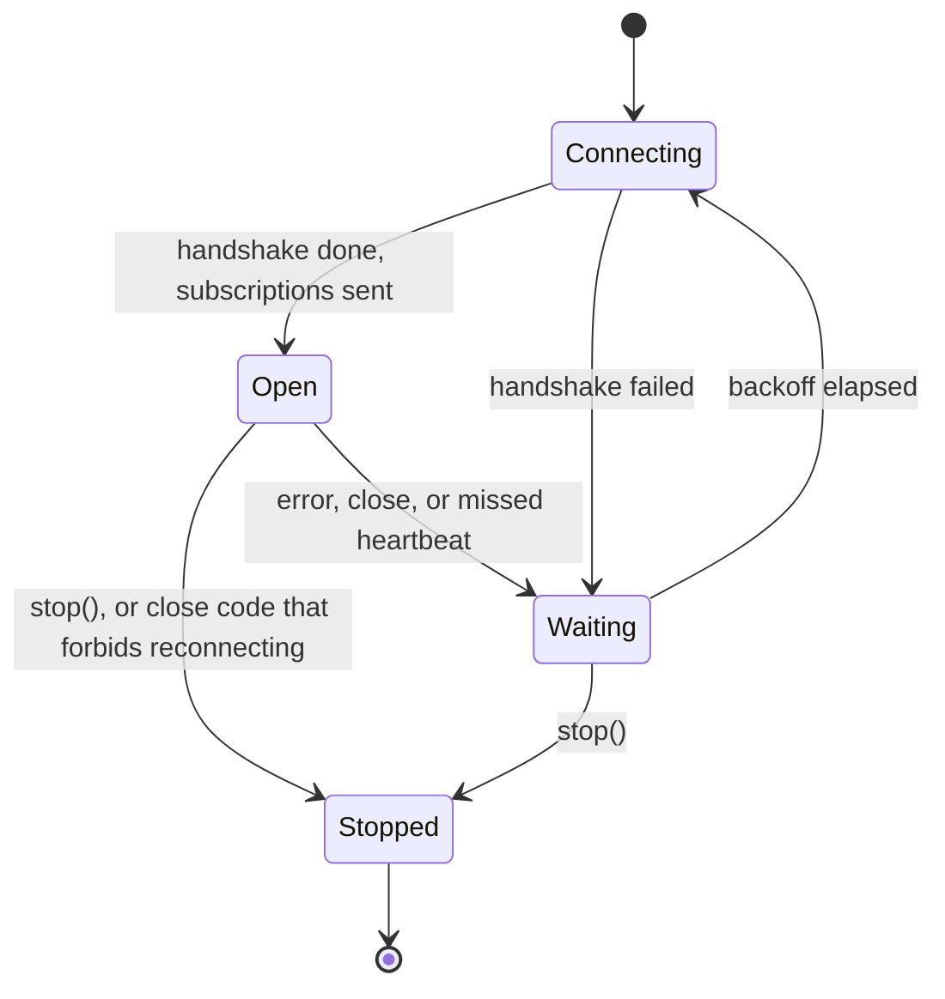

An HTTP request has a beginning and an end, and the client always knows which of the two it is waiting for. A WebSocket has neither. It is a long-lived, two-way channel that is open until something closes it: the server deliberately, the network accidentally, or nothing at all, when the other end has silently disappeared and the socket looks healthy forever. A live feature built on a WebSocket, such as chat, a shared reading list, or a "books available now" ticker, is only as good as the client's answer to one question: what state is the connection in right now, and what does it do about it?

This article starts from the protocol: the upgrade handshake that turns an HTTP request into a WebSocket, and the frames that follow. It then measures the three ways a `URLSessionWebSocketTask` connection ends, against a WebSocket server built with Network framework, including the one that produces no error at all. Finally it builds a connection manager with an explicit state machine, heartbeats that detect dead peers within a bounded time, jittered reconnection, and resubscription after every reconnect.

<!--more-->

The examples use Swift 6 language mode and were compiled and run with the Swift 6.4 toolchain from Xcode 27.1 on macOS 26. One section sends a request to `LocalServer`, the loopback HTTP server from the [appendix of the first article](/swift-http-methods-status-codes-headers/#appendix-the-local-server-used-in-this-series); the WebSocket server is built in this article. Paste `LocalServer` first, then the blocks below in order, into one `main.swift`.

<!-- check-uses: local-server -->

## From HTTP to WebSocket

A WebSocket connection starts as an HTTP/1.1 `GET` with an `Upgrade: websocket` header, defined in [RFC 6455](https://www.rfc-editor.org/rfc/rfc6455). If the server agrees, it answers `101 Switching Protocols`, and from then on the TCP connection carries WebSocket frames instead of HTTP messages. Pointing a `URLSessionWebSocketTask` at `LocalServer`, which speaks only HTTP, shows the request it sends:

```swift
import Foundation
import Network
import CryptoKit
import Synchronization

let http = try await LocalServer.start { request in .text("not a WebSocket server", status: 400) }
let probe = URLSession.shared.webSocketTask(with: URL(string: "ws://127.0.0.1:\(http.port)/live")!, protocols: ["library.v1"])
probe.resume()
do {
    _ = try await probe.receive()
    assertionFailure("the handshake cannot succeed against an HTTP-only server")
} catch let error as URLError {
    assert(error.code == .badServerResponse)  // -1011: the server did not answer 101
}
let handshake = http.requests[0]
print(handshake.head)
assert(handshake.header("Upgrade") == "websocket" && handshake.header("Connection") == "Upgrade")
assert(handshake.header("Sec-WebSocket-Version") == "13")
assert(handshake.header("Sec-WebSocket-Protocol") == "library.v1")
assert(probe.maximumMessageSize == 1_048_576)
```

```text
GET /live HTTP/1.1
Host: 127.0.0.1:50174
Sec-WebSocket-Protocol: library.v1
Sec-WebSocket-Key: g1x9S8H+Burq1v3oY/F9gg==
Sec-WebSocket-Version: 13
Upgrade: websocket
Sec-WebSocket-Extensions: permessage-deflate
Connection: Upgrade
```

The `Sec-WebSocket-Key` is 16 random bytes in base64. The server proves it understood the WebSocket handshake, rather than being an HTTP server that happened to echo headers, by returning `Sec-WebSocket-Accept`: the SHA-1 of the key concatenated with a fixed GUID from the RFC, in base64.

$$
\text{Accept} = \operatorname{base64}\big(\operatorname{SHA1}(\text{Key} \,\|\, \texttt{258EAFA5-E914-47DA-95CA-C5AB0DC85B11})\big)
$$

The RFC's own example checks the formula:

```swift
func websocketAccept(for key: String) -> String {
    let digest = Insecure.SHA1.hash(data: Data((key + "258EAFA5-E914-47DA-95CA-C5AB0DC85B11").utf8))
    return Data(digest).base64EncodedString()
}
assert(websocketAccept(for: "dGhlIHNhbXBsZSBub25jZQ==") == "s3pPLMBiTxaQ9kYGzzhZRbK+xOo=")  // RFC 6455 §1.3
```

SHA-1 is not used for security here; it only makes the response specific to this request. The security of a WebSocket comes from TLS, so production URLs use `wss://`, which App Transport Security requires anyway. The client also offered `permessage-deflate` ([RFC 7692](https://www.rfc-editor.org/rfc/rfc7692)) compression, and the 1 MiB `maximumMessageSize` is the largest message `receive()` accepts before failing.

After the handshake, data flows as **frames**: text and binary frames carry messages, ping and pong frames check liveness, and a close frame ends the connection with a **close code**:

| Close code | Meaning |
|---|---|
| 1000 | Normal closure |
| 1001 | Going away (server shutting down, page navigating) |
| 1008 | Policy violation |
| 1011 | Server error |
| 1006 | *Never sent*: reported locally when the connection dropped without a close frame |
| 4000–4999 | Reserved for applications, e.g. 4001 "token expired", 4003 "forbidden" |



## A WebSocket server for tests

Network framework can terminate WebSockets itself: adding `NWProtocolWebSocket.Options` to a listener's protocol stack makes it perform the handshake and deliver whole messages. The server below echoes text messages, records subscriptions per connection, and lets a test close or drop every connection. With `autoReplyPing` turned off, it simulates a peer that has vanished: the socket stays open, but nothing answers.

```swift
final class WebSocketServer: Sendable {
    private let listener: NWListener
    private let connections = Mutex<[NWConnection]>([])
    let subscriptions = Mutex<[String]>([])   // "connection#:topic", in arrival order
    private let accepted = Mutex(0)
    let port: Int

    init(answersPings: Bool = true) async throws {
        let websocket = NWProtocolWebSocket.Options()
        websocket.autoReplyPing = answersPings
        let parameters = NWParameters.tcp
        parameters.defaultProtocolStack.applicationProtocols.insert(websocket, at: 0)
        parameters.requiredLocalEndpoint = .hostPort(host: .ipv4(.loopback), port: .any)
        let listener = try NWListener(using: parameters)
        listener.newConnectionHandler = { _ in }
        port = try await withCheckedThrowingContinuation { continuation in
            let resumed = Mutex(false)
            listener.stateUpdateHandler = { state in
                guard case .ready = state, resumed.withLock({ done in defer { done = true }; return !done }) else { return }
                continuation.resume(returning: Int(listener.port!.rawValue))
            }
            listener.start(queue: .global())
        }
        self.listener = listener
        listener.newConnectionHandler = { [self] connection in accept(connection) }
    }

    var connectionCount: Int { accepted.withLock { $0 } }

    private func accept(_ connection: NWConnection) {
        let number = accepted.withLock { count in count += 1; return count }
        connections.withLock { $0.append(connection) }
        connection.start(queue: .global())
        receive(on: connection, number: number)
    }

    private func receive(on connection: NWConnection, number: Int) {
        connection.receiveMessage { [self] data, context, _, error in
            guard error == nil, let data else { return }
            let metadata = context?.protocolMetadata(definition: NWProtocolWebSocket.definition) as? NWProtocolWebSocket.Metadata
            if metadata?.opcode == .text {
                let text = String(decoding: data, as: UTF8.self)
                if text.hasPrefix("subscribe:") {
                    subscriptions.withLock { $0.append("\(number):\(text.dropFirst(10))") }
                }
                send("echo: \(text)", on: connection)
            }
            receive(on: connection, number: number)
        }
    }

    private func send(_ text: String, on connection: NWConnection) {
        let context = NWConnection.ContentContext(identifier: "text", metadata: [NWProtocolWebSocket.Metadata(opcode: .text)])
        connection.send(content: Data(text.utf8), contentContext: context, isComplete: true, completion: .contentProcessed { _ in })
    }

    func broadcast(_ text: String) {
        for connection in connections.withLock({ $0 }) { send(text, on: connection) }
    }

    /// Sends a close frame with the given code, then closes the socket.
    func closeAll(code: NWProtocolWebSocket.CloseCode) {
        for connection in connections.withLock({ $0 }) {
            let metadata = NWProtocolWebSocket.Metadata(opcode: .close)
            metadata.closeCode = code
            let context = NWConnection.ContentContext(identifier: "close", metadata: [metadata])
            connection.send(content: nil, contentContext: context, isComplete: true,
                            completion: .contentProcessed { _ in connection.cancel() })
        }
        connections.withLock { $0.removeAll() }
    }

    /// Resets every connection without a close frame, like a network failure.
    func dropAll() {
        for connection in connections.withLock({ $0 }) { connection.forceCancel() }
        connections.withLock { $0.removeAll() }
    }
}
```

## Three ways a connection ends

With the server in place, each ending can be produced and observed:

```swift
let server = try await WebSocketServer()
let liveURL = URL(string: "ws://127.0.0.1:\(server.port)/live")!

// 1. A deliberate close frame with an application code.
let closing = URLSession.shared.webSocketTask(with: liveURL)
closing.resume()
try await closing.send(.string("hello"))
guard case .string(let echo) = try await closing.receive() else { fatalError() }
assert(echo == "echo: hello")
server.closeAll(code: .applicationCode(4001))
var closeError: (any Error)?
do { _ = try await closing.receive() } catch { closeError = error }
assert((closeError as NSError?)?.domain == NSPOSIXErrorDomain && (closeError as NSError?)?.code == 57)  // ENOTCONN
assert(closing.closeCode.rawValue == 4001)

// 2. An abrupt reset, as when a network path disappears.
let resetting = URLSession.shared.webSocketTask(with: liveURL)
resetting.resume()
try await resetting.send(.string("x"))
_ = try await resetting.receive()
server.dropAll()
var resetError: (any Error)?
do { _ = try await resetting.receive() } catch { resetError = error }
assert((resetError as NSError?)?.code == 54)            // ECONNRESET
assert(resetting.closeCode == .invalid)                  // no close frame was received

// 3. A peer that is gone but whose socket is still open.
let silentServer = try await WebSocketServer(answersPings: false)
let silent = URLSession.shared.webSocketTask(with: URL(string: "ws://127.0.0.1:\(silentServer.port)/live")!)
silent.resume()
try await silent.send(.string("y"))
_ = try await silent.receive()
let pongArrived = Mutex(false)
silent.sendPing { _ in pongArrived.withLock { $0 = true } }
try await Task.sleep(for: .seconds(2))
assert(!pongArrived.withLock { $0 })   // nothing happened, and nothing will
silent.cancel(with: .goingAway, reason: nil)
```

| How the connection ended | What the client observed (macOS 26) |
|---|---|
| Server sent close frame 4001 | `receive()` threw POSIX 57, "Socket is not connected"; `closeCode` was 4001 |
| Connection reset, no close frame | `receive()` threw POSIX 54, "Connection reset by peer"; `closeCode` was `.invalid` |
| Peer silent, socket open | No error, no event; the ping's pong handler was never called |

Two details matter for code that handles these. The errors are `NSError`s in the POSIX domain, not `URLError`s, so an error handler written for HTTP requests, which matches on `URLError.Code`, does not recognize them. The reliable signal for a deliberate close is `closeCode` and `closeReason` on the task, read after `receive()` throws.

The third row is the dangerous one. A phone that walks out of Wi-Fi range, a NAT gateway that silently forgets an idle mapping, or a server process that froze all produce a socket that neither delivers data nor reports an error. Without a heartbeat, the app shows "Live" over a connection that died minutes ago.

## Detecting a dead peer: heartbeats

A heartbeat sends a ping every $$P$$ seconds and treats a missing pong after $$T$$ seconds as a dead connection. If the peer dies at a random moment, the next ping goes out within $$P$$ seconds and its timeout fires $$T$$ seconds later, so the time to detection $$D$$ is bounded and, on average, about half an interval plus the timeout:

$$
D \le P + T,
\qquad
\mathbb{E}[D] \approx \tfrac{P}{2} + T
$$

The interval is a trade between detection time and cost. Each ping wakes the radio, and on cellular networks a radio that wakes every few seconds drains the battery noticeably. NAT and carrier-grade NAT gateways commonly drop idle mappings after somewhere between 30 seconds and a few minutes, so an interval under that limit also keeps the connection alive. For an app in the foreground, $$P = 25$$ s and $$T = 10$$ s gives detection within 35 seconds at about 144 pings per hour. The tests below use $$P = 0.5$$ s and $$T = 0.5$$ s so they run quickly.

`sendPing` takes a completion handler, which is never called if no pong arrives. The heartbeat wraps it in a continuation and races it against a timeout. When the timeout wins, it cancels the WebSocket task, which is what makes the pending pong handler finally run, with an error, so the continuation is resumed exactly once. Cancelling the task also makes any pending `receive()` fail, and that error can reach the caller before `HeartbeatMissed` does, so the heartbeat sets a flag first; the flag, not the error type, says why the connection ended:

```swift
struct HeartbeatMissed: Error {}

/// Records that a heartbeat failed, so the reason survives whichever child task reports its error first.
final class HeartbeatFlag: Sendable {
    private let missed = Mutex(false)
    func set() { missed.withLock { $0 = true } }
    var isSet: Bool { missed.withLock { $0 } }
}

func ping(_ task: URLSessionWebSocketTask, timeout: Duration, flag: HeartbeatFlag) async throws {
    try await withThrowingTaskGroup(of: Void.self) { group in
        group.addTask {
            try await withCheckedThrowingContinuation { (continuation: CheckedContinuation<Void, any Error>) in
                task.sendPing { error in
                    if let error { continuation.resume(throwing: error) } else { continuation.resume() }
                }
            }
        }
        group.addTask {
            try await Task.sleep(for: timeout)
            flag.set()
            task.cancel(with: .goingAway, reason: nil)  // unblocks the pending pong handler
            throw HeartbeatMissed()
        }
        defer { group.cancelAll() }
        _ = try await group.next()
    }
}
```

## A connection manager with explicit states

Everything a live feature needs fits in one actor with a small state machine. The states are what the UI shows; the transitions are what the network does:



The manager publishes events through an `AsyncStream`. Each connection runs two child tasks, a receive loop and a heartbeat loop, in a task group: whichever fails first ends the connection, and the group cancels the other. Between connections it waits with the full-jitter backoff from [Retry Policies, Backoff, and Idempotency](/swift-retry-backoff-idempotency/), and the attempt counter resets after a connection succeeds, so a connection that worked for an hour reconnects quickly after a blip:

```swift
actor LiveConnection {
    enum Event: Sendable, Equatable {
        case open(attempt: Int)
        case message(String)
        case waiting(reason: String, retryIn: Duration)
        case stopped(reason: String)
    }

    let url: URL
    let topics: [String]
    let pingInterval: Duration
    let pingTimeout: Duration
    let backoffBase: Duration = .milliseconds(100)
    let backoffCap: Duration = .seconds(2)
    /// Close codes after which reconnecting cannot help without user action.
    let terminalCloseCodes: Set<Int> = [1008, 4003]

    private var runner: Task<Void, Never>?
    private var current: URLSessionWebSocketTask?

    init(url: URL, topics: [String], pingInterval: Duration, pingTimeout: Duration) {
        (self.url, self.topics, self.pingInterval, self.pingTimeout) = (url, topics, pingInterval, pingTimeout)
    }

    func start() -> AsyncStream<Event> {
        let (stream, continuation) = AsyncStream.makeStream(of: Event.self)
        runner = Task { await run(continuation) }
        return stream
    }

    func stop() {
        runner?.cancel()
        current?.cancel(with: .normalClosure, reason: nil)
    }

    func send(_ text: String) async throws {
        guard let current else { throw URLError(.networkConnectionLost) }
        try await current.send(.string(text))
    }

    private func run(_ events: AsyncStream<Event>.Continuation) async {
        var failures = 0
        while !Task.isCancelled {
            let task = URLSession.shared.webSocketTask(with: url)
            let heartbeat = HeartbeatFlag()
            current = task
            task.resume()
            var reason = "cancelled"
            do {
                for topic in topics { try await task.send(.string("subscribe:\(topic)")) }  // resubscribe every time
                events.yield(.open(attempt: failures + 1))
                failures = 0
                try await withThrowingTaskGroup(of: Void.self) { [pingInterval, pingTimeout] group in
                    group.addTask {
                        while true {
                            if case .string(let text) = try await task.receive() { events.yield(.message(text)) }
                        }
                    }
                    group.addTask {
                        while true {
                            try await Task.sleep(for: pingInterval)
                            try await ping(task, timeout: pingTimeout, flag: heartbeat)
                        }
                    }
                    defer { group.cancelAll() }
                    _ = try await group.next()
                }
            } catch {
                let code = task.closeCode.rawValue
                if heartbeat.isSet {
                    reason = "heartbeat missed"
                } else {
                    reason = code != 0 ? "closed \(code)" : "error \((error as NSError).domain) \((error as NSError).code)"
                }
            }
            task.cancel(with: .goingAway, reason: nil)
            current = nil
            if Task.isCancelled { break }
            if terminalCloseCodes.contains(task.closeCode.rawValue) {
                events.yield(.stopped(reason: reason))
                events.finish()
                return
            }
            failures += 1
            let ceiling = min(backoffCap, backoffBase * (1 << min(failures - 1, 16)))
            let milliseconds = Int(ceiling.components.seconds * 1000 + ceiling.components.attoseconds / 1_000_000_000_000_000)
            let delay = Duration.milliseconds(Int.random(in: 0...milliseconds))
            events.yield(.waiting(reason: reason, retryIn: delay))
            try? await Task.sleep(for: delay)
        }
        events.yield(.stopped(reason: "stopped"))
        events.finish()
    }
}
```

The decisions in that code, each of which is a common bug when missing:

- **Resubscribe on every connection.** Subscriptions are server-side state attached to a connection, and a new connection starts with none. A client that subscribes once at startup receives nothing after its first reconnect.
- **Distinguish terminal closes.** A close code that means "forbidden" or "policy violation" will be repeated on every attempt; reconnecting in a loop only hammers the server. Code 4001, "token expired" in this example's protocol, is not terminal: the right response is to refresh the token, as in [Refreshing Credentials Without Duplicate Requests](/swift-token-refresh/), and reconnect.
- **Report the reason.** The `waiting` event carries why the connection ended, which is what makes "Reconnecting… (connection reset)" possible in the UI and in logs.

## Reconnection, measured

The first test resets the server's connections twice while a client is subscribed to two topics. The client must reconnect each time and resubscribe on each new connection:

```swift
/// Collects a connection's events and waits for particular ones.
actor EventRecorder {
    private var iterator: AsyncStream<LiveConnection.Event>.Iterator
    private(set) var log: [LiveConnection.Event] = []
    init(_ stream: AsyncStream<LiveConnection.Event>) { iterator = stream.makeAsyncIterator() }

    func next(where matches: @Sendable (LiveConnection.Event) -> Bool) async -> LiveConnection.Event {
        var events = iterator  // a mutating async call cannot be made on actor-isolated storage directly
        defer { iterator = events }
        while let event = await events.next(isolation: self) {
            log.append(event)
            if matches(event) { return event }
        }
        fatalError("stream ended")
    }
}

@Sendable func isOpen(_ event: LiveConnection.Event) -> Bool { if case .open = event { true } else { false } }

let feed = try await WebSocketServer()
let connection = LiveConnection(url: URL(string: "ws://127.0.0.1:\(feed.port)/live")!,
                                topics: ["availability", "loans"],
                                pingInterval: .milliseconds(500), pingTimeout: .milliseconds(500))
let recorder = EventRecorder(await connection.start())

_ = await recorder.next(where: isOpen)
feed.broadcast("event:1")
_ = await recorder.next { $0 == .message("event:1") }

for _ in 0..<2 {
    feed.dropAll()
    _ = await recorder.next(where: isOpen)
}
try await Task.sleep(for: .milliseconds(100))
feed.broadcast("event:2")
_ = await recorder.next { $0 == .message("event:2") }

assert(feed.connectionCount == 3)
assert(feed.subscriptions.withLock { $0 } == ["1:availability", "1:loans", "2:availability", "2:loans", "3:availability", "3:loans"])
let waits = await recorder.log.compactMap { event -> String? in if case .waiting(let reason, _) = event { reason } else { nil } }
assert(waits == ["error NSPOSIXErrorDomain 54", "error NSPOSIXErrorDomain 54"])
```

Three connections, each with both subscriptions, and the second broadcast arrived after two resets. The two `waiting` events name the reset that caused them, POSIX error 54, as in the table above.

The second test points a client at a server that stops answering pings after the handshake. The heartbeat must detect it within $$P + T$$, one second here:

```swift
let frozen = try await WebSocketServer(answersPings: false)
let frozenConnection = LiveConnection(url: URL(string: "ws://127.0.0.1:\(frozen.port)/live")!, topics: ["availability"],
                                      pingInterval: .milliseconds(500), pingTimeout: .milliseconds(500))
let frozenRecorder = EventRecorder(await frozenConnection.start())
_ = await frozenRecorder.next(where: isOpen)
let openedAt = ContinuousClock.now
guard case .waiting(let reason, _) = await frozenRecorder.next(where: { if case .waiting = $0 { true } else { false } }) else {
    fatalError()
}
let detection = ContinuousClock.now - openedAt
print("dead peer detected after \(detection): \(reason)")
assert(reason == "heartbeat missed")
assert(detection < .milliseconds(1_300))   // within P + T, plus scheduling
await frozenConnection.stop()
```

The dead peer was detected about one second after the connection opened: a 500 ms interval to the first ping, then 500 ms without a pong. Without the heartbeat the client would have stayed "open" indefinitely.

The last test closes the connection with code 4003, which the manager treats as terminal:

```swift
feed.closeAll(code: .applicationCode(4003))
let final = await recorder.next { if case .stopped = $0 { true } else { false } }
assert(final == .stopped(reason: "closed 4003"))
assert(feed.connectionCount == 3)   // no reconnection attempt
```

## What reconnection does not fix

A reconnected socket is a new conversation. Messages the server sent while the client was disconnected are gone, unless the protocol says otherwise. Two designs handle the gap:

- **Resume from a position.** Every server message carries a sequence number or event ID, the client sends the last one it processed when it resubscribes, and the server replays what it missed. [Server-Sent Events](https://html.spec.whatwg.org/multipage/server-sent-events.html) build this in with `Last-Event-ID`; WebSocket protocols have to add it themselves.
- **Refetch the state.** After reconnecting, the client fetches the current state of what it displays over plain HTTP, and applies live messages on top. Combined with the version-based merge from [Coalescing Duplicate Requests and Rejecting Stale Results](/swift-request-coalescing/), late or duplicate messages cannot move the state backwards.

Outgoing messages need the same thought. `send(_:)` above throws when there is no connection, which is honest. Queueing them for later is right only for messages that are still meaningful later, and then they need the idempotency and outbox treatment of [Offline Behavior and Reachability Assumptions](/swift-offline-reachability/).

Finally, on iOS a WebSocket does not survive the app being suspended. Close it when the app moves to the background, and reconnect, then refetch, when it returns. For updates while the app is not running, push notifications are the mechanism, not a socket.

## Summary

- A WebSocket begins as an HTTP `GET` with `Upgrade: websocket`; the server answers `101` with `Sec-WebSocket-Accept`, $$\operatorname{base64}(\operatorname{SHA1}(\text{key} \| \text{GUID}))$$. A non-`101` answer fails with `badServerResponse`.
- Measured endings: a close frame gives POSIX 57 from `receive()` and the code in `closeCode`; a reset gives POSIX 54 and `closeCode == .invalid`; a silent peer gives nothing at all. These are not `URLError`s.
- Heartbeats bound detection of dead peers: $$D \le P + T$$. Cancel the task on timeout, so the pending pong handler runs and the continuation resumes once. Measured: detection in about one second with $$P = T = 0.5$$ s.
- Model the connection as explicit states, reconnect with full-jitter backoff that resets after success, resubscribe on every connection, and stop on terminal close codes.
- Reconnection loses messages: resume from a sequence number or refetch state over HTTP, and merge by version.

## Exercise

Add sequence numbers to `WebSocketServer.broadcast` and a `resume:<n>` message that makes the server replay every broadcast after `n` from an in-memory log. Extend `LiveConnection` to remember the last sequence number it delivered and send `resume:` after resubscribing. Test it by broadcasting ten events, dropping the connection after the fourth, broadcasting the rest while the client waits to reconnect, and asserting that the client delivers all ten exactly once and in order.

## Further reading

- [RFC 6455: The WebSocket Protocol](https://www.rfc-editor.org/rfc/rfc6455) and [RFC 8441](https://www.rfc-editor.org/rfc/rfc8441), which carries WebSockets over HTTP/2.
- Apple's [`URLSessionWebSocketTask`](https://developer.apple.com/documentation/foundation/urlsessionwebsockettask) and [`NWProtocolWebSocket`](https://developer.apple.com/documentation/network/nwprotocolwebsocket) documentation.
- [Advances in Networking, Part 1](https://developer.apple.com/videos/play/wwdc2019/712/), WWDC19, which introduced `URLSessionWebSocketTask`.

Previous: [Background Transfers and App Relaunch](/swift-background-transfers/). Next: [Streaming Responses and Incremental Parsing](/swift-streaming-responses/).

Return to the [Networking roadmap](/swift-networking/).
