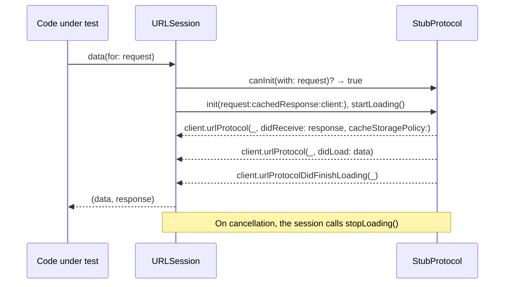

A test that talks to a real server is slow, depends on the network and the server's data, and cannot easily produce the responses that matter most: the `503`, the truncated body, the timeout. The standard way to give `URLSession` canned responses without changing the code under test is `URLProtocol`, the extension point the URL Loading System uses to decide how to load a request. A test registers a protocol class on a session's configuration, and every request through that session is answered by the test's own code.

It is an old API with sharp edges, and two of them cut most test suites: a shared static handler that races once tests run in parallel, which Swift Testing does by default, and request bodies that are not where the code expects them. This article builds a fixture protocol that is safe under parallel tests and Swift 6 strict concurrency, uses it to test a small client's success, failure, redirect, timeout, and cancellation paths, and then measures what a `URLProtocol` stub does *not* reproduce from the real HTTP stack, so the tests' claims stay honest.

<!--more-->

The examples use Swift 6 language mode and Swift Testing, and were run with `swift test` using the Swift 6.4 toolchain from Xcode 27.1 on macOS 26. Each block is labeled with the file it belongs to in a Swift package with a `Library` target and a `LibraryTests` test target.

## How `URLProtocol` fits in

When a session starts a task, it asks each class in its configuration's `protocolClasses`, in order, whether it can handle the request. The first class whose `canInit(with:)` returns `true` is instantiated for the request, and its `startLoading()` produces the response by calling methods on its `client`:



Registering the class on a *configuration* scopes it to sessions created from that configuration. `URLProtocol.registerClass(_:)` registers it globally, for `URLSession.shared` and everything else in the process, which is exactly the coupling between tests that a fixture should avoid.

## The code under test

The client below is ordinary production code. It takes a session and a base URL, and maps outcomes into a small error type in the spirit of [Separating Transport Errors from Application Failures](/swift-transport-vs-application-errors/):

<!-- file: Sources/Library/BookClient.swift -->
```swift
import Foundation

public struct Book: Codable, Equatable, Sendable {
    public let id: String
    public let title: String
    public init(id: String, title: String) { (self.id, self.title) = (id, title) }
}

public enum ClientError: Error, Equatable {
    case status(Int)
    case transport(URLError.Code)
    case decoding
}

public struct BookClient: Sendable {
    let session: URLSession
    let baseURL: URL

    public init(session: URLSession, baseURL: URL) { (self.session, self.baseURL) = (session, baseURL) }

    public func book(_ id: String) async throws(ClientError) -> Book {
        try await send(URLRequest(url: baseURL.appending(components: "books", id)))
    }

    public func create(title: String) async throws(ClientError) -> Book {
        var request = URLRequest(url: baseURL.appending(path: "books"))
        request.httpMethod = "POST"
        request.setValue("application/json", forHTTPHeaderField: "Content-Type")
        request.httpBody = try? JSONEncoder().encode(["title": title])
        return try await send(request)
    }

    private func send<Value: Decodable>(_ request: URLRequest) async throws(ClientError) -> Value {
        let data: Data
        let response: URLResponse
        do {
            (data, response) = try await session.data(for: request)
        } catch let error as URLError {
            throw .transport(error.code)
        } catch {
            throw .transport(.unknown)
        }
        let status = (response as? HTTPURLResponse)?.statusCode ?? 0
        guard (200..<300).contains(status) else { throw .status(status) }
        do { return try JSONDecoder().decode(Value.self, from: data) } catch { throw .decoding }
    }
}
```

Nothing in it knows about tests. The seam is the `URLSession` it receives, which is all a `URLProtocol` fixture needs.

## The shared-handler trap

The `URLProtocol` stub found in many codebases looks like this:

```swift
// Does not compile in Swift 6 language mode.
final class LegacyStub: URLProtocol {
    static var handler: ((URLRequest) -> (HTTPURLResponse, Data))?
    override class func canInit(with request: URLRequest) -> Bool { true }
    override class func canonicalRequest(for request: URLRequest) -> URLRequest { request }
    override func startLoading() { /* uses LegacyStub.handler */ }
    override func stopLoading() {}
}
// error: static property 'handler' is not concurrency-safe because it is nonisolated global shared mutable state
```

Swift 6 rejects it, and the error is not pedantry. Each test sets `LegacyStub.handler` and then makes a request; with tests running in parallel, which Swift Testing does by default, test A's request can be answered by test B's handler. The resulting failures are intermittent and depend on scheduling, the worst kind. Marking the property `nonisolated(unsafe)` silences the compiler and keeps the race. The fix is to give every test its own fixture and route each request to the right one.

## A fixture registry that is safe in parallel

Each test creates a `Fixture`, which holds its handler and records the requests it receives. The fixture is registered under a unique ID, and the test's session sends that ID as a header on every request, through `httpAdditionalHeaders`. The protocol looks up the fixture by the header, so concurrent tests never see each other's fixtures:

<!-- file: Tests/LibraryTests/StubProtocol.swift -->
```swift
import Foundation
import Synchronization

struct StubResponse: Sendable {
    var status = 200
    var headers: [String: String] = ["Content-Type": "application/json"]
    var body = Data()
    var delay: Duration = .zero
    var error: URLError.Code?
    var redirect: URL?

    static func json(_ text: String, status: Int = 200) -> StubResponse {
        StubResponse(status: status, body: Data(text.utf8))
    }
    static func failure(_ code: URLError.Code) -> StubResponse { StubResponse(error: code) }
}

struct RecordedRequest: Sendable {
    let method: String
    let url: URL
    let headers: [String: String]
    let body: Data
}

final class Fixture: Sendable {
    let id = UUID().uuidString
    private let handler: @Sendable (RecordedRequest) -> StubResponse
    private let recorded = Mutex<[RecordedRequest]>([])
    private let stops = Mutex(0)

    init(_ handler: @escaping @Sendable (RecordedRequest) -> StubResponse) { self.handler = handler }

    var requests: [RecordedRequest] { recorded.withLock { $0 } }
    var stopCount: Int { stops.withLock { $0 } }

    func respond(to request: RecordedRequest) -> StubResponse {
        recorded.withLock { $0.append(request) }
        return handler(request)
    }
    func stopped() { stops.withLock { $0 += 1 } }

    /// A session whose every request is answered by this fixture, and only this fixture.
    func session(timeout: TimeInterval = 5) -> URLSession {
        FixtureRegistry.shared.register(self)
        let configuration = URLSessionConfiguration.ephemeral
        configuration.protocolClasses = [StubProtocol.self]
        configuration.httpAdditionalHeaders = [StubProtocol.fixtureHeader: id]
        configuration.timeoutIntervalForRequest = timeout
        return URLSession(configuration: configuration)
    }
}

final class FixtureRegistry: Sendable {
    static let shared = FixtureRegistry()
    private let fixtures = Mutex<[String: Fixture]>([:])
    func register(_ fixture: Fixture) { fixtures.withLock { $0[fixture.id] = fixture } }
    func fixture(for id: String?) -> Fixture? { id.flatMap { id in fixtures.withLock { $0[id] } } }
}
```

The protocol itself does four things in `startLoading()`: find the fixture, reconstruct the request including its body, wait if the response is delayed, and deliver the response through the client. Its only stored state is the in-flight delay task, so `stopLoading()` can cancel it:

<!-- file: Tests/LibraryTests/StubProtocol.swift -->
```swift
final class StubProtocol: URLProtocol, @unchecked Sendable {
    static let fixtureHeader = "X-Fixture-ID"
    private let pending = Mutex<Task<Void, Never>?>(nil)

    // Only sessions configured by `Fixture.session()` list this class, so it can claim every request:
    // a request without a fixture fails loudly instead of reaching the real network.
    override class func canInit(with request: URLRequest) -> Bool { true }
    override class func canonicalRequest(for request: URLRequest) -> URLRequest { request }

    override func startLoading() {
        guard let fixture = FixtureRegistry.shared.fixture(for: request.value(forHTTPHeaderField: Self.fixtureHeader)) else {
            client?.urlProtocol(self, didFailWithError: URLError(.unsupportedURL))
            return
        }
        let recorded = RecordedRequest(method: request.httpMethod ?? "GET", url: request.url!,
                                       headers: request.allHTTPHeaderFields ?? [:], body: Self.body(of: request))
        let response = fixture.respond(to: recorded)
        guard response.delay > .zero else { return deliver(response, for: recorded) }
        let protocolInstance = UncheckedSendable(self)  // see below
        let delayed = Task {
            do { try await Task.sleep(for: response.delay) } catch { return }
            protocolInstance.value.deliver(response, for: recorded)
        }
        pending.withLock { $0 = delayed }
    }

    override func stopLoading() {
        pending.withLock { $0?.cancel() }
        FixtureRegistry.shared.fixture(for: request.value(forHTTPHeaderField: Self.fixtureHeader))?.stopped()
    }

    private func deliver(_ response: StubResponse, for request: RecordedRequest) {
        if let code = response.error {
            client?.urlProtocol(self, didFailWithError: URLError(code))
            return
        }
        let http = HTTPURLResponse(url: request.url, statusCode: response.status, httpVersion: "HTTP/1.1",
                                   headerFields: response.headers)!
        if let target = response.redirect {
            var next = URLRequest(url: target)
            next.allHTTPHeaderFields = request.headers
            client?.urlProtocol(self, wasRedirectedTo: next, redirectResponse: http)
            return
        }
        client?.urlProtocol(self, didReceive: http, cacheStoragePolicy: .notAllowed)
        client?.urlProtocol(self, didLoad: response.body)
        client?.urlProtocolDidFinishLoading(self)
    }

    /// Inside a URLProtocol, a body set with `httpBody` arrives as `httpBodyStream`.
    private static func body(of request: URLRequest) -> Data {
        if let body = request.httpBody { return body }
        guard let stream = request.httpBodyStream else { return Data() }
        stream.open()
        defer { stream.close() }
        var data = Data()
        var buffer = [UInt8](repeating: 0, count: 16_384)
        while stream.hasBytesAvailable {
            let count = stream.read(&buffer, maxLength: buffer.count)
            guard count > 0 else { break }
            data.append(buffer, count: count)
        }
        return data
    }
}

/// URLProtocol inherits from a non-Sendable Objective-C class, so even an `@unchecked Sendable`
/// subclass's `self` cannot be captured by a `Task`. This wrapper makes that one hand-off explicit.
struct UncheckedSendable<Value>: @unchecked Sendable {
    let value: Value
    init(_ value: Value) { self.value = value }
}
```

The class is `@unchecked Sendable` because `URLProtocol` is an Objective-C class the compiler cannot reason about; its own state is behind a `Mutex`, and the fixture it talks to is `Sendable`. The body reconstruction handles the second trap from the introduction, measured below: by the time a request reaches a protocol, `httpBody` is `nil` and the body is in `httpBodyStream`.

## Tests

With the fixture in place, tests read as a description of the exchange: what the server answers, what the client returns, and what the server received.

<!-- file: Tests/LibraryTests/BookClientTests.swift -->
```swift
import Foundation
import Testing
@testable import Library

let api = URL(string: "https://api.library.example/v2")!

@Suite struct BookClientTests {
    @Test func decodesABook() async throws {
        let fixture = Fixture { _ in .json(#"{"id":"b-7","title":"Dune"}"#) }
        let client = BookClient(session: fixture.session(), baseURL: api)

        let book = try await client.book("b-7")

        #expect(book == Book(id: "b-7", title: "Dune"))
        let request = try #require(fixture.requests.first)
        #expect(request.method == "GET")
        #expect(request.url.absoluteString == "https://api.library.example/v2/books/b-7")
    }

    @Test func sendsTheBodyItCreates() async throws {
        let fixture = Fixture { request in
            let sent = try? JSONDecoder().decode([String: String].self, from: request.body)
            return .json(#"{"id":"b-9","title":"\#(sent?["title"] ?? "?")"}"#, status: 201)
        }
        let client = BookClient(session: fixture.session(), baseURL: api)

        let created = try await client.create(title: "Children of Dune")

        #expect(created.title == "Children of Dune")
        let request = try #require(fixture.requests.first)
        #expect(request.method == "POST")
        #expect(request.headers["Content-Type"] == "application/json")
        #expect(request.body == Data(#"{"title":"Children of Dune"}"#.utf8))
    }

    @Test func mapsAStatusCode() async {
        let fixture = Fixture { _ in .json(#"{"error":"not found"}"#, status: 404) }
        let client = BookClient(session: fixture.session(), baseURL: api)
        await #expect(throws: ClientError.status(404)) { try await client.book("missing") }
    }

    @Test func mapsATransportError() async {
        let fixture = Fixture { _ in .failure(.networkConnectionLost) }
        let client = BookClient(session: fixture.session(), baseURL: api)
        await #expect(throws: ClientError.transport(.networkConnectionLost)) { try await client.book("b-7") }
        #expect(fixture.requests.count == 1)
    }

    @Test func followsARedirect() async throws {
        let fixture = Fixture { request in
            request.url.path().hasSuffix("/old")
                ? StubResponse(status: 301, headers: ["Location": "/v2/books/b-7"],
                               redirect: URL(string: "https://api.library.example/v2/books/b-7"))
                : .json(#"{"id":"b-7","title":"Dune"}"#)
        }
        let client = BookClient(session: fixture.session(), baseURL: api)
        #expect(try await client.book("old").title == "Dune")
        #expect(fixture.requests.map { $0.url.lastPathComponent } == ["old", "b-7"])
    }

    @Test func timesOut() async {
        let fixture = Fixture { _ in StubResponse(body: Data("{}".utf8), delay: .seconds(10)) }
        let client = BookClient(session: fixture.session(timeout: 0.3), baseURL: api)
        let start = ContinuousClock.now
        await #expect(throws: ClientError.transport(.timedOut)) { try await client.book("slow") }
        #expect(ContinuousClock.now - start < .seconds(2))
    }

    @Test func cancellationStopsLoading() async throws {
        let fixture = Fixture { _ in StubResponse(body: Data("{}".utf8), delay: .seconds(10)) }
        let client = BookClient(session: fixture.session(), baseURL: api)
        let task = Task { try await client.book("slow") }
        try await Task.sleep(for: .milliseconds(100))
        task.cancel()
        let result = await task.result
        #expect(throws: ClientError.transport(.cancelled)) { try result.get() }
        try await Task.sleep(for: .milliseconds(50))
        #expect(fixture.stopCount == 1)
    }

    @Test(arguments: 0..<50)
    func parallelFixturesNeverCross(index: Int) async throws {
        let fixture = Fixture { _ in .json(#"{"id":"b-\#(index)","title":"Book \#(index)"}"#) }
        let client = BookClient(session: fixture.session(), baseURL: api)
        try await Task.sleep(for: .milliseconds(Int.random(in: 0...20)))
        #expect(try await client.book("b-\(index)").title == "Book \(index)")
        #expect(fixture.requests.count == 1)
    }
}
```

All 13 tests, 62 test cases counting the parameterized ones, pass under `swift test`, which runs them in parallel. The 50 parameterized cases start in random order with random delays, each with its own fixture, and each receives its own response. The timeout test also documents that `timeoutIntervalForRequest` is enforced for protocol-backed tasks: a 0.3 s timeout against a response delayed by ten seconds failed with `timedOut` in well under two seconds. The cancellation test shows the other half of the contract: cancelling the Swift task made the session call `stopLoading()`, which cancelled the pending delivery.

## What a stub does not test

A `URLProtocol` replaces the entire HTTP layer of `URLSession`, not just the server. Everything that layer does is therefore absent in a stubbed test. A probe that sent requests through a stub and inspected what arrived and what came back measured the differences on macOS 26:

<!-- file: Tests/LibraryTests/FidelityTests.swift -->
```swift
import Foundation
import Testing

@Suite struct StubFidelity {
    @Test func headersTheSystemWouldAddAreAbsent() async throws {
        let fixture = Fixture { _ in .json("{}") }
        _ = try await fixture.session().data(from: api.appending(path: "probe"))
        let headers = try #require(fixture.requests.first).headers
        #expect(headers["User-Agent"] == nil && headers["Accept-Encoding"] == nil && headers["Accept-Language"] == nil)
    }

    @Test func bodiesArriveAsStreams() async throws {
        let fixture = Fixture { _ in .json("{}") }
        var request = URLRequest(url: api.appending(path: "probe"))
        request.httpMethod = "POST"
        request.httpBody = Data("hello".utf8)
        _ = try await fixture.session().data(for: request)
        #expect(try #require(fixture.requests.first).body == Data("hello".utf8))  // only because StubProtocol read the stream
    }

    @Test func lostConnectionsAreNotRetried() async {
        let fixture = Fixture { _ in .failure(.networkConnectionLost) }
        _ = try? await fixture.session().data(from: api.appending(path: "probe"))
        #expect(fixture.requests.count == 1)   // the real stack tried a GET three times
    }

    @Test func contentEncodingIsNotDecoded() async throws {
        let gzippedHello = Data([0x1f, 0x8b, 0x08, 0x00, 0x00, 0x00, 0x00, 0x00, 0x00, 0x03, 0xcb, 0x48, 0xcd, 0xc9,
                                 0xc9, 0x07, 0x00, 0x86, 0xa6, 0x10, 0x36, 0x05, 0x00, 0x00, 0x00])
        let fixture = Fixture { _ in StubResponse(headers: ["Content-Encoding": "gzip"], body: gzippedHello) }
        let (data, _) = try await fixture.session().data(from: api.appending(path: "probe"))
        #expect(data == gzippedHello)          // the real stack would return "hello"
    }

    @Test func redirectResponsesAreNotFollowedAutomatically() async throws {
        let fixture = Fixture { _ in StubResponse(status: 302, headers: ["Location": "/elsewhere"]) }
        let (_, response) = try await fixture.session().data(from: api.appending(path: "probe"))
        #expect((response as? HTTPURLResponse)?.statusCode == 302)   // only wasRedirectedTo makes it redirect
    }
}
```

| Behavior of the real HTTP stack | Under a `URLProtocol` stub (measured) |
|---|---|
| Adds `User-Agent`, `Accept-Encoding`, `Accept-Language` | Absent |
| `httpBody` on the request | `nil`; the body is in `httpBodyStream` |
| Retries `GET` up to three times on a lost connection | One attempt |
| Decompresses `Content-Encoding: gzip` | Raw compressed bytes returned |
| Follows `3xx` with `Location` | Only if the protocol calls `wasRedirectedTo` |
| Stores `Set-Cookie`, applies `URLCache` | Not observed in the probe; do not rely on either |
| Connection reuse, DNS, TLS, HTTP/2, timing | Not involved at all |

None of this makes stubs less useful. It defines what a stubbed test proves: that the code under test builds the right requests and handles the responses it is given, including ones that are hard to produce for real. It does not prove that the real stack and a real server will produce those responses. That is the job of tests against a controlled server, which [Verifying Contracts Against a Controlled Server](/swift-contract-testing-controlled-server/) builds with the same `LocalServer` used throughout this series, and a stub that emulates redirects, retries, or compression is a second HTTP implementation that can drift from the first.

## Summary

- `URLProtocol` subclasses registered in a configuration's `protocolClasses` answer every request of sessions made from it; avoid global registration.
- A static, mutable handler is rejected by Swift 6 for good reason: it races under parallel tests. Give each test a fixture, register it under an ID, and route by a header set in `httpAdditionalHeaders`.
- Claim every request in `canInit` for stub sessions, and fail requests without a fixture, so tests never reach the network by accident.
- Read request bodies from `httpBodyStream`; `httpBody` is `nil` inside a protocol.
- Measured: request timeouts and cancellation (`stopLoading`) work with protocol-backed tasks; 50 parallel parameterized tests with separate fixtures never crossed.
- Measured gaps: no system headers, no retry on lost connections, no decompression, no automatic redirects. Stubs test the client's logic, not the HTTP stack.

## Exercise

Add a `StubResponse.chunks` option that delivers the body in several `didLoad` calls with delays between them, and use it to test a function that reads `bytes(for:)` and reports progress. Then write a test that fails if any test in the suite makes a request without a fixture: record unmatched requests in the registry, and check the record in a test that runs last, or with a custom Swift Testing trait. Finally, try to reproduce the shared-handler race with `nonisolated(unsafe) static var` and 50 parallel tests, and count how often it fails in 20 runs.

## Further reading

- Apple's [`URLProtocol`](https://developer.apple.com/documentation/foundation/urlprotocol) and [`URLSessionConfiguration.protocolClasses`](https://developer.apple.com/documentation/foundation/urlsessionconfiguration/protocolclasses).
- [Meet Swift Testing](https://developer.apple.com/videos/play/wwdc2024/10179/), WWDC24, on parameterized tests and parallel execution.
- The concurrency roadmap's [Testing Concurrent Work with Controlled Interleavings](/swift-testing-controlled-interleavings/).

Previous: [Streaming Responses and Incremental Parsing](/swift-streaming-responses/). Next: [Testing Status Codes, Invalid Payloads, and Transport Errors](/swift-testing-network-failures/).

Return to the [Networking roadmap](/swift-networking/).
