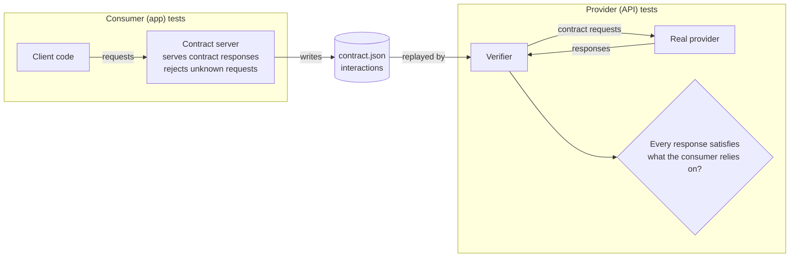

Unit tests with stubbed responses prove that a client handles the responses its authors wrote down. They cannot prove that the server sends those responses. The gap between the two is where integration failures live: the server renames `authorName` to `author`, starts returning prices as strings, or begins to require a header the app never sends, and every client test still passes because every fixture still says what it always said.

A **contract** closes that gap by making the fixtures themselves the thing both sides test against. The client's tests record what it sends and what it relies on in the responses, as data. The server's tests replay the same requests and check that the real responses still satisfy what the client relies on. This article builds that loop: a small contract format with type-based matching, a `LocalServer` that serves the contract to the client and rejects requests that do not match it, and a provider check that runs the contract against three versions of a server, one that is compatible, one that adds a field, and one that breaks the client in a way no client-side test could catch.

<!--more-->

The examples use Swift 6 language mode and Swift Testing, and were run with `swift test` using the Swift 6.4 toolchain from Xcode 27.1 on macOS 26. Each block is labeled with the file it belongs to in a Swift package with a `Library` target and a `LibraryTests` test target. The tests use `LocalServer`, the loopback HTTP server from the [appendix of the first article](/swift-http-methods-status-codes-headers/#appendix-the-local-server-used-in-this-series), placed in the test target.

<!-- check-uses: local-server -->

## What a contract records

The idea is known as **consumer-driven contract testing**, and [Pact](https://docs.pact.io) is its best-known implementation. The consumer, here the app, declares a set of **interactions**. Each one is a request the consumer sends and the minimum the consumer needs from the response:



Two properties make this different from sharing a fixture file. The contract describes what the consumer *relies on*, not a full example response, so the provider can add fields, reorder them, and change values freely; only changes that would break the consumer fail. And each side runs the contract in its own test suite, against its own code, so a breaking change fails the build of the side that made it, before it ships.

## The client

The consumer is a client for three endpoints: a search, a book detail, and a reservation, which sends a JSON body:

<!-- file: Sources/Library/CatalogAPI.swift -->
```swift
import Foundation

public struct BookSummary: Decodable, Equatable, Sendable {
    public let id: String
    public let title: String
    public let authorName: String
}

public struct BookDetail: Decodable, Equatable, Sendable {
    public let id: String
    public let title: String
    public let authorName: String
    public let pages: Int
    public let subjects: [String]
}

public struct Reservation: Decodable, Equatable, Sendable {
    public let id: String
    public let bookID: String
    public let readyBy: String
}

public enum CatalogError: Error, Equatable { case status(Int), decoding(String) }

public struct CatalogAPI: Sendable {
    let baseURL: URL
    let session: URLSession
    public init(baseURL: URL, session: URLSession = .shared) { (self.baseURL, self.session) = (baseURL, session) }

    public func search(_ text: String) async throws -> [BookSummary] {
        var components = URLComponents(url: baseURL.appending(path: "books"), resolvingAgainstBaseURL: false)!
        components.queryItems = [URLQueryItem(name: "q", value: text)]
        return try await send(URLRequest(url: components.url!))
    }

    public func book(_ id: String) async throws -> BookDetail {
        try await send(URLRequest(url: baseURL.appending(components: "books", id)))
    }

    public func reserve(_ id: String, pickupBranch: String) async throws -> Reservation {
        var request = URLRequest(url: baseURL.appending(components: "books", id, "reservations"))
        request.httpMethod = "POST"
        request.setValue("application/json", forHTTPHeaderField: "Content-Type")
        request.httpBody = try JSONEncoder().encode(["pickupBranch": pickupBranch])
        return try await send(request)
    }

    private func send<Value: Decodable>(_ request: URLRequest) async throws -> Value {
        var request = request
        request.setValue("application/json", forHTTPHeaderField: "Accept")
        let (data, response) = try await session.data(for: request)
        let status = (response as? HTTPURLResponse)?.statusCode ?? 0
        guard (200..<300).contains(status) else { throw CatalogError.status(status) }
        do { return try JSONDecoder().decode(Value.self, from: data) }
        catch { throw CatalogError.decoding("\(error)") }
    }
}
```

## A contract format with type matching

A contract must say "this field is a string" without saying which string, or every changed value would break it. The format below describes JSON by **shape**: strings, integers, booleans, arrays of a shape, and objects with required fields. An example value travels alongside each shape, because the consumer's tests need concrete data to serve:

<!-- file: Tests/LibraryTests/Contract.swift -->
```swift
import Foundation

indirect enum Shape: Codable, Equatable, Sendable {
    case string
    case integer
    case boolean
    case array(Shape)
    case object([String: Shape])

    /// Every path where `value` does not have this shape. Extra object members are allowed.
    func mismatches(in value: Any?, at path: String = "$") -> [String] {
        switch (self, value) {
        case (.string, is String): return []
        case (.integer, let number as NSNumber) where CFGetTypeID(number) != CFBooleanGetTypeID()
                                                    && number.doubleValue == number.doubleValue.rounded():
            return []
        case (.boolean, let number as NSNumber) where CFGetTypeID(number) == CFBooleanGetTypeID(): return []
        case (.array(let element), let array as [Any]):
            return array.enumerated().flatMap { element.mismatches(in: $1, at: "\(path)[\($0)]") }
        case (.object(let fields), let object as [String: Any]):
            return fields.keys.sorted().flatMap { key in
                object[key].map { fields[key]!.mismatches(in: $0, at: "\(path).\(key)") } ?? ["\(path).\(key) is missing"]
            }
        default:
            return ["\(path) should be \(self.name), got \(Self.describe(value))"]
        }
    }

    private static func describe(_ value: Any?) -> String {
        switch value {
        case nil: "nothing"
        case is NSNull: "null"
        case is String: "a string"
        case let number as NSNumber: CFGetTypeID(number) == CFBooleanGetTypeID() ? "a boolean" : "a number \(number)"
        case is [Any]: "an array"
        case is [String: Any]: "an object"
        default: "\(type(of: value!))"
        }
    }

    private var name: String {
        switch self {
        case .string: "a string"
        case .integer: "an integer"
        case .boolean: "a boolean"
        case .array: "an array"
        case .object: "an object"
        }
    }
}

struct Interaction: Codable, Equatable, Sendable {
    struct Request: Codable, Equatable, Sendable {
        var method: String
        var path: String
        var query: [String: String] = [:]
        var headers: [String: String] = [:]
        var body: Shape?
    }
    struct Response: Codable, Equatable, Sendable {
        var status: Int
        var headers: [String: String] = ["Content-Type": "application/json"]
        var body: Shape
        var example: String  // served to the consumer; must itself match `body`
    }

    var description: String
    var request: Request
    var response: Response
}

struct Contract: Codable, Sendable {
    var consumer: String
    var provider: String
    var interactions: [Interaction]
}
```

Matching is deliberately one-directional, following the **tolerant reader** principle: a response may contain more than the contract asks for, but not less, and not different types. Integers are checked as numbers with no fractional part, and booleans separately, because `JSONSerialization` represents both as `NSNumber`, and a `1` must not satisfy a boolean field or the reverse.

The consumer's contract for its three endpoints:

<!-- file: Tests/LibraryTests/CatalogContract.swift -->
```swift
import Foundation

let summaryShape = Shape.object(["id": .string, "title": .string, "authorName": .string])

let catalogContract = Contract(consumer: "LibraryApp", provider: "CatalogAPI", interactions: [
    Interaction(
        description: "search for books by title",
        request: .init(method: "GET", path: "/books", query: ["q": "dune"], headers: ["Accept": "application/json"]),
        response: .init(status: 200, body: .array(summaryShape),
                        example: #"[{"id":"b-7","title":"Dune","authorName":"Frank Herbert"}]"#)),
    Interaction(
        description: "fetch a book's details",
        request: .init(method: "GET", path: "/books/b-7", headers: ["Accept": "application/json"]),
        response: .init(status: 200,
                        body: .object(["id": .string, "title": .string, "authorName": .string,
                                       "pages": .integer, "subjects": .array(.string)]),
                        example: #"{"id":"b-7","title":"Dune","authorName":"Frank Herbert","pages":412,"subjects":["Science fiction"]}"#)),
    Interaction(
        description: "reserve a book for pickup",
        request: .init(method: "POST", path: "/books/b-7/reservations",
                       headers: ["Content-Type": "application/json", "Accept": "application/json"],
                       body: .object(["pickupBranch": .string])),
        response: .init(status: 201, body: .object(["id": .string, "bookID": .string, "readyBy": .string]),
                        example: #"{"id":"r-1","bookID":"b-7","readyBy":"2026-10-20"}"#)),
])
```

## The consumer side: a server that holds the client to the contract

The contract server is a `LocalServer` that answers each request with the example response of the matching interaction, and answers anything else with a `500` whose body says exactly why the request did not match. It also records which interactions were exercised, so a test can prove the whole contract was used. `LocalServer.start` takes its handler before it returns the server, so the state the handler needs lives in a separate `Sendable` object, the ledger, created first:

<!-- file: Tests/LibraryTests/ContractServer.swift -->
```swift
import Foundation
import Synchronization

final class ContractLedger: Sendable {
    let contract: Contract
    private let used = Mutex<Set<String>>([])
    private let rejected = Mutex<[String]>([])
    init(_ contract: Contract) { self.contract = contract }

    var exercised: Set<String> { used.withLock { $0 } }
    var mismatches: [String] { rejected.withLock { $0 } }

    func respond(to request: HTTPRequest) -> HTTPResponse {
        var reasons: [String] = []
        for interaction in contract.interactions {
            let problems = Self.problems(request, against: interaction.request)
            if problems.isEmpty {
                used.withLock { _ = $0.insert(interaction.description) }
                return HTTPResponse(status: interaction.response.status,
                                    headers: interaction.response.headers.map { ($0.key, $0.value) },
                                    body: [.bytes(Data(interaction.response.example.utf8))])
            }
            reasons.append("\(interaction.description): \(problems.joined(separator: "; "))")
        }
        let report = "No interaction matches \(request.method) \(request.target)\n" + reasons.joined(separator: "\n")
        rejected.withLock { $0.append(report) }
        return .text(report, status: 500)
    }

    static func problems(_ request: HTTPRequest, against expected: Interaction.Request) -> [String] {
        var problems: [String] = []
        if request.method != expected.method { problems.append("method \(request.method) ≠ \(expected.method)") }
        if request.path != expected.path { problems.append("path \(request.path) ≠ \(expected.path)") }
        for (name, value) in expected.query where request.query[name] != value {
            problems.append("query \(name)=\(request.query[name] ?? "nil") ≠ \(value)")
        }
        for (name, value) in expected.headers where request.header(name) != value {
            problems.append("header \(name): \(request.header(name) ?? "nil") ≠ \(value)")
        }
        if let shape = expected.body {
            let json = try? JSONSerialization.jsonObject(with: request.body, options: [.fragmentsAllowed])
            problems += shape.mismatches(in: json, at: "body")
        }
        return problems
    }
}

func startContractServer(_ contract: Contract) async throws -> (LocalServer, ContractLedger) {
    let ledger = ContractLedger(contract)
    let server = try await LocalServer.start { ledger.respond(to: $0) }
    return (server, ledger)
}
```

The consumer tests run the real client against the contract server. Each test is short, because the contract carries the data:

<!-- file: Tests/LibraryTests/ConsumerTests.swift -->
```swift
import Foundation
import Testing
@testable import Library

@Suite struct ConsumerContract {
    @Test func theClientHonorsEveryInteraction() async throws {
        let (server, ledger) = try await startContractServer(catalogContract)
        let api = CatalogAPI(baseURL: server.baseURL, session: URLSession(configuration: .ephemeral))

        let results = try await api.search("dune")
        #expect(results.first?.authorName == "Frank Herbert")
        let detail = try await api.book("b-7")
        #expect(detail.pages == 412)
        let reservation = try await api.reserve("b-7", pickupBranch: "Central")
        #expect(reservation.bookID == "b-7")

        #expect(ledger.mismatches.isEmpty)
        #expect(ledger.exercised == Set(catalogContract.interactions.map(\.description)))
    }

    @Test func examplesSatisfyTheirOwnShapes() throws {
        for interaction in catalogContract.interactions {
            let example = try JSONSerialization.jsonObject(with: Data(interaction.response.example.utf8))
            #expect(interaction.response.body.mismatches(in: example).isEmpty, "\(interaction.description)")
        }
    }

    @Test func aDriftingClientIsCaughtHere() async throws {
        let (server, ledger) = try await startContractServer(catalogContract)
        var request = URLRequest(url: server.baseURL.appending(path: "books/b-7/reservations"))
        request.httpMethod = "POST"
        request.setValue("application/json", forHTTPHeaderField: "Content-Type")
        request.setValue("application/json", forHTTPHeaderField: "Accept")
        request.httpBody = Data(#"{"branch":"Central"}"#.utf8)   // a refactor renamed the field
        let (_, response) = try await URLSession.shared.data(for: request)
        #expect((response as? HTTPURLResponse)?.statusCode == 500)
        #expect(ledger.mismatches.first?.contains("body.pickupBranch is missing") == true)
    }

    @Test func publishTheContract() throws {
        let encoder = JSONEncoder()
        encoder.outputFormatting = [.prettyPrinted, .sortedKeys]
        let file = FileManager.default.temporaryDirectory.appending(path: "LibraryApp-CatalogAPI.json")
        try encoder.encode(catalogContract).write(to: file)
        let reloaded = try JSONDecoder().decode(Contract.self, from: Data(contentsOf: file))
        #expect(reloaded.interactions == catalogContract.interactions)
    }
}
```

The third test is the consumer half of the contract's value. A refactor that renames `pickupBranch` in the request body would pass every stubbed unit test, because stubs answer whatever they are sent. Against the contract server it fails with a message that names the field. The fourth test writes the contract to a file, which in a real project is the artifact the client's CI publishes for the provider's CI to verify, often through a contract broker.

## The provider side: replaying the contract

The provider check sends each interaction's request to a real server and checks the status, the content type, and the body's shape. Here the "real" providers are three versions of the catalog API, each on its own `LocalServer`:

<!-- file: Tests/LibraryTests/Providers.swift -->
```swift
import Foundation

enum ProviderVersion: String, CaseIterable, Sendable {
    case v1          // the version the contract was written against
    case v2Additive  // adds fields and an optional header; reorders nothing the client reads
    case v3Breaking  // renames authorName to author, and returns pages as a string

    func handle(_ request: HTTPRequest) -> HTTPResponse {
        let author = self == .v3Breaking ? #""author":"Frank Herbert""# : #""authorName":"Frank Herbert""#
        let extra = self == .v2Additive ? #","coverURL":"https://covers.example/b-7.jpg","rating":4.6"# : ""
        let pages = self == .v3Breaking ? #""412""# : "412"
        switch (request.method, request.path) {
        case ("GET", "/books"):
            return .json(#"[{"id":"b-7","title":"Dune",\#(author)\#(extra)},{"id":"b-8","title":"Dune Messiah",\#(author)}]"#)
        case ("GET", "/books/b-7"):
            return .json(#"{"id":"b-7","title":"Dune",\#(author),"pages":\#(pages),"subjects":["Science fiction","Classics"]\#(extra)}"#,
                         headers: self == .v2Additive ? [("X-Catalog-Revision", "2")] : [])
        case ("POST", "/books/b-7/reservations"):
            return .json(#"{"id":"r-\#(Int.random(in: 100...999))","bookID":"b-7","readyBy":"2026-10-21"\#(extra)}"#, status: 201)
        default:
            return .text("not found", status: 404)
        }
    }
}

struct VerificationFailure: CustomStringConvertible {
    let interaction: String
    let problems: [String]
    var description: String { "\(interaction): \(problems.joined(separator: "; "))" }
}

func verify(_ contract: Contract, against baseURL: URL) async throws -> [VerificationFailure] {
    var failures: [VerificationFailure] = []
    for interaction in contract.interactions {
        var components = URLComponents(url: baseURL.appending(path: String(interaction.request.path.dropFirst())),
                                       resolvingAgainstBaseURL: false)!
        if !interaction.request.query.isEmpty {
            components.queryItems = interaction.request.query.map { URLQueryItem(name: $0.key, value: $0.value) }
        }
        var request = URLRequest(url: components.url!)
        request.httpMethod = interaction.request.method
        interaction.request.headers.forEach { request.setValue($0.value, forHTTPHeaderField: $0.key) }
        if interaction.request.body != nil {
            request.httpBody = Data(#"{"pickupBranch":"Central"}"#.utf8)  // in a real broker, an example travels with the request too
        }
        let (data, response) = try await URLSession(configuration: .ephemeral).data(for: request)
        let http = response as! HTTPURLResponse
        var problems: [String] = []
        if http.statusCode != interaction.response.status {
            problems.append("status \(http.statusCode) ≠ \(interaction.response.status)")
        }
        if let type = interaction.response.headers["Content-Type"], http.mimeType != type {
            problems.append("Content-Type \(http.mimeType ?? "nil") ≠ \(type)")
        }
        let json = try? JSONSerialization.jsonObject(with: data, options: [.fragmentsAllowed])
        problems += interaction.response.body.mismatches(in: json)
        if !problems.isEmpty { failures.append(VerificationFailure(interaction: interaction.description, problems: problems)) }
    }
    return failures
}
```

<!-- file: Tests/LibraryTests/ProviderTests.swift -->
```swift
import Foundation
import Testing

@Suite struct ProviderVerification {
    @Test(arguments: ProviderVersion.allCases)
    func verifyProvider(_ version: ProviderVersion) async throws {
        let provider = try await LocalServer.start { version.handle($0) }
        let failures = try await verify(catalogContract, against: provider.baseURL)
        switch version {
        case .v1, .v2Additive:
            #expect(failures.isEmpty, "\(failures)")
        case .v3Breaking:
            #expect(failures.map(\.interaction) == ["search for books by title", "fetch a book's details"])
            let detail = failures.first { $0.interaction == "fetch a book's details" }
            #expect(detail?.problems == ["$.authorName is missing", "$.pages should be an integer, got a string"])
        }
    }
}
```

| Provider change | Contract result | Would a client-side stub test notice? |
|---|---|---|
| v2: adds `coverURL`, `rating`, a response header, more subjects | Passes | No, and it does not need to |
| v3: renames `authorName` to `author` | Fails: `$.authorName is missing`, and `$[0].authorName` / `$[1].authorName` for the search | No: stubs still send `authorName` |
| v3: sends `pages` as `"412"` | Fails: `$.pages should be an integer` | No |

The breaking version's failures name the interaction, the JSON path, and the reason, which is exactly the review comment the provider's team needs: "the app reads `authorName` and `pages` as an integer." The additive version passed, because every field the app relies on is still there with the same type, and the extra ones are ignored, as the app's `Decodable` types already ignore them.

## Which changes are safe

The rules the verifier enforces generalize into the compatibility rules for JSON APIs that every client and server team should share:

| Change on the provider | Safe for existing clients? |
|---|---|
| Add a response field | Yes, if clients ignore unknown fields |
| Add an optional request field or query parameter | Yes |
| Add a new enum value in a response | Only if clients have an `unknown` case (see [Decoding JSON with `Codable`](/swift-decoding-json-codable/)) |
| Remove or rename a response field the client reads | No |
| Change a field's type, including number to string | No |
| Make an optional request field required | No |
| Change status codes for existing outcomes | No |
| Tighten validation of request values | Usually no |

Two of the "yes" rows depend on the client: they are safe only for clients written as tolerant readers. The contract encodes that assumption by allowing extra members, so a client that broke on unknown fields would be breaking its own contract.

## Where contracts fit

Contracts complement the other kinds of test in this series rather than replacing any of them:

- **Stubbed unit tests** ([`URLProtocol` fixtures](/swift-urlprotocol-fixtures/), [failure matrices](/swift-testing-network-failures/)) check the client's handling of every response, including ones a contract does not describe, such as a `503`.
- **Contract tests** check that the client's requests and the provider's responses agree on the parts that matter. They are the only fast test that fails when *the other side* changes.
- **End-to-end tests** against a real staging environment check deployment, authentication, and data, slowly and with more flakiness, and should be few.

A contract is only as good as the interactions in it. It describes what the app relies on today, so it must be updated when the app starts relying on something new, which is easiest when the consumer tests above are the only place fixtures for these endpoints come from.

## Summary

- A consumer-driven contract records the requests a client sends and the minimum it relies on in each response, as data both sides test against.
- Describe responses by shape, not by value, and allow extra fields: the tolerant-reader rule that lets providers evolve.
- On the consumer side, serve the contract's examples from a controlled server that rejects any request that does not match, with a message that names the mismatch, and check that every interaction was exercised.
- On the provider side, replay each interaction's request against the real service and check status, content type, and body shape.
- Measured: an additive provider change passed; renaming `authorName` and sending `pages` as a string failed with the exact JSON paths, changes no stubbed client test would have caught.
- Share the compatibility rules: adding fields is safe for tolerant readers; removing, renaming, retyping, and tightening are not.

## Exercise

Add an `optional(Shape)` case to `Shape`, use it for a new `subtitle` field in the book detail interaction, and check that a provider that omits `subtitle` passes and one that sends `"subtitle": 3` fails. Then add request-body examples to `Interaction.Request` so the verifier stops hard-coding the reservation body, and add a provider version that requires a new `pickupDate` field in the reservation request, which the verifier should report as a `400` from the provider for the reservation interaction.

## Further reading

- The [Pact documentation](https://docs.pact.io), on consumer-driven contracts and brokers.
- Martin Fowler, [*Contract Test*](https://martinfowler.com/bliki/ContractTest.html) and [*Tolerant Reader*](https://martinfowler.com/bliki/TolerantReader.html).
- Ian Robinson, [*Consumer-Driven Contracts: A Service Evolution Pattern*](https://martinfowler.com/articles/consumerDrivenContracts.html).

Previous: [Testing Status Codes, Invalid Payloads, and Transport Errors](/swift-testing-network-failures/). Next: [Reading `URLSessionTaskMetrics`](/swift-urlsessiontaskmetrics/).

Return to the [Networking roadmap](/swift-networking/).
