"The request is slow" is not a diagnosis. A request can be slow because the name took long to resolve, because the connection needed a TCP and TLS handshake to a distant server, because the server took long to think, because the response was large, or because the request waited in the session's own queue before any of that started. Each cause has a different fix, and guessing between them is how teams spend a week optimizing a server that was never the bottleneck.

`URLSessionTaskMetrics` answers the question for every request, from inside the app, on the user's real network. For each task it reports a timeline of the phases of every HTTP transaction, whether a connection was reused, which protocol was negotiated, whether the response came from the cache, and how many bytes went each way. This article reads those fields against the local server, where every number can be checked, and against real HTTPS endpoints, where they show what a phone actually pays for. It ends with a recorder that turns per-request metrics into the percentiles that matter.

<!--more-->

The examples use Swift 6 language mode and were compiled and run with the Swift 6.4 toolchain from Xcode 27.1 on macOS 26. They send requests to `LocalServer`, the loopback HTTP server from the [appendix of the first article](/swift-http-methods-status-codes-headers/#appendix-the-local-server-used-in-this-series); paste that code first, then the blocks below in order, into one `main.swift`. The TLS section uses the test certificate authority and server identity generated in [App Transport Security and TLS Trust](/swift-ats-tls-trust/); the files must be in the working directory.

<!-- check-uses: local-server -->

## Collecting metrics

Metrics arrive through one delegate method, `urlSession(_:task:didFinishCollecting:)`, called once per task after it completes. A session delegate receives it for every task; the `delegate:` parameter of the `async` methods receives it for one task. The collector below stores each task's metrics by task identifier, behind a lock, because the session calls it on its own delegate queue:

```swift
import Foundation
import Network
import Security
import Synchronization

final class MetricsCollector: NSObject, URLSessionTaskDelegate, Sendable {
    private let collected = Mutex<[URLSessionTaskMetrics]>([])

    func urlSession(_ session: URLSession, task: URLSessionTask, didFinishCollecting metrics: URLSessionTaskMetrics) {
        collected.withLock { $0.append(metrics) }
    }

    var all: [URLSessionTaskMetrics] { collected.withLock { $0 } }
    var last: URLSessionTaskMetrics? { all.last }
}

func milliseconds(_ start: Date?, _ end: Date?) -> Double? {
    guard let start, let end else { return nil }
    return end.timeIntervalSince(start) * 1000
}
```

A `URLSessionTaskMetrics` value has three parts: `taskInterval`, the task's whole life from creation to completion; `redirectCount`; and `transactionMetrics`, one `URLSessionTaskTransactionMetrics` for each request-response pair the task made, including redirects and cache lookups.

## The phases of a transaction

Each transaction carries timestamps for the phases of loading a resource, defined in the same terms as the W3C's [Resource Timing](https://www.w3.org/TR/resource-timing/) for browsers:

```mermaid
gantt
    accTitle: The phases of a cold HTTPS request to www.apple.com, measured with URLSessionTaskMetrics
    dateFormat x
    axisFormat %L ms
    section DNS
    domainLookup (cached) :0, 1
    section Connection
    TCP handshake :1, 17
    TLS handshake :17, 32
    section Exchange
    request sent :32, 33
    waiting for first byte :33, 42
    response body :42, 45
```



| Phase | Timestamps | What it costs |
|---|---|---|
| Queueing | `fetchStartDate` → `domainLookupStartDate` | Waiting for a connection slot or the cache |
| DNS | `domainLookupStartDate` → `domainLookupEndDate` | Name resolution, often cached |
| Connect | `connectStartDate` → `connectEndDate` | TCP or QUIC handshake, **including** TLS |
| TLS | `secureConnectionStartDate` → `secureConnectionEndDate` | The TLS part of the connect phase |
| Request | `requestStartDate` → `requestEndDate` | Sending headers and body |
| Waiting | `requestEndDate` → `responseStartDate` | Network round trip plus server processing |
| Download | `responseStartDate` → `responseEndDate` | Receiving the body |

The connect phase contains the TLS phase; they are not consecutive. A reused connection has no DNS, connect, or TLS timestamps at all, which is the most direct way to see that reuse happened. The "waiting" phase is often called time to first byte, and it is the only phase that includes the server's own work.

The timeline above comes from a real request. Three requests to public HTTPS endpoints from the Mac used for this series, over Wi-Fi, produced:

<!-- skip-check -->
```swift
let collector = MetricsCollector()
let session = URLSession(configuration: .ephemeral, delegate: collector, delegateQueue: nil)
for url in ["https://www.apple.com/library/test/success.html",
            "https://www.apple.com/library/test/success.html",
            "https://www.google.com/generate_204"] {
    _ = try await session.data(from: URL(string: url)!)
}
// Printed for each network transaction: protocol, reuse, phase durations, TLS version, header bytes sent
```

```text
www.apple.com   h2  reused=false  dns 1.0  connect 31.0 (tls 15.0)  ttfb 9.2   total 45.1   TLS 1.3  header bytes sent 142
www.apple.com   h2  reused=true   dns -    connect -                ttfb 7.9   total 8.1    TLS 1.3  header bytes sent 48
www.google.com  h3  reused=false  dns 1.0  connect 170.0 (tls 167.0) ttfb 53.9 total 242.8  TLS 1.3  header bytes sent 113
```

Several lessons are in those three lines:

- The first request to `www.apple.com` spent 31 ms of its 45 ms connecting. The second, on the reused HTTP/2 connection, took 8 ms in total. Connection reuse, not server speed, was the difference.
- The second request sent 48 header bytes instead of 142, because HTTP/2's HPACK compression ([RFC 7541](https://www.rfc-editor.org/rfc/rfc7541)) sends repeated headers as references to an earlier request's.
- The Google endpoint was reached over HTTP/3, on QUIC. Its connect and TLS phases nearly coincide, 170 and 167 ms, because QUIC performs the transport and TLS 1.3 handshakes together.

### Round trips set the floor

The phases explain why latency, not bandwidth, dominates small requests. If the round-trip time to the server is $$R$$ and the server needs $$S$$ to produce the response, a request on a new HTTPS connection over TCP needs one round trip for the TCP handshake, one for the TLS 1.3 handshake, and one for the request itself:

$$
T_{\text{cold, TCP+TLS 1.3}} \;\ge\; 3R + S,
\qquad
T_{\text{cold, QUIC}} \;\ge\; 2R + S,
\qquad
T_{\text{reused}} \;\ge\; R + S
$$

TLS 1.2 adds another round trip, and QUIC can even send the request in its first flight on reconnection with 0-RTT, at the cost of replay protection. The TCP part of the connect phase, `secureConnectionStartDate − connectStartDate`, is itself one round trip, so the metrics provide an estimate of $$R$$ for free: about 16 ms in the `apple.com` measurement, which also bounds the server's think time in the 9 ms "waiting" phase to almost nothing. On a cellular network where $$R$$ is 80 ms, the same cold request costs at least 240 ms before the server does anything, which is why [connection reuse](/swift-urlsession-configuration/) and fewer, larger requests matter more on phones than any server optimization.

## Reading the fields against a known server

The local server makes every field checkable. It serves a fast route, a slow route that waits 150 ms before answering, a redirect, and a cacheable route:

```swift
let server = try await LocalServer.start { request in
    switch request.path {
    case "/fast": .json(#"{"ok":true}"#)
    case "/slow": HTTPResponse(status: 200, headers: [("Content-Type", "application/json")],
                               body: [.bytes(Data(repeating: 65, count: 5_000))], delay: .milliseconds(150))
    case "/moved": HTTPResponse(status: 302, headers: [("Location", "/landing")])
    case "/landing": .json(#"{"moved":true}"#)
    case "/cached": .json(#"{"ok":true}"#, headers: [("Cache-Control", "max-age=60")])
    default: .text("not found", status: 404)
    }
}

let collector = MetricsCollector()
let configuration = URLSessionConfiguration.default
configuration.urlCache = URLCache(memoryCapacity: 1_000_000, diskCapacity: 0)
let session = URLSession(configuration: configuration, delegate: collector, delegateQueue: nil)

_ = try await session.data(from: server.baseURL.appending(path: "fast"))
let cold = collector.last!.transactionMetrics.last!
_ = try await session.data(from: server.baseURL.appending(path: "slow"))
let warm = collector.last!.transactionMetrics.last!

assert(cold.networkProtocolName == "http/1.1" && cold.resourceFetchType == .networkLoad)
assert(!cold.isReusedConnection && cold.connectStartDate != nil)
assert(warm.isReusedConnection && warm.connectStartDate == nil && warm.domainLookupStartDate == nil)
assert(cold.remoteAddress == "127.0.0.1" && cold.remotePort == server.port)
assert(cold.localPort == warm.localPort)   // the same TCP connection, seen from the client side

let waiting = milliseconds(warm.requestEndDate, warm.responseStartDate)!
assert(waiting >= 150 && waiting < 250)    // the server's 150 ms shows up as time to first byte
assert(warm.countOfResponseBodyBytesReceived == 5_000)
assert(warm.countOfRequestHeaderBytesSent > 100 && warm.countOfRequestBodyBytesSent == 0)
assert(!warm.isCellular && !warm.isExpensive && !warm.isConstrained)
```

The server's 150 ms delay appeared, as it should, in the waiting phase, between the end of the request and the first byte of the response. The second request reused the first one's TCP connection: no DNS or connect timestamps, and the same local port.

### Redirects and the cache add transactions

A task's `transactionMetrics` is an array because one task can make several exchanges. A redirect makes two:

```swift
_ = try await session.data(from: server.baseURL.appending(path: "moved"))
let redirected = collector.last!
assert(redirected.redirectCount == 1 && redirected.transactionMetrics.count == 2)
assert((redirected.transactionMetrics[0].response as? HTTPURLResponse)?.statusCode == 302)
assert((redirected.transactionMetrics[1].response as? HTTPURLResponse)?.statusCode == 200)
```

The cache adds transactions of its own. A fresh cached response produces one transaction with `resourceFetchType == .localCache` and no network timestamps. A response that was stored without freshness information, like the `/fast` route's, which has no `Cache-Control`, produces *two* on its next use: a cache transaction for the stored candidate, then the network transaction that replaced it:

```swift
_ = try await session.data(from: server.baseURL.appending(path: "cached"))
_ = try await session.data(from: server.baseURL.appending(path: "cached"))
let hit = collector.last!
assert(hit.transactionMetrics.count == 1 && hit.transactionMetrics[0].resourceFetchType == .localCache)
assert(hit.transactionMetrics[0].networkProtocolName == nil && hit.transactionMetrics[0].remoteAddress == nil)

_ = try await session.data(from: server.baseURL.appending(path: "fast"))
let revalidated = collector.last!.transactionMetrics.map(\.resourceFetchType)
assert(revalidated == [.localCache, .networkLoad])
```

This is the reliable way to answer "was this served from the cache?" The response itself cannot tell you: as [HTTP Caching](/swift-http-caching-etag/) showed, even a revalidated `304` is delivered as a `200`.

Cache lookups also combine with redirects. Had `/moved` pointed at `/slow`, which this session had already stored without freshness information, the task would have had three transactions, the `302`, a cache candidate for `/slow`, and the network load that replaced it. Code that reads `transactionMetrics.last` for the final exchange, as the recorder below does, is unaffected; code that assumes `transactionMetrics.count == redirectCount + 1` is not.

### TLS details

Over HTTPS, the transaction also reports the negotiated TLS version and cipher suite. Against the TLS-enabled `LocalServer` from the ATS article, with the test CA trusted by a delegate:

```swift
func identity() throws -> sec_identity_t {
    let p12 = try Data(contentsOf: URL(fileURLWithPath: "server.p12"))
    var items: CFArray?
    let options: [String: Any] = [kSecImportExportPassphrase as String: "test", kSecImportToMemoryOnly as String: true]
    guard SecPKCS12Import(p12 as CFData, options as CFDictionary, &items) == errSecSuccess,
          let first = (items as? [[String: Any]])?.first else { throw URLError(.clientCertificateRejected) }
    return sec_identity_create(first[kSecImportItemIdentity as String] as! SecIdentity)!
}

final class TrustTestCA: NSObject, URLSessionTaskDelegate, Sendable {
    let collector = MetricsCollector()
    func urlSession(_ session: URLSession, task: URLSessionTask, didReceive challenge: URLAuthenticationChallenge)
        async -> (URLSession.AuthChallengeDisposition, URLCredential?) {
        guard let trust = challenge.protectionSpace.serverTrust,
              let ca = try? Data(contentsOf: URL(fileURLWithPath: "ca.der")),
              let anchor = SecCertificateCreateWithData(nil, ca as CFData) else { return (.performDefaultHandling, nil) }
        SecTrustSetAnchorCertificates(trust, [anchor] as CFArray)
        return SecTrustEvaluateWithError(trust, nil) ? (.useCredential, URLCredential(trust: trust)) : (.cancelAuthenticationChallenge, nil)
    }
    func urlSession(_ session: URLSession, task: URLSessionTask, didFinishCollecting metrics: URLSessionTaskMetrics) {
        collector.urlSession(session, task: task, didFinishCollecting: metrics)
    }
}

let tlsOptions = NWProtocolTLS.Options()
sec_protocol_options_set_local_identity(tlsOptions.securityProtocolOptions, try identity())
let secure = try await LocalServer.start(tls: tlsOptions) { _ in .json(#"{"secure":true}"#) }
let trustDelegate = TrustTestCA()
_ = try await URLSession(configuration: .ephemeral).data(from: secure.baseURL, delegate: trustDelegate)
let tls = trustDelegate.collector.last!.transactionMetrics.last!
assert(tls.negotiatedTLSProtocolVersion == .TLSv13)
assert(tls.secureConnectionStartDate != nil && tls.secureConnectionEndDate != nil)
assert(tls.connectStartDate! <= tls.secureConnectionStartDate! && tls.secureConnectionEndDate! <= tls.connectEndDate!)
print("TLS 1.3, cipher suite 0x\(String(tls.negotiatedTLSCipherSuite!.rawValue, radix: 16))")
```

The assertion on the timestamps confirms the table: the TLS phase lies inside the connect phase. The cipher suite printed `0x1302`, `TLS_AES_256_GCM_SHA384`, the same suite the public servers above negotiated; it is a TLS 1.3 suite and satisfies App Transport Security.

## From single requests to percentiles

One request's metrics explain one request. Decisions need distributions: "the 95th-percentile time to first byte for the catalog endpoint is 800 ms on cellular." The recorder below reduces each transaction to a few numbers, keyed by a route template so that `/books/7` and `/books/8` aggregate together, and computes percentiles with the nearest-rank method:

$$
P_p = x_{(\lceil p\,n \rceil)}
$$

where $$x_{(k)}$$ is the $$k$$-th smallest of the $$n$$ samples. The mean is a poor summary for latency, because latency distributions are skewed: a few very slow requests pull the mean up while saying nothing about the typical one, and the typical one says nothing about the slow requests users notice.

```swift
struct Sample: Sendable {
    let route: String
    let waiting: Double     // ms, request end to first byte
    let total: Double       // ms, fetch start to response end
    let reused: Bool
    let fromCache: Bool
}

final class MetricsRecorder: NSObject, URLSessionTaskDelegate, Sendable {
    private let samples = Mutex<[Sample]>([])
    let route: @Sendable (URL) -> String

    init(route: @escaping @Sendable (URL) -> String) { self.route = route }

    func urlSession(_ session: URLSession, task: URLSessionTask, didFinishCollecting metrics: URLSessionTaskMetrics) {
        guard let final = metrics.transactionMetrics.last, let url = final.request.url else { return }
        let sample = Sample(route: route(url),
                            waiting: milliseconds(final.requestEndDate, final.responseStartDate) ?? 0,
                            total: milliseconds(final.fetchStartDate, final.responseEndDate) ?? 0,
                            reused: final.isReusedConnection,
                            fromCache: final.resourceFetchType == .localCache)
        samples.withLock { $0.append(sample) }
    }

    func percentile(_ p: Double, of keyPath: KeyPath<Sample, Double>, route: String) -> Double? {
        let values = samples.withLock { $0 }.filter { $0.route == route && !$0.fromCache }.map { $0[keyPath: keyPath] }.sorted()
        guard !values.isEmpty else { return nil }
        return values[max(0, Int((p * Double(values.count)).rounded(.up)) - 1)]
    }

    func reuseRate(route: String) -> Double {
        let network = samples.withLock { $0 }.filter { $0.route == route && !$0.fromCache }
        return network.isEmpty ? 0 : Double(network.filter(\.reused).count) / Double(network.count)
    }
}
```

The test drives 200 requests at a route whose server-side delay follows a known distribution: 90% take 20 ms, 10% take 200 ms. The recorder should find that the median waiting time is near 20 ms and the 95th percentile near 200 ms, and that a mean would describe neither:

```swift
let books = try await LocalServer.start { request in
    let slow = Int(request.query["n"] ?? "0")! % 10 == 0
    return HTTPResponse(status: 200, headers: [("Content-Type", "application/json")],
                        body: [.bytes(Data("{}".utf8))], delay: .milliseconds(slow ? 200 : 20))
}
let recorder = MetricsRecorder { url in
    url.path().split(separator: "/").map { Int($0) == nil ? String($0) : ":id" }.joined(separator: "/")
}
let recordingSession = URLSession(configuration: .ephemeral, delegate: recorder, delegateQueue: nil)
try await withThrowingTaskGroup(of: Void.self) { group in
    for n in 0..<200 {
        group.addTask {
            var components = URLComponents(url: books.baseURL.appending(path: "books/\(n % 25)"), resolvingAgainstBaseURL: false)!
            components.queryItems = [URLQueryItem(name: "n", value: "\(n)")]
            _ = try await recordingSession.data(from: components.url!)
        }
    }
    try await group.waitForAll()
}

let p50 = recorder.percentile(0.50, of: \.waiting, route: "books/:id")!
let p95 = recorder.percentile(0.95, of: \.waiting, route: "books/:id")!
let p99Total = recorder.percentile(0.99, of: \.total, route: "books/:id")!
print(String(format: "waiting p50 %.0f ms, p95 %.0f ms; total p99 %.0f ms; reuse %.0f%%",
             p50, p95, p99Total, recorder.reuseRate(route: "books/:id") * 100))
assert(p50 >= 20 && p50 < 60)
assert(p95 >= 200 && p95 < 300)
assert(recorder.reuseRate(route: "books/:id") > 0.9)   // six connections served 200 requests
```

The run printed a median waiting time of 25 ms and a 95th percentile of 207 ms, close to the fast requests' 20 ms and the slow requests' 200 ms: exactly the shape the server was given, plus a few milliseconds of overhead. The mean, about 38 ms, would have suggested that every request is moderately slow, which no request was. The reuse rate, 97%, shows the session at work: with the default limit of six connections per host, nearly all of the 200 requests went over an existing connection.

`total` includes queueing, which here is large: the 99th percentile of total time was 1.48 seconds, for requests whose server work took at most 200 ms, because 200 concurrent requests shared six connections and most of each request's time was spent waiting for a free one. That queueing is visible only in metrics, between `fetchStartDate` and the moment the request is sent, and it is the subject of [Diagnosing Slow Requests and Excessive Network Usage](/swift-diagnosing-slow-requests/).

## Using metrics in production

Metrics are cheap to collect and easy to over-collect. A few rules keep them useful and safe:

- **Aggregate on the device.** Send percentiles per route and network type at intervals, not one record per request. A dozen numbers per route per hour answer nearly every question.
- **Segment by what changes the answer.** Network type (`isCellular`, `isExpensive`, `isConstrained`), protocol (`networkProtocolName`), and reuse change latency more than anything in the app's code. A p95 across all of them hides the cellular cold-start case that users complain about.
- **Treat addresses as personal data.** `localAddress` and `remoteAddress` include the device's IP address, which can identify a user and approximate their location. Do not upload them; [Redacting Sensitive Data from Network Logs](/swift-redacting-network-logs/) applies here too.
- **Template the routes.** Grouping by full URL produces one bucket per book; grouping by `books/:id` produces one per endpoint, and keeps identifiers out of analytics.

## Summary

- `urlSession(_:task:didFinishCollecting:)` delivers one `URLSessionTaskMetrics` per task, with a transaction for every exchange, including redirects and cache lookups.
- Phases: queueing, DNS, connect (which contains TLS), request, waiting for the first byte (round trip plus server time), and download. Reused connections have no DNS, connect, or TLS timestamps.
- Measured against public servers: a reused HTTP/2 connection cut a request from 45 ms to 8 ms and its header bytes from 142 to 48; HTTP/3 merged the transport and TLS handshakes.
- Round trips set a floor: at least $$3R + S$$ for a cold TCP and TLS 1.3 request, $$2R + S$$ over QUIC, $$R + S$$ on a reused connection.
- `resourceFetchType == .localCache` is the reliable signal of a cache hit; a stale stored response produces a cache transaction followed by a network one.
- Aggregate into percentiles per route template and network type. Measured: a 90/10 mix of 20 ms and 200 ms server times gave p50 near 20 ms and p95 near 200 ms, which a mean of about 38 ms would hide.

## Exercise

Extend `MetricsRecorder` to keep, per route, a histogram with fixed buckets (0–25, 25–50, 50–100, 100–250, 250–500, 500–1000, over 1000 ms) instead of every sample, so it can run for days in constant memory. Compute approximate percentiles from the histogram by interpolating within the bucket that contains the rank, and compare them with the exact percentiles from the 200-request test. How large is the error at p50 and p95, and how would you choose buckets so the error is smallest where you make decisions?

## Further reading

- Apple's [`URLSessionTaskMetrics`](https://developer.apple.com/documentation/foundation/urlsessiontaskmetrics) and [`URLSessionTaskTransactionMetrics`](https://developer.apple.com/documentation/foundation/urlsessiontasktransactionmetrics).
- [Analyze HTTP traffic in Instruments](https://developer.apple.com/videos/play/wwdc2021/10212/), WWDC21.
- The W3C [Resource Timing](https://www.w3.org/TR/resource-timing/) specification, which defines the same phases for browsers.
- [RFC 9000: QUIC](https://www.rfc-editor.org/rfc/rfc9000) and [RFC 7541: HPACK](https://www.rfc-editor.org/rfc/rfc7541).

Previous: [Verifying Contracts Against a Controlled Server](/swift-contract-testing-controlled-server/). Next: [Diagnosing Slow Requests and Excessive Network Usage](/swift-diagnosing-slow-requests/).

Return to the [Networking roadmap](/swift-networking/).
