Two complaints reach every app team eventually: "the screen takes forever to load" and "the app uses a lot of data." Both sound like server problems, and both are usually client problems: requests that wait for each other when they could run together, the same resource fetched three times by three components, payloads sent uncompressed, a poll every 30 seconds that nobody remembers adding. None of them shows up in a profile of the app's CPU usage, and none of them shows up in the server's latency dashboards, which report each request as fast.

The way out is to measure the network behavior of a *screen*, not of individual requests, and to keep measuring it in tests so that a regression fails a build instead of a review. This article builds a small audit from `URLSessionTaskMetrics`, uses it on a deliberately wasteful screen against a local server, and fixes each problem it finds: a waterfall, duplicate and N+1 requests, queueing behind the connection limit, uncompressed responses, and polling. Each fix is measured, and the end result is locked in with a network budget test.

<!--more-->

The examples use Swift 6 language mode and were compiled and run with the Swift 6.4 toolchain from Xcode 27.1 on macOS 26. They send requests to `LocalServer`, the loopback HTTP server from the [appendix of the first article](/swift-http-methods-status-codes-headers/#appendix-the-local-server-used-in-this-series); paste that code first, then the blocks below in order, into one `main.swift`. The metrics fields used here are explained in [Reading `URLSessionTaskMetrics`](/swift-urlsessiontaskmetrics/).

<!-- check-uses: local-server -->

## A method, not a tool

Network performance problems are found the same way every time:

1. **Measure a user-visible unit of work**, such as opening a screen, from the first request to the last. Record every request: when it started and ended, how many bytes it moved, whether it was a duplicate.
2. **Look for shape, not speed.** Total time is a symptom. The diagnosis is in the shape of the requests over time: a staircase means a waterfall, a pile-up at the start means queueing, two identical bars mean a duplicate.
3. **Fix one pattern, measure again.**
4. **Write the result down as a budget** that a test enforces: at most so many requests, so many bytes, so many sequential round trips.

The first step needs a recorder. The audit below is a session delegate that turns each task's metrics into an entry, and summarizes the entries:

```swift
import Foundation
import Synchronization

struct AuditEntry: Sendable {
    let path: String
    let start: Date
    let end: Date
    let queued: Double          // ms between the task starting and its request being sent
    let wireBytes: Int64        // response body bytes as received
    let decodedBytes: Int64     // after Content-Encoding was undone
    let reused: Bool
}

final class NetworkAudit: NSObject, URLSessionTaskDelegate, Sendable {
    private let entries = Mutex<[AuditEntry]>([])

    func urlSession(_ session: URLSession, task: URLSessionTask, didFinishCollecting metrics: URLSessionTaskMetrics) {
        guard let last = metrics.transactionMetrics.last, let url = last.request.url else { return }
        let queued = last.requestStartDate.map { $0.timeIntervalSince(metrics.taskInterval.start) * 1000 } ?? 0
        let entry = AuditEntry(path: url.path() + (url.query().map { "?" + $0 } ?? ""),
                               start: metrics.taskInterval.start, end: metrics.taskInterval.end, queued: queued,
                               wireBytes: metrics.transactionMetrics.reduce(0) { $0 + $1.countOfResponseBodyBytesReceived },
                               decodedBytes: last.countOfResponseBodyBytesAfterDecoding, reused: last.isReusedConnection)
        entries.withLock { $0.append(entry) }
    }

    func reset() { entries.withLock { $0.removeAll() } }

    struct Report: CustomStringConvertible {
        let requests: Int
        let duplicates: [String]
        let wall: Double          // ms from first start to last end
        let busy: Double          // ms summed over all requests
        let wireBytes: Int64
        let decodedBytes: Int64
        let worstQueued: Double

        /// Average number of requests in flight while the screen loaded.
        var parallelism: Double { wall > 0 ? busy / wall : 0 }

        var description: String {
            String(format: "%d requests, %d duplicates, %.0f ms wall, parallelism %.2f, %lld B on the wire (%lld decoded), worst queue %.0f ms",
                   requests, duplicates.count, wall, parallelism, wireBytes, decodedBytes, worstQueued)
        }
    }

    var report: Report {
        let all = entries.withLock { $0 }
        let start = all.map(\.start).min() ?? .now
        let end = all.map(\.end).max() ?? .now
        let counts = Dictionary(all.map { ($0.path, 1) }, uniquingKeysWith: +)
        return Report(requests: all.count,
                      duplicates: counts.filter { $0.value > 1 }.keys.sorted(),
                      wall: end.timeIntervalSince(start) * 1000,
                      busy: all.reduce(0) { $0 + $1.end.timeIntervalSince($1.start) * 1000 },
                      wireBytes: all.reduce(0) { $0 + $1.wireBytes },
                      decodedBytes: all.reduce(0) { $0 + $1.decodedBytes },
                      worstQueued: all.map(\.queued).max() ?? 0)
    }
}
```

**Parallelism** is the one derived number worth explaining. If the requests' durations add up to $$B$$ (the busy time) and the screen took $$W$$ from first request to last, then $$B/W$$ is the average number of requests in flight, Little's law again. A value near 1 with several requests means they ran one after another.

## The server and a wasteful screen

The server below is a small library API. Every route answers after 60 ms, standing in for a mobile round trip, and book responses are about 2 KB of JSON. It compresses responses with gzip when the client accepts it and the server has compression switched on, which the test toggles:

```swift
func crc32(_ data: Data) -> UInt32 {
    var table = [UInt32](repeating: 0, count: 256)
    for index in 0..<256 {
        var value = UInt32(index)
        for _ in 0..<8 { value = value & 1 != 0 ? 0xEDB8_8320 ^ (value >> 1) : value >> 1 }
        table[index] = value
    }
    var crc: UInt32 = 0xFFFF_FFFF
    for byte in data { crc = table[Int((crc ^ UInt32(byte)) & 0xFF)] ^ (crc >> 8) }
    return crc ^ 0xFFFF_FFFF
}

/// RFC 1952 framing around the raw DEFLATE stream that Foundation's `.zlib` algorithm produces.
func gzip(_ data: Data) throws -> Data {
    var output = Data([0x1F, 0x8B, 0x08, 0, 0, 0, 0, 0, 0, 0xFF])
    output.append(try (data as NSData).compressed(using: .zlib) as Data)
    for value in [crc32(data), UInt32(truncatingIfNeeded: data.count)] {
        withUnsafeBytes(of: value.littleEndian) { output.append(contentsOf: $0) }
    }
    return output
}

let compressionEnabled = Mutex(false)

func book(_ id: String) -> String {
    let synopsis = String(repeating: "A desert planet, a noble family, and a prophecy. ", count: 36)
    return #"{"id":"\#(id)","title":"Book \#(id)","author":"Frank Herbert","synopsis":"\#(synopsis)"}"#
}

let server = try await LocalServer.start { request in
    let body: String
    switch request.path {
    case "/me": body = #"{"id":"u-1","branch":"central"}"#
    case "/me/loans": body = "[" + (1...5).map { #"{"bookID":"b-\#($0)"}"# }.joined(separator: ",") + "]"
    case "/books": body = "[" + (request.query["ids"] ?? "").split(separator: ",").map { book(String($0)) }.joined(separator: ",") + "]"
    case let path where path.hasPrefix("/books/"): body = book(String(path.dropFirst(7)))
    case "/branches/central/hours": body = #"{"open":"09:00","close":"18:00"}"#
    default: return .text("not found", status: 404)
    }
    let data = Data(body.utf8)
    var headers: [(name: String, value: String)] = [("Content-Type", "application/json")]
    var payload = data
    if compressionEnabled.withLock({ $0 }), request.header("Accept-Encoding")?.contains("gzip") == true {
        payload = try! gzip(data)
        headers.append(("Content-Encoding", "gzip"))
    }
    return HTTPResponse(status: 200, headers: headers, body: [.bytes(payload)], delay: .milliseconds(60))
}

let audit = NetworkAudit()
let session = URLSession(configuration: .ephemeral, delegate: audit, delegateQueue: nil)

func get<T: Decodable>(_ path: String, as type: T.Type) async throws -> T {
    let (data, _) = try await session.data(from: URL(string: server.baseURL.absoluteString + path)!)
    return try JSONDecoder().decode(T.self, from: data)
}

struct Me: Decodable { let id: String; let branch: String }
struct Loan: Decodable { let bookID: String }
struct BookDTO: Decodable { let id: String; let title: String }
struct Hours: Decodable { let open: String; let close: String }
```

The "My loans" screen shows the user's loans with each book's title, and the opening hours of their branch. This first version is written the way screens often grow: each component loads what it needs, one `await` after another, and a header component loads the current user again on its own:

```swift
struct LoansScreen { let titles: [String]; let hours: Hours }

func loadNaively() async throws -> LoansScreen {
    let me = try await get("/me", as: Me.self)
    let loans = try await get("/me/loans", as: [Loan].self)
    var titles: [String] = []
    for loan in loans {
        titles.append(try await get("/books/\(loan.bookID)", as: BookDTO.self).title)  // N+1
    }
    let hours = try await get("/branches/\(me.branch)/hours", as: Hours.self)
    _ = try await get("/me", as: Me.self)  // the header view loads the user too
    return LoansScreen(titles: titles, hours: hours)
}

let naive = try await loadNaively()
let before = audit.report
print("naive:", before)
assert(naive.titles.count == 5)
assert(before.requests == 9 && before.duplicates == ["/me"])
assert(before.parallelism < 1.1)   // a waterfall: one request at a time
```

The audit's report for the naive screen:

```text
naive: 9 requests, 1 duplicates, 632 ms wall, parallelism 1.00, 9350 B on the wire (9350 decoded), worst queue 6 ms
```

Nine requests, one of them a duplicate, each waiting for the previous one: a parallelism of 1.00 is the numeric signature of a waterfall. The server answered every request in 60 ms, so its dashboards show nothing wrong, and the user waited more than half a second.

## The waterfall and its critical path

A screen's minimum load time is set by its **critical path**: the longest chain of requests where each one needs the previous one's result. Requests that do not depend on each other can overlap, so with a round-trip time of $$R$$:

$$
T_{\text{screen}} \;\ge\; R \times (\text{length of the longest dependency chain})
$$

In the naive version every request waits for the one before it, so the chain has nine links. The real dependencies are fewer. The loans do not need the user's profile, since the server identifies the user by their credentials; the books need the loans; the hours need the profile's branch. The longest true chain is two requests long: loans, then books. Everything else can run alongside.

```mermaid
gantt
    accTitle: The naive loans screen as a waterfall of nine requests, compared with the fixed version in two rounds
    dateFormat x
    axisFormat %L ms
    section Naive
    /me :0, 70
    /me/loans :70, 140
    /books/b-1 :140, 210
    /books/b-2 :210, 280
    /books/b-3 :280, 350
    /books/b-4 :350, 420
    /books/b-5 :420, 490
    /branches/central/hours :490, 560
    /me (duplicate) :560, 630
    section Fixed
    /me :0, 75
    /me/loans :0, 75
    /books?ids=b-1..b-5 :75, 150
    /branches/central/hours :75, 150
```



The fix applies three changes, one per pattern:

- **Overlap independent requests** with `async let`, so the user and the loans load together, and the books and the hours load together.
- **Batch the N+1** into one request for all five books, through the server's `ids` parameter. [Designing an API Client Around Consumer Needs](/swift-api-client-design/) measured the three strategies for this.
- **Load shared data once.** The header gets the `Me` value that the screen already loaded. In a larger app, the coalescer from [Coalescing Duplicate Requests](/swift-request-coalescing/) does this across components that cannot easily share.

```swift
func loadEfficiently() async throws -> LoansScreen {
    async let me = get("/me", as: Me.self)
    async let loans = get("/me/loans", as: [Loan].self)
    let (profile, loanList) = try await (me, loans)                 // round 1
    let ids = loanList.map(\.bookID).joined(separator: ",")
    async let books = get("/books?ids=\(ids)", as: [BookDTO].self)  // round 2, together
    async let hours = get("/branches/\(profile.branch)/hours", as: Hours.self)
    return LoansScreen(titles: try await books.map(\.title), hours: try await hours)
}

audit.reset()
let efficient = try await loadEfficiently()
let after = audit.report
print("fixed:", after)
assert(efficient.titles == naive.titles)
assert(after.requests == 4 && after.duplicates.isEmpty)
assert(after.wall < 200 && after.parallelism > 1.7)
```

```text
fixed: 4 requests, 0 duplicates, 151 ms wall, parallelism 1.99, 9325 B on the wire (9325 decoded), worst queue 3 ms
```

Four requests in two rounds, 151 ms instead of 632, and the same data on screen. The critical path predicted two round trips, about 120 ms plus overhead, and that is what the measurement shows.

## Bytes on the wire: compression

The fixed screen still moved about 9 KB, almost all of it the books' synopses as plain JSON. JSON compresses well, because it repeats key names and, in most APIs, much of the data. `URLSession` advertises `Accept-Encoding: gzip, deflate` on every request and decompresses responses transparently, as [the first article](/swift-http-methods-status-codes-headers/) showed, so compression costs the client nothing to accept. Whether it happens is up to the server, and servers often skip it for API responses because nobody turned it on:

```swift
compressionEnabled.withLock { $0 = true }
audit.reset()
let compressed = try await loadEfficiently()
let gzipped = audit.report
print("gzip:", gzipped)
assert(compressed.titles == efficient.titles)
assert(gzipped.decodedBytes == after.decodedBytes)        // the same JSON after decoding
assert(gzipped.wireBytes * 5 < gzipped.decodedBytes)      // a fraction of it on the wire
```

```text
gzip: 4 requests, 0 duplicates, 142 ms wall, parallelism 1.98, 357 B on the wire (9325 decoded), worst queue 2 ms
```

The same 9.3 KB of JSON crossed the network as 357 bytes. The synopsis text in this example is unusually repetitive, which flatters the ratio; for more realistic data, a list of 500 varied book records encoded as 67 KB of JSON compressed to 4.9 KB with the same DEFLATE algorithm, a factor of 13.6. `countOfResponseBodyBytesReceived` and `countOfResponseBodyBytesAfterDecoding` in the metrics are exactly the pair that reveals whether compression is happening; if they are equal for JSON responses, it is not.

Compression is one of three byte-level fixes, in order of how much they usually save:

| Fix | Saves | Where it is covered |
|---|---|---|
| Don't download it again: freshness and `ETag` validation | The whole body on repeat visits | [HTTP Caching](/swift-http-caching-etag/) |
| Compress it: `Content-Encoding: gzip` or `br` | 70–95% of JSON | This section |
| Send less: fields the screen needs, images at the size displayed | Varies, often the most for images | [Designing an API Client](/swift-api-client-design/) |

## Queueing behind the connection limit

The audit's `worstQueued` column has stayed at 1 ms so far. It grows when a screen starts more requests to one host than the session allows in flight. A grid of 40 thumbnails is the classic case:

```swift
func thumbnails(limit: Int) async throws -> NetworkAudit.Report {
    let configuration = URLSessionConfiguration.ephemeral
    configuration.httpMaximumConnectionsPerHost = limit
    let thumbnailAudit = NetworkAudit()
    let grid = URLSession(configuration: configuration, delegate: thumbnailAudit, delegateQueue: nil)
    try await withThrowingTaskGroup(of: Void.self) { group in
        for index in 1...40 {
            group.addTask { _ = try await grid.data(from: server.baseURL.appending(path: "books/t-\(index)")) }
        }
        try await group.waitForAll()
    }
    grid.finishTasksAndInvalidate()
    return thumbnailAudit.report
}

let sixConnections = try await thumbnails(limit: 6)
let twentyConnections = try await thumbnails(limit: 20)
print("6 connections:", sixConnections, "\n20 connections:", twentyConnections)
assert(sixConnections.worstQueued > 300)
assert(twentyConnections.worstQueued < sixConnections.worstQueued / 2)
```

```text
6 connections: 40 requests, 0 duplicates, 512 ms wall, parallelism 21.96, 5368 B on the wire (73422 decoded), worst queue 439 ms
20 connections: 40 requests, 0 duplicates, 161 ms wall, parallelism 30.61, 5368 B on the wire (73422 decoded), worst queue 88 ms
```

The parallelism column here counts tasks that are waiting in the session's queue as well as those on the wire, which is what the user experiences as "loading." With six connections, the last thumbnails waited 439 ms in the session's queue before their requests were sent, about $$\lceil 40/6 \rceil - 1 = 6$$ rounds of 60 ms, while the server had nothing to do. That waiting is invisible on the server and appears in the metrics only as the gap between the task starting and its request being sent. The fixes are, in order of preference: request fewer, larger things, such as a sprite or a smaller first page; serve the host over HTTP/2 or HTTP/3, where one connection carries many concurrent streams; or raise `httpMaximumConnectionsPerHost` for a session dedicated to that host, as [Choosing a `URLSession` Configuration](/swift-urlsession-configuration/) suggested for media.

## Data usage over a day: polling

Excessive data usage is rarely one large request. It is usually a small request made very often. A poll every $$\tau$$ seconds makes $$86\,400/\tau$$ requests a day, each costing its headers $$h$$ plus, when the data changed, a body $$b$$. With conditional requests, an unchanged response costs only headers, so if the data changes in a fraction $$p$$ of polls:

$$
\text{bytes per day} \approx \frac{86\,400}{\tau}\,\big(h + p\,b\big)
$$

For a 30-second poll of a 20 KB response with about 600 bytes of request and response headers, an app that refetches unconditionally ($$p = 1$$) moves about 59 MB a day, and keeps the radio waking up 2,880 times. With `ETag` validation and data that changes in 5% of polls, the same poll moves about 4.6 MB. With a push notification or a server-sent event when the data actually changes, as in [Streaming Responses and Incremental Parsing](/swift-streaming-responses/), the polling cost disappears.

```swift
func dailyBytes(interval: Double, headers: Double, body: Double, changeRate: Double) -> Double {
    86_400 / interval * (headers + changeRate * body)
}
let unconditional = dailyBytes(interval: 30, headers: 600, body: 20_000, changeRate: 1)
let conditional = dailyBytes(interval: 30, headers: 600, body: 20_000, changeRate: 0.05)
assert(Int(unconditional / 1_000_000) == 59 && Int(conditional / 100_000) == 46)
```

The wake-ups matter as much as the bytes. Each request from an idle radio forces it into a high-power state that it leaves only after a delay of its own, so 2,880 small requests cost far more energy than the same bytes in a few large ones. Batch background work, respect `isConstrained` (Low Data Mode) and `isExpensive` as described in [Offline Behavior and Reachability Assumptions](/swift-offline-reachability/), and stop polling when the screen is not visible.

## Budgets that fail builds

The fixes above are only as durable as the next change to the screen. A **network budget** turns the measurements into a test: it loads the screen against the local server and fails if the screen makes more requests, moves more bytes, or needs more sequential round trips than agreed. The round trips are measured as wall time in units of the server's fixed latency:

```swift
struct NetworkBudget {
    var maxRequests: Int
    var maxRoundTrips: Int
    var maxWireBytes: Int64
    var latency: Double = 60

    func violations(of report: NetworkAudit.Report) -> [String] {
        var problems: [String] = []
        if report.requests > maxRequests { problems.append("\(report.requests) requests > \(maxRequests)") }
        if !report.duplicates.isEmpty { problems.append("duplicates: \(report.duplicates)") }
        let roundTrips = Int((report.wall / latency).rounded())
        if roundTrips > maxRoundTrips { problems.append("\(roundTrips) sequential round trips > \(maxRoundTrips)") }
        if report.wireBytes > maxWireBytes { problems.append("\(report.wireBytes) bytes > \(maxWireBytes)") }
        return problems
    }
}

let loansBudget = NetworkBudget(maxRequests: 4, maxRoundTrips: 2, maxWireBytes: 2_000)

audit.reset()
_ = try await loadEfficiently()
assert(loansBudget.violations(of: audit.report).isEmpty)

audit.reset()
_ = try await loadNaively()
let regressions = loansBudget.violations(of: audit.report)
print(regressions)
assert(regressions.count == 3)   // requests, duplicates, and round trips are over budget
print(audit.report.wireBytes)       // bytes are within budget: compression is still on
```

The naive version fails three of the four checks, with messages that say which number is over budget and by how much: `9 requests > 4`, `duplicates: ["/me"]`, and `10 sequential round trips > 2`. It passes the byte budget, at 863 bytes, only because the server is now compressing: five separately compressed book responses still fit under 2 KB. That is a useful reminder that each budget line guards a different failure, and that the request and round-trip limits are what catch structural regressions. A budget like this belongs in the test suite for every screen that matters, and in code review the conversation becomes "this change adds a request to the loans screen; is it worth it?" rather than a discovery months later.

## Tools for the field

The local audit finds structural problems. Problems that depend on real networks, devices, and users need other tools:

| Tool | What it shows |
|---|---|
| Instruments, **Network** template | Connections and HTTP traffic per process on a device, with timings for every request |
| **Network Link Conditioner** (Xcode Additional Tools) | The app on simulated 3G, high-latency, or lossy links, which makes waterfalls painfully visible |
| `networkQuality` (macOS) | The capacity and responsiveness of the current network, so a slow test run can be told apart from a slow link |
| `URLSessionTaskMetrics` aggregated in the app | Percentiles per route and network type from real users, as built in [Reading `URLSessionTaskMetrics`](/swift-urlsessiontaskmetrics/) |
| MetricKit, `MXNetworkTransferMetric` | Daily cellular and Wi-Fi upload and download totals per app version, reported by the system |
| `os_signpost` intervals around screen loads | The network audit's timeline next to CPU and main-thread activity in Instruments |

The combination that catches most problems is the local audit and budget in tests, for structure, and aggregated metrics in production, for the network conditions no test reproduces.

## Summary

- Measure a screen's requests as a whole: count, duplicates, bytes, wall time, and parallelism, busy time divided by wall time.
- A parallelism near 1 with several requests is a waterfall. The screen's load time is bounded by $$R$$ times its longest true dependency chain, not by its request count.
- Measured on the example screen: overlapping independent requests, batching an N+1, and loading shared data once took nine requests in 632 ms to four in 151 ms.
- Compare `countOfResponseBodyBytesReceived` with the decoded count to see whether compression happens; gzip cut the screen's 9.3 KB to 357 bytes, and realistic JSON compresses by a factor of about 13.
- Queueing behind the connection limit shows up as the gap between task start and request start; 40 requests on six connections queued for up to 439 ms.
- Polling costs $$\frac{86\,400}{\tau}(h + p\,b)$$ bytes a day and as many radio wake-ups; validate, batch, or replace it with push.
- Lock improvements in with a network budget test that fails on extra requests, duplicates, round trips, or bytes.

## Exercise

Add the thumbnail grid to the loans screen, loading a 3 KB image per book, and give the screen a budget that includes it. Then make the images load lazily, only for the first six visible rows, and the rest as the user scrolls, using the prefetch formula from [Pagination](/swift-pagination-cursors/). Measure the screen's initial and total bytes with the audit, and write two budgets: one for the first frame and one for a full scroll. Finally, run the screen with Network Link Conditioner's "3G" profile on a device and compare the measured wall time with $$R$$ times the critical path.

## Further reading

- Ilya Grigorik, [*High Performance Browser Networking*](https://hpbn.co), especially the chapters on latency, TCP, and mobile networks; the principles apply directly to apps.
- [Analyze HTTP traffic in Instruments](https://developer.apple.com/videos/play/wwdc2021/10212/), WWDC21.
- Apple's [`MXNetworkTransferMetric`](https://developer.apple.com/documentation/metrickit/mxnetworktransfermetric) documentation, for field data on transfer volumes.

Previous: [Reading `URLSessionTaskMetrics`](/swift-urlsessiontaskmetrics/).

Return to the [Networking roadmap](/swift-networking/).
